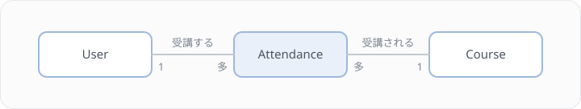

# Lesson 10 受講登録APIを作る

## 学習目標

このレッスンでは、受講（attendances）テーブルを設計し、生徒が講座に申し込む受講登録API（`POST /api/courses/{course}/attendances`）を作ります。Lesson 4 の User API、Lesson 9 の Course API に続く3本目のAPIです。Part 2 のレッスンは、どれもこのAPIを題材にして進めます。

### 到達目標
- 外部キー制約を付け、参照先が削除されたときの動き（onDelete）を選べる
- 複合ユニーク制約で重複登録を防ぎ、違反したときに 409 を返せる
- データが入っているテーブルに、NOT NULL のカラムを段階を踏んで追加できる
- Policy で「生徒だけが申し込める」という認可を書ける

> このレッスンでは、テーブル設計の考え方を使う場面ごとに短く説明します。インデックスの選び方や NULL を避ける理由、マイグレーションの書き方などをもっと詳しく知りたいときは、[発展 A1 データベース設計の原則](./A1-database-design.md) を読んでください。A1 を読んでいなくても、このレッスンは最後まで進められます。

## このレッスンで作るもの

受講（Attendance）は、ユーザーと講座の多対多の関係を表します。1人のユーザーは複数の講座を受講でき、1つの講座には複数の受講者がいます。



Step 1〜3 で attendances テーブル、Attendance モデル、courses テーブルの `starts_at` カラムを用意し、Step 4〜6 で Policy と受講登録APIを作って動きを確かめます。

## Step 1 attendances テーブルを設計する

マイグレーションを書く前に、このテーブルで使う3つの制約を確認します。

### 外部キー制約と onDelete

`user_id` と `course_id` には外部キー制約を付けます。外部キー制約を付けると、存在しないユーザーIDや講座IDを入れようとしたときに DB がエラーを返すので、どこにもつながらない受講データが残りません。

```php
$table->foreignIdFor(User::class)->constrained();
```

参照先（ユーザーや講座）が削除されたときの動きは、`onDelete()` で選びます。よく使うのは次の3種類です。

| オプション | 親が削除されたとき | 向いている例 |
|-----------|------------------|-------------|
| cascade | 子も一緒に削除する | 親がなくなれば意味のないデータ（コメントなど） |
| set null | 子の外部キーを NULL にする | 参照は外れても行は残したいデータ（退職した担当者など） |
| restrict | 子がいる間は親を削除させない | 消えると困るデータ（受講履歴など） |

受講は「誰がいつ申し込んだか、修了したか」を残す履歴なので、このレッスンでは `restrict` を選びます。`cascade` にすると、講座を消しただけで受講履歴も気付かないうちに消えてしまいます。`restrict` にしておけば、受講履歴が残っている講座やユーザーは削除できず、「履歴があるのに消そうとしている」ことにエラーで気付けます。

> 補足: 検索を速くするインデックスは、外部キー制約や unique 制約を付けたときに一緒に張られる場合があります（DB の種類によって違います）。どのカラムにインデックスを足すべきかは、発展 A1 で扱います。

### NOT NULL とデフォルト値

受講の状態を表す `status` は、NULL を許さず、デフォルト値に `attending`（受講中）を入れます。NULL を許すと、読み出すたびに「値がない場合」の分岐が必要になり、`where('status', null)` が期待どおりに動かないといった落とし穴も増えます。必ず値が入るカラムは、NOT NULL にしてデフォルト値を決めておきます。

### 複合ユニーク制約

同じ生徒が同じ講座に2回申し込めないようにします。アプリ側で「すでに登録しているか」を確かめるだけでは、この重複を防ぎきれません。

```php
// アプリ側のチェックだけでは不十分
$isAttending = Attendance::where('user_id', $userId)
    ->where('course_id', $courseId)
    ->exists();

if ($isAttending) {
    return response()->json(['message' => 'すでにこの講座に登録済みです。'], 409);
}

Attendance::create([...]);
```

同じ生徒のリクエストがほぼ同時に2つ届くと、どちらも `exists()` の時点ではまだ登録がないので確認を通り抜け、2件とも保存されてしまいます。そこで、`user_id` と `course_id` の組み合わせに複合ユニーク制約を付け、DB に重複を拒否させます。

```php
$table->unique(['user_id', 'course_id']);
```

制約に違反すると、Laravel は `Illuminate\Database\UniqueConstraintViolationException` を投げます。MySQL でも SQLite でも同じ例外になるので、DB ごとのエラーコードを調べる必要はありません。Step 5 のコントローラーでこの例外を catch し、409 Conflict を返します。

### マイグレーションの作成

`make app` でコンテナに入ってから、以下のコマンドを実行します。

```bash
php artisan make:migration create_attendances_table
```

### マイグレーションの実装

ここまでの3つの制約が、それぞれどこに書かれているかを確かめながら実装してください。

```php
<?php

use App\Models\Course;
use App\Models\User;
use Illuminate\Database\Migrations\Migration;
use Illuminate\Database\Schema\Blueprint;
use Illuminate\Support\Facades\Schema;

return new class extends Migration
{
    public function up(): void
    {
        Schema::create('attendances', function (Blueprint $table) {
            $table->id();

            // 外部キー（受講履歴は残したいので restrict）
            $table->foreignIdFor(User::class)
                ->constrained()
                ->onDelete('restrict');

            $table->foreignIdFor(Course::class)
                ->constrained()
                ->onDelete('restrict');

            // 受講状態（NOT NULL + デフォルト値）
            $table->string('status')->default('attending');

            // 受講日時（timestamp 型は 2038 年問題があるので datetime を使う）
            $table->datetime('attended_at')->useCurrent();

            // 同上の理由で timestamps() ではなく datetimes() を使う
            $table->datetimes();

            // 複合ユニーク制約（同じ講座に2回登録できない）
            $table->unique(['user_id', 'course_id']);
        });
    }

    public function down(): void
    {
        Schema::dropIfExists('attendances');
    }
};
```

### マイグレーションの実行

作成したマイグレーションを適用します。

```bash
php artisan migrate
```

> 既存データを保持したまま差分適用するのが `migrate` です。何かおかしくなったら `make fresh` で全テーブル作り直し＋シーダーが走ります。

## Step 2 Attendance モデルを作る

### モデルの作成

```bash
php artisan make:model Attendance --factory
```

`--factory` を付けると、モデルと同時に `database/factories/AttendanceFactory.php` も生成されます。Lesson 12 以降のテストで使います。

### Attendance モデルの実装

生成された `app/Models/Attendance.php` を以下の内容に書き換えます。

```php
<?php

namespace App\Models;

use App\Enums\AttendanceStatus;
use Illuminate\Database\Eloquent\Factories\HasFactory;
use Illuminate\Database\Eloquent\Model;
use Illuminate\Database\Eloquent\Relations\BelongsTo;

class Attendance extends Model
{
    use HasFactory;

    protected $fillable = [
        'user_id',
        'course_id',
        'status',
        'attended_at',
    ];

    protected function casts(): array
    {
        return [
            'status' => AttendanceStatus::class,
            'attended_at' => 'datetime',
        ];
    }

    public function user(): BelongsTo
    {
        return $this->belongsTo(User::class);
    }

    public function course(): BelongsTo
    {
        return $this->belongsTo(Course::class);
    }
}
```

### AttendanceStatus Enum

`app/Enums/AttendanceStatus.php` を新規作成します。

```php
<?php

namespace App\Enums;

enum AttendanceStatus: string
{
    case Attending = 'attending';
    case Completed = 'completed';
    case Cancelled = 'cancelled';

    public function label(): string
    {
        return match($this) {
            self::Attending => '受講中',
            self::Completed => '修了',
            self::Cancelled => 'キャンセル',
        };
    }
}
```

### AttendanceFactory の実装

`--factory` で生成された `database/factories/AttendanceFactory.php` を以下の内容にします。

```php
<?php

namespace Database\Factories;

use App\Enums\AttendanceStatus;
use App\Models\Course;
use App\Models\User;
use Illuminate\Database\Eloquent\Factories\Factory;

class AttendanceFactory extends Factory
{
    public function definition(): array
    {
        return [
            'user_id' => User::factory(),
            'course_id' => Course::factory(),
            'status' => AttendanceStatus::Attending,
            'attended_at' => now(),
        ];
    }

    /**
     * キャンセル済みの受講
     */
    public function cancelled(): static
    {
        return $this->state(fn (array $attributes) => [
            'status' => AttendanceStatus::Cancelled,
        ]);
    }
}
```

> `'user_id' => User::factory()` と書いておくと、`user_id` を明示しなかったときに紐づくユーザーも自動で作られます。テストで `Attendance::factory()->create(['course_id' => $course->id])` のように一部だけ指定できるのはこのためです。

### User と Course にリレーションを追加

Lesson 4 / 9 で作成済みの `app/Models/User.php` と `app/Models/Course.php` に、以下のメソッドを追記します（既存のメソッドは残したまま末尾に追加）。

```php
// app/Models/User.php に追記
public function attendances(): HasMany
{
    return $this->hasMany(Attendance::class);
}

public function attendedCourses(): BelongsToMany
{
    return $this->belongsToMany(Course::class, 'attendances')
        ->withPivot('status', 'attended_at')
        ->withTimestamps();
}
```

```php
// app/Models/Course.php に追記
public function attendances(): HasMany
{
    return $this->hasMany(Attendance::class);
}

public function students(): BelongsToMany
{
    return $this->belongsToMany(User::class, 'attendances')
        ->withPivot('status', 'attended_at')
        ->withTimestamps();
}

/**
 * まだ空いている席があるか
 */
public function hasCapacity(): bool
{
    return $this->attendances()
        ->where('status', AttendanceStatus::Attending)
        ->count() < $this->capacity;
}
```

`HasMany` / `BelongsToMany` の `use` 文と、Course.php では `use App\Enums\AttendanceStatus;` も忘れずに追加してください。

`hasCapacity()` は、受講中（`attending`）の受講だけを数えます。キャンセルした受講まで数えると、Lesson 18 でキャンセルの機能を足したときに、キャンセルしても席が空かなくなるためです。

> `hasCapacity()` は呼ぶたびに COUNT のクエリを1回発行します。講座を1件ずつ扱ういまは問題ありませんが、一覧の中で講座ごとに呼ぶとクエリが講座の数だけ増えます（N+1問題）。Lesson 16 で `withCount` を使って改善します。

## Step 3 courses テーブルに starts_at を追加する

`courses` テーブルに「講座開始日時（`starts_at`）」を追加します。このカラムは Lesson 17・18 で使います。

### 要件

- 既存の `courses` テーブルに `starts_at`（NOT NULL）を追加する
- 既存データには「今日の日付」を暫定値として入れる

### データが入っているテーブルに NOT NULL のカラムを足す

すでに行があるテーブルに、デフォルト値のない NOT NULL カラムをいきなり追加すると、既存の行に入れる値がないのでエラーになります。そこで、1つのマイグレーションの中で次の3段階を踏みます。

1. nullable で追加する
2. 既存の行に暫定値を入れる
3. NOT NULL に変更する

あわせて `down()` も必ず書きます。`down()` は `php artisan migrate:rollback` で変更を取り消すときに呼ばれ、ここでは追加したカラムを削除します。

### マイグレーションの作成

```bash
php artisan make:migration add_starts_at_to_courses_table
```

### マイグレーションの実装

```php
<?php

use Illuminate\Database\Migrations\Migration;
use Illuminate\Database\Schema\Blueprint;
use Illuminate\Support\Facades\DB;
use Illuminate\Support\Facades\Schema;

return new class extends Migration
{
    public function up(): void
    {
        // 1. nullable で追加
        Schema::table('courses', function (Blueprint $table) {
            $table->datetime('starts_at')->nullable()->after('status');
        });

        // 2. 既存データに暫定値を設定
        DB::table('courses')
            ->whereNull('starts_at')
            ->update(['starts_at' => now()]);

        // 3. NOT NULL に変更
        Schema::table('courses', function (Blueprint $table) {
            $table->datetime('starts_at')->nullable(false)->change();
        });
    }

    public function down(): void
    {
        Schema::table('courses', function (Blueprint $table) {
            $table->dropColumn('starts_at');
        });
    }
};
```

### モデル・Factory・Resource・FormRequest の更新

Lesson 9 で作成した `Course` モデル・`CourseFactory`・`CourseResource`・`Course/StoreRequest`・`Course/UpdateRequest` にも `starts_at` を反映します。

> ここを忘れると、`POST /api/courses` が「`starts_at` に値が入っていない」というDBエラー（500）になります。NOT NULL のカラムを増やしたら、そのカラムに値を入れる経路（バリデーション → fillable → Factory）を一通り見直すのが、実務でのチェックの手順です。

```php
// app/Models/Course.php
protected $fillable = [
    'title',
    'description',
    'instructor_id',
    'capacity',
    'status',
    'starts_at',  // 追加
];

protected function casts(): array
{
    return [
        'capacity' => 'integer',
        'status' => CourseStatus::class,
        'starts_at' => 'datetime',  // 追加
    ];
}
```

```php
// database/factories/CourseFactory.php
public function definition(): array
{
    return [
        'title' => fake()->sentence(3),
        'description' => fake()->paragraph(),
        'instructor_id' => User::factory(),
        'capacity' => fake()->numberBetween(10, 30),
        'status' => fake()->randomElement(CourseStatus::cases()),
        'starts_at' => fake()->dateTimeBetween('+1 week', '+3 months'),  // 追加
    ];
}
```

```php
// app/Http/Resources/CourseResource.php
return [
    // ...既存のフィールド
    'status_label' => $this->resource->status->label(),
    'starts_at' => $this->resource->starts_at?->format('Y-m-d H:i:s'),  // 追加
    'created_at' => $this->resource->created_at->format('Y-m-d H:i:s'),
];
```

```php
// app/Http/Requests/Course/StoreRequest.php
public function rules(): array
{
    return [
        'title' => ['required', 'string', 'max:255'],
        'description' => ['nullable', 'string'],
        'capacity' => ['required', 'integer', 'min:1', 'max:100'],
        'status' => ['required', Rule::enum(CourseStatus::class)],
        'starts_at' => ['required', 'date'],  // 追加
    ];
}
```

```php
// app/Http/Requests/Course/UpdateRequest.php
public function rules(): array
{
    return [
        'title' => ['sometimes', 'string', 'max:255'],
        'description' => ['nullable', 'string'],
        'capacity' => ['sometimes', 'integer', 'min:1', 'max:100'],
        'status' => ['sometimes', Rule::enum(CourseStatus::class)],
        'starts_at' => ['sometimes', 'date'],  // 追加
    ];
}
```

### マイグレーションの適用

```bash
php artisan migrate
```

> 開発環境で壊れても問題なければ `make fresh` で全テーブルを作り直してもOKです。本番では必ず上記の段階的マイグレーションで対応します。

## Step 4 AttendancePolicy を作る

受講登録できるのは生徒だけです（[API仕様一覧](../reference/api-spec.md) の「生徒のみ」）。講師が自分の講座に申し込むことは想定していません。この認可は、Lesson 7 で学んだ Policy に書きます。

### Policy の作成

```bash
php artisan make:policy AttendancePolicy --model=Attendance
```

`app/Policies/AttendancePolicy.php` が作成されます。`viewAny` や `update` などのメソッドもまとめて生成されますが、いま使うのは `create` だけなので、以下の内容に書き換えます。

```php
<?php

namespace App\Policies;

use App\Models\User;

class AttendancePolicy
{
    /**
     * 受講登録できるか
     */
    public function create(User $user): bool
    {
        // 生徒のみ申し込める（Lesson 7 で追加した isStudent() を使う）
        return $user->isStudent();
    }
}
```

Lesson 7 で学んだとおり、`app/Policies` に置いた「モデル名 + `Policy`」のクラスは自動で見つかるので、登録のコードは要りません。`Attendance` モデルには `AttendancePolicy` が紐づきます。

`create` が受け取るのはログイン中のユーザーだけです。申し込む時点では受講のデータがまだないので、Lesson 9 の `CoursePolicy::create` と同じく、コントローラーからはモデルのインスタンスではなくクラス名（`Attendance::class`）を渡して呼び出します。

## Step 5 受講登録APIを作る

### AttendanceResource の作成

```bash
php artisan make:resource AttendanceResource
```

```php
<?php

namespace App\Http\Resources;

use Illuminate\Http\Request;
use Illuminate\Http\Resources\Json\JsonResource;

class AttendanceResource extends JsonResource
{
    /** @var \App\Models\Attendance */
    public $resource;

    public function toArray(Request $request): array
    {
        return [
            'id' => $this->resource->id,
            'user' => new UserResource($this->resource->user),
            'course' => new CourseResource($this->resource->course),
            'status' => $this->resource->status,
            'status_label' => $this->resource->status->label(),
            'attended_at' => $this->resource->attended_at->format('Y-m-d H:i:s'),
        ];
    }
}
```

### AttendanceController の作成

```bash
php artisan make:controller Api/AttendanceController
```

```php
<?php

namespace App\Http\Controllers\Api;

use App\Enums\AttendanceStatus;
use App\Http\Controllers\Controller;
use App\Http\Resources\AttendanceResource;
use App\Models\Attendance;
use App\Models\Course;
use Illuminate\Database\UniqueConstraintViolationException;
use Illuminate\Http\JsonResponse;
use Illuminate\Http\Request;

class AttendanceController extends Controller
{
    /**
     * 受講登録
     */
    public function store(Request $request, Course $course): JsonResponse
    {
        // 生徒以外は 403（AttendancePolicy@create）
        $this->authorize('create', Attendance::class);

        // 定員チェック
        if (! $course->hasCapacity()) {
            return response()->json([
                'message' => 'この講座は定員に達しています。',
            ], 422);
        }

        // 受講登録（重複時はDBの複合ユニーク制約でエラー）
        try {
            $attendance = Attendance::create([
                'user_id' => $request->user()->id,
                'course_id' => $course->id,
                'status' => AttendanceStatus::Attending,
                'attended_at' => now(),
            ]);
        } catch (UniqueConstraintViolationException) {
            return response()->json([
                'message' => 'すでにこの講座に登録済みです。',
            ], 409);
        }

        $attendance->load(['user', 'course.instructor']);

        return (new AttendanceResource($attendance))
            ->response()
            ->setStatusCode(201);
    }
}
```

ポイント
- 最初に `$this->authorize('create', Attendance::class)` で `AttendancePolicy@create` を呼び、生徒以外は 403 にします。メッセージは Lesson 7 で見た既定のもの（`This action is unauthorized.`）のままです
- 定員は Step 2 で作った `hasCapacity()` で確かめ、満員なら 422 を返します
- 重複の判定は、Step 1 の複合ユニーク制約に任せます。`UniqueConstraintViolationException` を catch して 409 Conflict を返すので、同時に2回申し込まれても2件目は保存されません
- 受講のデータを新しく作るので、成功時は 201 Created を返します（Lesson 9 の `CourseController@store` と同じ方針）

> 定員の確認にも、Step 1 の `exists()` と同じ競合の問題があります。残り1席の講座に2人がほぼ同時に申し込むと、2人とも `hasCapacity()` を通り抜けて定員を1人超えることがあります。この問題は Lesson 15 でトランザクションとロックを使って直します。

### ルート追加

`routes/api.php` の `auth:sanctum` グループ内に追加します。Lesson 9 と同じく、`use` 文はファイル先頭の既存の `use` ブロックに足してください。

```php
use App\Http\Controllers\Api\AttendanceController;

Route::middleware('auth:sanctum')->group(function () {
    // ...既存のルート...

    // 受講登録
    Route::post('/courses/{course}/attendances', [AttendanceController::class, 'store']);
});
```

## Step 6 動作確認

> 動作確認の前提として、`CourseSeeder` で作られる講座データが必要です。`make fresh` では `DatabaseSeeder` が実行されますが、`CourseSeeder` は個別に `php artisan db:seed --class=CourseSeeder` で実行するか、`DatabaseSeeder::run` の末尾に `$this->call(CourseSeeder::class);` を追記してください。

Postman のコレクションで、以下の手順で確認してください。

#### 1. 生徒でログイン
`login > ログイン` を実行します。Body には生徒の `test@example.com` / `password` が事前設定されています。

#### 2. 受講登録（成功）
`api > courses > {courseId} > attendances > 受講登録`（POST）を実行し、201 が返ることを確認します。

> - `Params > Path Variables` の `courseId` には初期値 `27` が入っています。既存の講座IDに書き換えてから送信してください。
> - このエンドポイントはリクエストボディ不要のため、Body は未設定のままで構いません。

#### 3. 同じ講座に再度登録（重複エラー）
同じリクエストをもう一度送信し、409 が返ることを確認します。

#### 4. 講師で申し込む（認可エラー）
`login > ログイン` の Body の `email` を講師の `test2@example.com` に変えてログインし直し、受講登録を送信して 403 が返ることを確認します。確認が終わったら、`email` を `test@example.com` に戻してログインし直してください。

#### 5. 定員オーバー
定員1の講座を作り、別の生徒で1席を埋めておきます。

```bash
php artisan tinker --execute '
  $course = App\Models\Course::factory()->active()->create(["capacity" => 1]);
  App\Models\Attendance::factory()->create(["course_id" => $course->id]);
  echo $course->id;
'
```

表示された講座IDを `courseId` に入れて、生徒の `test@example.com` で受講登録を送信し、422 が返ることを確認します。

## 練習問題

### 問題1
Lesson 9 で作った講座詳細API（`GET /api/courses/{course}`）のレスポンスに、残席数 `remaining_seats`（定員 − 受講中の人数）を追加してください。キャンセル済みの受講は数えません。講座一覧API（`GET /api/courses`）のレスポンスは変えずに、詳細だけに出すこととします。

> 動作確認には Postman の `api > courses > {courseId} > 講座詳細` を使います。Step 6 で受講登録した講座を指定すると、残席数が定員より1少なくなっているはずです。

> ヒント: `CourseResource` の中で講座ごとに `attendances()->...->count()` を呼ぶと、詳細では動きますが、同じ `CourseResource` を使う一覧でも講座の数だけ COUNT のクエリが発行されます。件数はコントローラーの `show` で先に読み込んでおき、`CourseResource` では「件数が読み込まれているときだけ」出すようにしてみてください。`loadCount()` と `whenCounted()` が使えます。

<details>
<summary>解答例</summary>

`show` で、受講中の件数だけを `loadCount()` で読み込みます。読み込んだ件数は `attendances_count` という属性に入ります。

```php
// app/Http/Controllers/Api/CourseController.php
use App\Enums\AttendanceStatus;

public function show(Course $course): CourseResource
{
    $course->load('instructor');
    $course->loadCount([
        'attendances' => fn ($query) => $query->where('status', AttendanceStatus::Attending),
    ]);

    return new CourseResource($course);
}
```

`CourseResource` では `whenCounted()` を使います。`attendances_count` が読み込まれていないとき（一覧の `index` など）は、`remaining_seats` のキーそのものがレスポンスから外れます。

```php
// app/Http/Resources/CourseResource.php
return [
    'id' => $this->resource->id,
    // ...既存のフィールド
    'capacity' => $this->resource->capacity,
    'remaining_seats' => $this->whenCounted(
        'attendances',
        fn ($count) => max($this->resource->capacity - $count, 0),
    ),
    // ...既存のフィールド
];
```

`max(..., 0)` は、講師が定員を受講者の数より少なく変更した場合に、残席数がマイナスにならないようにするためです。

> 補足: Lesson 16 で講座一覧の `index` に同じ条件の `withCount` を足すと、一覧でも `attendances_count` が読み込まれるので、追加のクエリなしで一覧にも `remaining_seats` が出るようになります。
</details>

## クリア判定

ここまでできたら、次のコマンドでクリアしたかを確かめましょう。

```bash
make quest-10
```

本文の手順で作った受講登録API（201・403・422・409、キャンセル済みを定員に数えないこと）がメインのミッションです。練習問題1の残席数はサイドのミッションです。

## 参考資料

- [Laravel 公式ドキュメント - Migrations（Foreign Key Constraints）](https://laravel.com/docs/migrations#foreign-key-constraints)
- [Laravel 公式ドキュメント - Authorization（Policies）](https://laravel.com/docs/authorization#creating-policies)
- [発展 A1 データベース設計の原則](./A1-database-design.md)

## 次のレッスン

[Lesson 11 安全なモデルの記述](./11-safe-model.md) では、Mass Assignment の脆弱性を防ぐ書き方や、キャスト・アクセサの使い方を学び、このレッスンで作った Attendance モデルを仕上げます。
