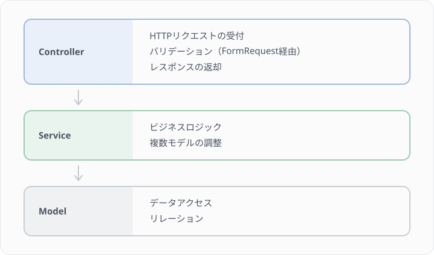
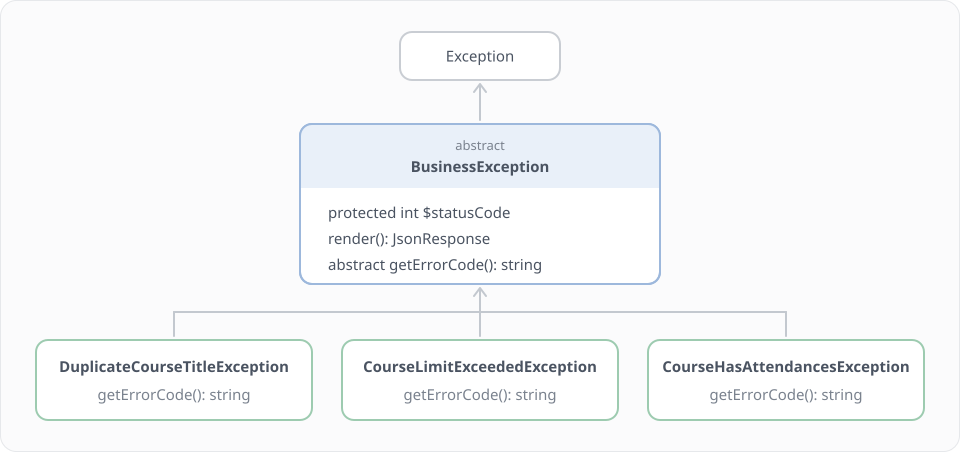
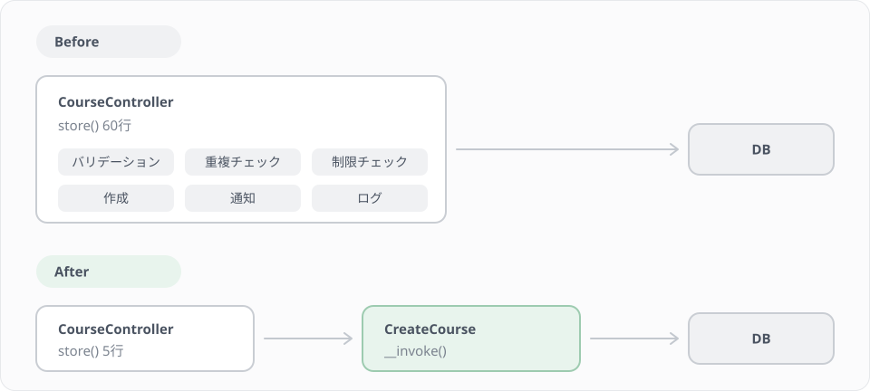
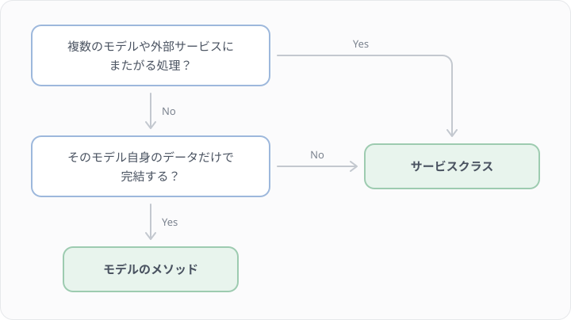

# Lesson 14 サービスクラスの設計

## 学習目標

このレッスンでは、ビジネスロジックをサービスクラスに分離し、保守性の高い設計を実践します。

### 到達目標
- Fat Controller の問題を理解する
- `__invoke` を使った単一責任のサービスクラスを設計できる
- カスタム例外クラスを作成できる
- コントローラーを薄く保てる
- コンストラクタで受け取ったサービスを、テストでモックに差し替えられる

> このレッスンは、プロジェクトのコードを実際に書き換えるハンズオンです。Step 1〜4 で作る `app/Services/` と `app/Exceptions/` のクラス、`CourseController` と `AttendanceController` の書き換え、Step 6 のテストは、実際にファイルを作成してください。
>
> 書き換えの前後で、Lesson 12 で書いたテストを `make test` で実行してください。このレッスンは「動きを変えずにコードを整理する」作業なので、テストは最初から最後まで緑のままのはずです。途中で赤くなったら、書き換えのどこかで動きが変わっています。


## Fat Controller の問題

### 問題のあるコード

```php
class CourseController extends Controller
{
    public function store(Request $request)
    {
        // バリデーション
        $validated = $request->validate([
            'title' => ['required', 'string', 'max:255'],
            'capacity' => ['required', 'integer', 'min:1'],
        ]);

        // 重複チェック
        $exists = Course::where('instructor_id', $request->user()->id)
            ->where('title', $validated['title'])
            ->exists();
        if ($exists) {
            return response()->json(['error' => '同じタイトルの講座があります'], 422);
        }

        // 講師の講座数制限チェック
        $count = Course::where('instructor_id', $request->user()->id)->count();
        if ($count >= 10) {
            return response()->json(['error' => '講座数の上限に達しています'], 422);
        }

        // 講座作成
        $course = Course::create([
            ...$validated,
            'instructor_id' => $request->user()->id,
            'status' => 'draft',
        ]);

        // 管理者に通知
        $admins = User::where('role', 'admin')->get();
        foreach ($admins as $admin) {
            Mail::to($admin)->send(new NewCourseNotification($course));
        }

        // ログ記録
        Log::info('講座作成', ['course_id' => $course->id]);

        return new CourseResource($course);
    }
}
```

このコードには以下の問題点があります。
- コントローラーが肥大化（100行以上になることも）
- ビジネスロジックとHTTP処理が混在
- テストが困難
- 再利用できない


## サービスクラスの役割

### 責務の分離



### `__invoke` による単一責任の設計

本レッスンでは、1つのサービスクラスに1つの操作だけを持たせます。PHPのマジックメソッド `__invoke` を使うことで、クラス自体を関数のように呼び出せます。

```php
// 1クラス = 1操作
$course = ($this->createCourse)($data, $instructor);
```

メリットは以下の通りです。
- クラスの責務が明確（クラス名 = やること）
- テストが書きやすい（1クラスに1つのパブリックメソッド）
- 依存関係が最小限になる

### サービスはコンストラクタで受け取る

コントローラーでサービスを使うときは、`new CreateCourse()` と書かずに、コンストラクタの引数に型を書いて受け取ります。

```php
class CourseController extends Controller
{
    public function __construct(
        private CreateCourse $createCourse,
    ) {}
}
```

こう書いておくと、Laravel がコントローラーを作るときに `CreateCourse` のインスタンスも作って渡してくれます。この仕組みをサービスコンテナと呼び、引数で受け取る書き方をコンストラクタインジェクションと呼びます。`CreateCourse` 自身がコンストラクタで別のクラスを受け取っている場合も、Laravel がその依存を順にたどって作るので、呼び出す側は何も書き足さなくて構いません。

コントローラーの外でサービスが欲しいときは、`app(CreateCourse::class)` と書くとサービスコンテナから取り出せます。Step 6 のテストではこの書き方を使います。テストの中で `$this->mock(CreateCourse::class, ...)` を呼ぶと、サービスコンテナが渡すものを偽物（モック）に差し替えられます。`new` で直接作っていると、この差し替えができません。

> 本コースでは、サービスクラスのインターフェースを切らず、具象クラス（`CreateCourse` など）をそのままコンストラクタで受け取ります。実装が1つしかないうちは、インターフェースを増やしても得るものが少ないためです。サービスコンテナの仕組み、インターフェースへのバインド、インターフェースを切るかどうかの判断基準は、発展 A2「サービスコンテナとDI」で詳しく扱います。このレッスンは A2 を読んでいなくても進められます。


## Step 1 講座作成サービスの作成

### ディレクトリ構成

```
app/
├── Http/
│   └── Controllers/
│       └── Api/
│           ├── AttendanceController.php
│           └── CourseController.php
├── Services/
│   ├── Attendance/
│   │   └── AttendCourse.php
│   └── Course/
│       ├── CreateCourse.php
│       ├── UpdateCourse.php
│       └── DeleteCourse.php
└── Exceptions/
    ├── BusinessException.php
    ├── DuplicateCourseTitleException.php
    ├── CourseLimitExceededException.php
    ├── CourseHasAttendancesException.php
    ├── CapacityExceededException.php
    └── AlreadyAttendingException.php
```

操作ごとにファイルを分けることで、どのファイルに何が書いてあるか一目でわかります。`Attendance/` 以下と最後の2つの例外は Step 4 で作ります。

### CreateCourse

```php
<?php

namespace App\Services\Course;

use App\Exceptions\CourseLimitExceededException;
use App\Exceptions\DuplicateCourseTitleException;
use App\Models\Course;
use App\Models\User;
use Illuminate\Support\Facades\Log;

class CreateCourse
{
    private const MAX_COURSES_PER_INSTRUCTOR = 10;

    public function __invoke(array $data, User $instructor): Course
    {
        $this->validate($data, $instructor);

        $course = Course::create([
            ...$data,
            'instructor_id' => $instructor->id,
        ]);

        Log::info('講座が作成されました', [
            'course_id' => $course->id,
            'instructor_id' => $instructor->id,
        ]);

        return $course->load('instructor');
    }

    private function validate(array $data, User $instructor): void
    {
        $exists = Course::where('instructor_id', $instructor->id)
            ->where('title', $data['title'])
            ->exists();

        if ($exists) {
            throw new DuplicateCourseTitleException();
        }

        $count = Course::where('instructor_id', $instructor->id)->count();

        if ($count >= self::MAX_COURSES_PER_INSTRUCTOR) {
            throw new CourseLimitExceededException();
        }
    }
}
```

ポイントは以下の通りです。
- `__invoke` がこのクラスの唯一のパブリックメソッド
- バリデーションはプライベートメソッドで整理
- 他のサービスへの依存がなく、このクラスだけで完結している
- `status` は `Course/StoreRequest` で検証済みの値をそのまま使う。ここで `CourseStatus::Draft` に固定してしまうと、リクエストで必須にしている項目を無視することになり、APIの挙動と仕様が食い違う
- 戻り値で `load('instructor')` しておくことで、`CourseResource` の `instructor` が Lesson 9 と同じように出力される

> 書き込むのは `courses` の1行だけなので、ここではトランザクションを使っていません。複数の書き込みをまとめて成功させるか、まとめて取り消す方法は、Lesson 15 で学びます。

### UpdateCourse

```php
<?php

namespace App\Services\Course;

use App\Exceptions\DuplicateCourseTitleException;
use App\Models\Course;

class UpdateCourse
{
    public function __invoke(Course $course, array $data): Course
    {
        if (isset($data['title'])) {
            $exists = Course::where('instructor_id', $course->instructor_id)
                ->where('title', $data['title'])
                ->where('id', '!=', $course->id)
                ->exists();

            if ($exists) {
                throw new DuplicateCourseTitleException();
            }
        }

        $course->update($data);

        return $course->fresh()->load('instructor');
    }
}
```

### DeleteCourse

```php
<?php

namespace App\Services\Course;

use App\Exceptions\CourseHasAttendancesException;
use App\Models\Course;

class DeleteCourse
{
    public function __invoke(Course $course): void
    {
        if ($course->attendances()->exists()) {
            throw new CourseHasAttendancesException();
        }

        $course->delete();
    }
}
```

> 素の `\DomainException` を投げると `render()` を持たないため 500 Internal Server Error になってしまいます。「受講者がいるので消せない」のはリクエスト側の問題なので、次の Step で作る `BusinessException` を継承した例外にして 422 で返します。
>
> キャンセル済みの受講も含めて `exists()` で確かめているのは、Lesson 10 で `attendances` の外部キーを `restrict` にしたためです。受講の行が1件でも残っていると、講座は削除できません。今のコードで受講者のいる講座を削除すると、外部キーの違反で 500 になります。


## Step 2 カスタム例外クラス

### 基底クラス

```php
// app/Exceptions/BusinessException.php
<?php

namespace App\Exceptions;

use Exception;
use Illuminate\Http\JsonResponse;

abstract class BusinessException extends Exception
{
    protected int $statusCode = 422;

    public function render(): JsonResponse
    {
        return response()->json([
            'message' => $this->getMessage(),
            'error_code' => $this->getErrorCode(),
        ], $this->statusCode);
    }

    abstract public function getErrorCode(): string;
}
```

### 具象クラス

```php
// app/Exceptions/DuplicateCourseTitleException.php
<?php

namespace App\Exceptions;

class DuplicateCourseTitleException extends BusinessException
{
    protected $message = '同じタイトルの講座が既に存在します。';

    public function getErrorCode(): string
    {
        return 'DUPLICATE_COURSE_TITLE';
    }
}
```

```php
// app/Exceptions/CourseLimitExceededException.php
<?php

namespace App\Exceptions;

class CourseLimitExceededException extends BusinessException
{
    protected $message = '講座数の上限（10講座）に達しています。';

    public function getErrorCode(): string
    {
        return 'COURSE_LIMIT_EXCEEDED';
    }
}
```

```php
// app/Exceptions/CourseHasAttendancesException.php
<?php

namespace App\Exceptions;

class CourseHasAttendancesException extends BusinessException
{
    protected $message = '受講者がいる講座は削除できません。';

    public function getErrorCode(): string
    {
        return 'COURSE_HAS_ATTENDANCES';
    }
}
```

### 例外の階層構造



`BusinessException` を継承することで、全てのビジネス例外が統一されたJSON形式でレスポンスを返します。


## Step 3 シンプルなコントローラー

```php
<?php

namespace App\Http\Controllers\Api;

use App\Http\Controllers\Controller;
use App\Http\Requests\Course\StoreRequest;
use App\Http\Requests\Course\UpdateRequest;
use App\Http\Resources\CourseResource;
use App\Models\Course;
use App\Services\Course\CreateCourse;
use App\Services\Course\DeleteCourse;
use App\Services\Course\UpdateCourse;
use Illuminate\Http\JsonResponse;
use Illuminate\Http\Request;
use Illuminate\Http\Response;

class CourseController extends Controller
{
    public function __construct(
        private CreateCourse $createCourse,
        private UpdateCourse $updateCourse,
        private DeleteCourse $deleteCourse,
    ) {}

    public function index(Request $request)
    {
        $query = Course::with('instructor');

        // ステータスでフィルタリング
        if ($request->has('status')) {
            $query->where('status', $request->input('status'));
        }

        // ページネーション
        $perPage = $request->input('per_page', 15);
        $courses = $query->latest()->paginate($perPage);

        return CourseResource::collection($courses);
    }

    public function store(StoreRequest $request): JsonResponse
    {
        $this->authorize('create', Course::class);

        $course = ($this->createCourse)(
            $request->validated(),
            $request->user()
        );

        return (new CourseResource($course))
            ->response()
            ->setStatusCode(201);
    }

    public function show(Course $course): CourseResource
    {
        $course->load('instructor');

        return new CourseResource($course);
    }

    public function update(UpdateRequest $request, Course $course): CourseResource
    {
        $this->authorize('update', $course);

        $course = ($this->updateCourse)($course, $request->validated());

        return new CourseResource($course);
    }

    public function destroy(Course $course): Response
    {
        $this->authorize('delete', $course);

        ($this->deleteCourse)($course);

        return response()->noContent();
    }
}
```

コントローラーの各メソッドは「リクエストを受けてサービスを呼び、レスポンスを返す」だけになりました。

> 書き換えるときの注意: このレッスンで変えるのは、コンストラクタの追加と `store` / `update` / `destroy` の3メソッドだけです。上のコードは全体像を示すために全文を載せていますが、ファイルをまるごと貼り替えないでください。
>
> - Lesson 9 で入れた `$this->authorize(...)` は残してください。認可はHTTPレイヤーの関心事なのでControllerに置いたままにします（サービスクラスに移すと、コマンドラインやジョブから呼んだときに意図せず認可が走ってしまいます）
> - `index` と `show` は Lesson 9 のままです。`index` のフィルタリングやページネーションを削ると、Lesson 12 で書いた「ステータスでフィルタリングできる」テストが落ちます。`index` の改善は Lesson 16 で行います
> - Lesson 9 の練習問題で追加した `stats()` や講師名検索など、上のコードに出てこないメソッドも消さずに残してください

書き換えたら `make test` を実行し、Lesson 12 で書いた講座APIのテスト（`tests/Feature/Api/CourseControllerTest.php`）が緑のままであることを確かめてください。

### Before / After の比較




## Step 4 受講登録をサービスに切り出す

Lesson 10 で作った `AttendanceController::store` には、定員のチェック、受講の作成、重複したときの 409 の組み立てが並んでいます。これを `App\Services\Attendance\AttendCourse` に移し、コントローラーを「認可してサービスを呼び、201 で返す」だけにします。

この書き換えでは、Lesson 12 で書いた受講登録のテスト（`tests/Feature/Api/AttendanceStoreTest.php` の 201・403・422・409）が守りになります。書き換える前に `make test` で緑であることを確かめてから始めてください。

### 受講登録の例外を作る

Lesson 10 のコントローラーが返していた 422 と 409 を、Step 2 と同じ形の例外にします。

```php
// app/Exceptions/CapacityExceededException.php
<?php

namespace App\Exceptions;

class CapacityExceededException extends BusinessException
{
    protected $message = 'この講座は定員に達しています。';

    public function getErrorCode(): string
    {
        return 'CAPACITY_EXCEEDED';
    }
}
```

```php
// app/Exceptions/AlreadyAttendingException.php
<?php

namespace App\Exceptions;

class AlreadyAttendingException extends BusinessException
{
    protected int $statusCode = 409;

    protected $message = 'すでにこの講座に登録済みです。';

    public function getErrorCode(): string
    {
        return 'ALREADY_ATTENDING';
    }
}
```

`BusinessException` の `$statusCode` は 422 が既定なので、409 を返したい `AlreadyAttendingException` だけ上書きします。message は Lesson 10 のコントローラーと同じ文言にしておきます。

### AttendCourse

```php
// app/Services/Attendance/AttendCourse.php
<?php

namespace App\Services\Attendance;

use App\Enums\AttendanceStatus;
use App\Exceptions\AlreadyAttendingException;
use App\Exceptions\CapacityExceededException;
use App\Models\Attendance;
use App\Models\Course;
use App\Models\User;
use Illuminate\Database\UniqueConstraintViolationException;

class AttendCourse
{
    public function __invoke(User $user, Course $course): Attendance
    {
        $this->validate($user, $course);

        try {
            $attendance = Attendance::create([
                'user_id' => $user->id,
                'course_id' => $course->id,
                'status' => AttendanceStatus::Attending,
                'attended_at' => now(),
            ]);
        } catch (UniqueConstraintViolationException) {
            throw new AlreadyAttendingException();
        }

        return $attendance->load(['user', 'course.instructor']);
    }

    private function validate(User $user, Course $course): void
    {
        if (! $course->hasCapacity()) {
            throw new CapacityExceededException();
        }

        $isAttending = $user->attendances()
            ->where('course_id', $course->id)
            ->where('status', '!=', AttendanceStatus::Cancelled)
            ->exists();

        if ($isAttending) {
            throw new AlreadyAttendingException();
        }
    }
}
```

ポイントは以下の通りです。
- チェックの順番は Lesson 10 のコントローラーと同じで、定員を先に、重複を後に確かめる
- `validate()` で重複を確かめているので、普段の2回目の申し込みはここで 409 になる
- それでも一意制約の違反の `catch` は残す。同じ受講者のリクエストがほぼ同時に2つ届くと、どちらも `exists()` を通り抜けることがあるためで、最後に止めるのは Lesson 10 で付けた複合ユニーク制約になる。違反を `AlreadyAttendingException` に変えておけば、どちらの経路でも同じ 409 と error_code が返る
- `exists()` はキャンセル済みの受講を数えない。キャンセルした講座に申し込み直したときにどうなるかは、Lesson 18 で扱う

### AttendanceController を細くする

```php
<?php

namespace App\Http\Controllers\Api;

use App\Http\Controllers\Controller;
use App\Http\Resources\AttendanceResource;
use App\Models\Attendance;
use App\Models\Course;
use App\Services\Attendance\AttendCourse;
use Illuminate\Http\JsonResponse;
use Illuminate\Http\Request;

class AttendanceController extends Controller
{
    public function __construct(
        private AttendCourse $attendCourse,
    ) {}

    /**
     * 受講登録
     */
    public function store(Request $request, Course $course): JsonResponse
    {
        $this->authorize('create', Attendance::class);

        $attendance = ($this->attendCourse)($request->user(), $course);

        return (new AttendanceResource($attendance))
            ->response()
            ->setStatusCode(201);
    }
}
```

生徒以外を 403 にする認可は、`CourseController` と同じ理由でコントローラーに残します。`Attendance::create()` や `UniqueConstraintViolationException` の `use` は、コントローラーで使わなくなったので消して構いません。

### テストが緑のままか確かめる

`make test` を実行してください。Lesson 12 で書いた受講登録のテストは、書き換える前と同じく緑のはずです。

レスポンスで変わったのは、422 と 409 の本文に `error_code` が付いたことだけです。

```json
{
    "message": "この講座は定員に達しています。",
    "error_code": "CAPACITY_EXCEEDED"
}
```

ステータスコードと message は Lesson 10 のときと変わらないので、`assertUnprocessable()` や `assertStatus(409)` で確かめているテストはそのまま通ります。テストが落ちた場合は、例外の `$statusCode` や message、`authorize()` の消し忘れを見直してください。

新しく付いた `error_code` もテストで守りたい場合は、Lesson 12 のテストに次のような1行を足します。

```php
$response->assertStatus(409)
    ->assertJsonPath('error_code', 'ALREADY_ATTENDING');
```


## Step 5 サービス設計のガイドライン

### 1. 1サービス = 1操作

```
app/Services/
├── Course/
│   ├── CreateCourse.php
│   ├── UpdateCourse.php
│   └── DeleteCourse.php
└── Attendance/
    ├── AttendCourse.php
    └── CancelAttendance.php   ← Lesson 18 で作る
```

クラス名が操作内容を表すため、ファイル一覧がそのまま機能一覧になります。

### 2. 依存が必要ならコンストラクタで注入

サービスが別のサービスを使うときも、コントローラーと同じくコンストラクタで受け取ります。次のコードは説明用の例で、このレッスンでは作りません。冒頭の Fat Controller にあった「管理者への通知」を `NotifyAdminsOfNewCourse` というサービスに分けたとすると、`CreateCourse` は次のようになります。

```php
class CreateCourse
{
    public function __construct(
        private NotifyAdminsOfNewCourse $notifyAdminsOfNewCourse,
    ) {}

    public function __invoke(array $data, User $instructor): Course
    {
        // 講座の作成...

        ($this->notifyAdminsOfNewCourse)($course);

        return $course;
    }
}
```

コントローラーの `__construct(private CreateCourse $createCourse)` は変えなくて構いません。`CreateCourse` を作るときに、Laravel が `NotifyAdminsOfNewCourse` も作って渡します。

### 3. モデルのロジックはモデルに

```php
// ❌ サービスでやりすぎ
class CheckCourseCapacity
{
    public function __invoke(Course $course): bool
    {
        return $course->attendances()
            ->where('status', AttendanceStatus::Attending)
            ->count() < $course->capacity;
    }
}

// ✅ モデルのメソッドとして定義（Lesson 10 で作った形）
class Course extends Model
{
    public function hasCapacity(): bool
    {
        return $this->attendances()
            ->where('status', AttendanceStatus::Attending)
            ->count() < $this->capacity;
    }
}
```

サービスクラスにするかモデルに書くかの判断基準は以下の通りです。



`AttendCourse` は、講座の定員を確かめ、受講者の重複を確かめ、受講を作るという、複数のモデルにまたがる処理なのでサービスにしました。その中で使う `hasCapacity()` は講座自身のデータだけで決まるので、モデルに置いたままにしています。

### 4. 単純なCRUDはサービス不要

```php
// シンプルな取得はコントローラーで直接
public function show(Course $course)
{
    return new CourseResource($course->load('instructor'));
}

// 複雑なロジックはサービスへ
public function store(StoreRequest $request)
{
    $course = ($this->createCourse)($request->validated(), $request->user());
}
```


## Step 6 テストしやすい設計

`__invoke` を使ったサービスはテストが簡潔になります。ここでは2種類のテストを書きます。サービスそのものを呼ぶテストと、コントローラーのテストでサービスをモックに差し替えるテストです。

### サービスの単体テスト

`make app` でコンテナに入ってから、テストファイルを作ります。

```bash
php artisan make:test Services/CreateCourseTest
```

`tests/Feature/Services/CreateCourseTest.php` を以下の内容にします。DB を使うので、Lesson 12 の Step 0 で `RefreshDatabase` を有効にした `tests/Feature` の下に置きます。

```php
<?php

use App\Exceptions\DuplicateCourseTitleException;
use App\Models\Course;
use App\Models\User;
use App\Services\Course\CreateCourse;

beforeEach(function () {
    $this->service = app(CreateCourse::class);
});

test('講座を作成できる', function () {
    $instructor = User::factory()->instructor()->create();

    ($this->service)([
        'title' => 'テスト講座',
        'capacity' => 20,
        'starts_at' => now()->addWeek(),
    ], $instructor);

    $this->assertDatabaseHas('courses', [
        'title' => 'テスト講座',
        'instructor_id' => $instructor->id,
    ]);
});

test('同じタイトルの講座は作成できない', function () {
    $instructor = User::factory()->instructor()->create();
    Course::factory()->create([
        'title' => '既存講座',
        'instructor_id' => $instructor->id,
    ]);

    expect(fn () => ($this->service)([
        'title' => '既存講座',
        'capacity' => 20,
        'starts_at' => now()->addWeek(),
    ], $instructor))->toThrow(DuplicateCourseTitleException::class);
});
```

`app(CreateCourse::class)` でサービスコンテナからサービスを取り出し、HTTPリクエストを通さずに直接呼んでいます。例外が投げられることは、Pest の `expect(fn () => ...)->toThrow(例外のクラス名::class)` で確かめます。Lesson 12 で使った `expect(...)->toBe(...)` と同じ形で、「この処理を実行すると、この例外が投げられる」ことを確かめるメソッドです。`fn () =>` で包むのは、呼び出しを `expect()` の中で実行させるためです。包まずに書くと、例外が `expect()` に届く前にテストが失敗します。

```bash
php artisan test tests/Feature/Services/CreateCourseTest.php
```

テスト対象が1メソッドだけなので、何をテストしているかが明確です。

### サービスをモックに差し替える

`CreateCourse` を偽物（モック）に差し替えて、講座作成APIをテストします。`CourseController` はコンストラクタで `CreateCourse` を受け取っているので、サービスコンテナにモックを登録しておくと、コントローラーにはモックが渡されます。

Lesson 12 の Step 8 で作った `tests/Feature/Api/CourseControllerTest.php` の末尾に、以下のテストを足してください。`use` の2行は、ファイルの先頭の `use` の並びに足します。

```php
use App\Services\Course\CreateCourse;
use Mockery\MockInterface;

test('講座作成APIは CreateCourse に処理を任せる', function () {
    $instructor = User::factory()->instructor()->create();
    $course = Course::factory()->for($instructor, 'instructor')->create();

    $this->mock(CreateCourse::class, function (MockInterface $mock) use ($course) {
        $mock->shouldReceive('__invoke')
            ->once()
            ->andReturn($course->load('instructor'));
    });

    $this->actingAs($instructor)
        ->postJson('/api/courses', [
            'title' => 'テスト講座',
            'capacity' => 20,
            'status' => 'draft',
            'starts_at' => now()->addWeek()->toDateTimeString(),
        ])
        ->assertCreated()
        ->assertJsonPath('data.id', $course->id);
});
```

`$this->mock()` は、Mockery でモックを作ってサービスコンテナに登録するところまでをまとめて行うメソッドです。`CreateCourse` は `__invoke` で呼び出すクラスなので、`shouldReceive('__invoke')` で呼ばれ方を指定します。

このテストで確かめているのは、コントローラーが `CreateCourse` を1回だけ呼び、その戻り値をレスポンスに使っていることです。レスポンスの `data.id` は、リクエストで送った「テスト講座」ではなく、モックが返した講座の ID になります。`store` を `Course::create()` を直接呼ぶ形に戻すと、`data.id` が食い違ってこのテストは落ちます。重複チェックなど `CreateCourse` 自身の中身は、上の単体テストで確かめます。

```bash
php artisan test tests/Feature/Api/CourseControllerTest.php
```

## 練習問題

### 問題1
講座を複製するAPI `POST /api/courses/{course}/copies` を作ってください。講師が同じ内容の講座を、別の回として作り直すときに使う想定です。

- 複製できるのは、その講座の担当講師だけ（`CoursePolicy` の `update` を使う）。ほかのユーザーは 403
- 複製した講座は、タイトルの末尾に「（コピー）」を付け、status を `draft` にする。説明・定員・開始日時はもとの講座と同じにする
- 成功したら 201 で `CourseResource` を返す
- 処理は `App\Services\Course\CopyCourse` に書き、講座を作る部分は `CreateCourse` をコンストラクタで受け取って使う

`CreateCourse` を使うと、同じタイトルの講座がすでにあるときの 422 や、講座数の上限のチェックも、そのまま複製に効きます。同じ講座を2回複製すると、2回目は「（コピー）」付きのタイトルが重複して 422 になります。

<details>
<summary>解答例</summary>

```php
// app/Services/Course/CopyCourse.php
<?php

namespace App\Services\Course;

use App\Enums\CourseStatus;
use App\Models\Course;
use App\Models\User;

class CopyCourse
{
    public function __construct(
        private CreateCourse $createCourse,
    ) {}

    public function __invoke(Course $source, User $instructor): Course
    {
        return ($this->createCourse)([
            'title' => $source->title.'（コピー）',
            'description' => $source->description,
            'capacity' => $source->capacity,
            'status' => CourseStatus::Draft,
            'starts_at' => $source->starts_at,
        ], $instructor);
    }
}
```

```php
// app/Http/Controllers/Api/CourseController.php（追加する部分）
public function __construct(
    private CreateCourse $createCourse,
    private UpdateCourse $updateCourse,
    private DeleteCourse $deleteCourse,
    private CopyCourse $copyCourse,
) {}

public function copy(Request $request, Course $course): JsonResponse
{
    $this->authorize('update', $course);

    $copiedCourse = ($this->copyCourse)($course, $request->user());

    return (new CourseResource($copiedCourse))
        ->response()
        ->setStatusCode(201);
}
```

```php
// routes/api.php の auth:sanctum グループに追加
Route::post('/courses/{course}/copies', [CourseController::class, 'copy']);
```

講師は `$source->instructor` から取らずに、引数で受け取っています。認可を通ったログイン中のユーザーが担当講師なので、コントローラーから `$request->user()` を渡せば足ります。

`CopyCourse` は `CreateCourse` をコンストラクタで受け取っていますが、コントローラーは `CopyCourse` を受け取るだけで構いません。`CopyCourse` を作るときに、Laravel が `CreateCourse` も作って渡します。

テストの例です。

```php
use App\Models\Course;
use App\Models\User;

test('担当講師は講座を複製できる', function () {
    $instructor = User::factory()->instructor()->create();
    $course = Course::factory()->for($instructor, 'instructor')->create(['title' => 'Laravel入門']);

    $this->actingAs($instructor)
        ->postJson("/api/courses/{$course->id}/copies")
        ->assertCreated()
        ->assertJsonPath('data.title', 'Laravel入門（コピー）')
        ->assertJsonPath('data.status', 'draft');

    // 2回目はタイトルが重複する
    $this->actingAs($instructor)
        ->postJson("/api/courses/{$course->id}/copies")
        ->assertUnprocessable()
        ->assertJsonPath('error_code', 'DUPLICATE_COURSE_TITLE');
});

test('担当講師以外は講座を複製できない', function () {
    $course = Course::factory()->create();

    $this->actingAs(User::factory()->instructor()->create())
        ->postJson("/api/courses/{$course->id}/copies")
        ->assertForbidden();
});
```
</details>

### 問題2
Step 4 で作った `AttendCourse` のテストを、Step 6 の `CreateCourseTest` と同じように、サービスを直接呼ぶ形で書いてください。`tests/Feature/Services/AttendCourseTest.php` に、以下のケースを入れます。

- 生徒は受講登録でき、戻り値の `Attendance` の status が `attending` になる
- 定員に達していると `CapacityExceededException` が投げられる
- 登録済みの講座にもう一度申し込むと `AlreadyAttendingException` が投げられる
- キャンセル済みの受講は定員に数えない（定員1の講座で、他の人のキャンセル済みの受講が1件あっても申し込める）
- 自分のキャンセル済みの受講が残っている講座に申し込むと、`AlreadyAttendingException` が投げられる

最後のケースは、`validate()` の `exists()` を通り抜けたあとに、一意制約の違反を `catch` する経路を通ります。

<details>
<summary>解答例</summary>

```php
<?php

use App\Enums\AttendanceStatus;
use App\Exceptions\AlreadyAttendingException;
use App\Exceptions\CapacityExceededException;
use App\Models\Attendance;
use App\Models\Course;
use App\Models\User;
use App\Services\Attendance\AttendCourse;

beforeEach(function () {
    $this->attendCourse = app(AttendCourse::class);
});

test('生徒は受講登録できる', function () {
    $student = User::factory()->student()->create();
    $course = Course::factory()->create(['capacity' => 20]);

    $attendance = ($this->attendCourse)($student, $course);

    expect($attendance->status)->toBe(AttendanceStatus::Attending);
    $this->assertDatabaseHas('attendances', [
        'user_id' => $student->id,
        'course_id' => $course->id,
    ]);
});

test('定員に達していると CapacityExceededException', function () {
    $student = User::factory()->student()->create();
    $course = Course::factory()->create(['capacity' => 1]);
    Attendance::factory()->create(['course_id' => $course->id]);

    expect(fn () => ($this->attendCourse)($student, $course))
        ->toThrow(CapacityExceededException::class);
});

test('登録済みの講座に申し込むと AlreadyAttendingException', function () {
    $student = User::factory()->student()->create();
    $course = Course::factory()->create(['capacity' => 20]);
    Attendance::factory()->create([
        'user_id' => $student->id,
        'course_id' => $course->id,
    ]);

    expect(fn () => ($this->attendCourse)($student, $course))
        ->toThrow(AlreadyAttendingException::class);
});

test('キャンセル済みの受講は定員に数えない', function () {
    $student = User::factory()->student()->create();
    $course = Course::factory()->create(['capacity' => 1]);
    Attendance::factory()->cancelled()->create(['course_id' => $course->id]);

    $attendance = ($this->attendCourse)($student, $course);

    expect($attendance->exists)->toBeTrue();
});

test('自分のキャンセル済みの受講が残っていると AlreadyAttendingException', function () {
    $student = User::factory()->student()->create();
    $course = Course::factory()->create(['capacity' => 20]);
    Attendance::factory()->cancelled()->create([
        'user_id' => $student->id,
        'course_id' => $course->id,
    ]);

    expect(fn () => ($this->attendCourse)($student, $course))
        ->toThrow(AlreadyAttendingException::class);
});
```

`Attendance::factory()` の status は既定で `attending` なので、定員を埋める受講や登録済みの受講は `course_id` などを指定するだけで作れます。キャンセル済みの受講は、Lesson 10 で作った `cancelled()` の state を使います。

最後のテストで `catch` を消すと、`AlreadyAttendingException` ではなく `UniqueConstraintViolationException` が投げられてテストが落ちます。試してみると、このテストが `catch` を守っていることを確かめられます。
</details>

## 参考資料

- [Laravel 公式ドキュメント - Service Container](https://laravel.com/docs/container)
- [Laravel 公式ドキュメント - Mocking](https://laravel.com/docs/mocking)
- [PHP 公式ドキュメント - マジックメソッド __invoke](https://www.php.net/manual/ja/language.oop5.magic.php#object.invoke)

## 次のレッスン

[Lesson 15 トランザクション処理](./15-transaction.md) では、このレッスンで作った `AttendCourse` にトランザクションとロックを足し、同時に申し込まれても定員を超えないようにします。
