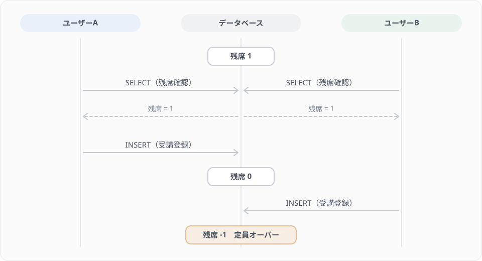
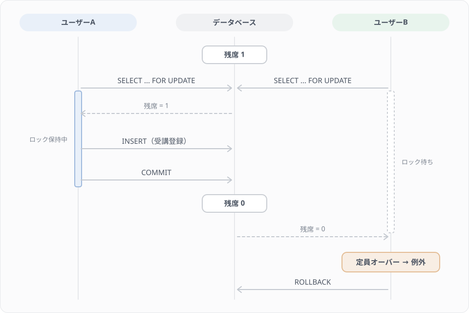
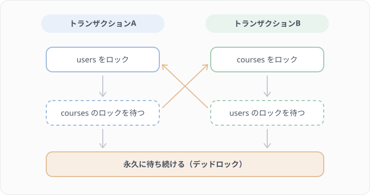
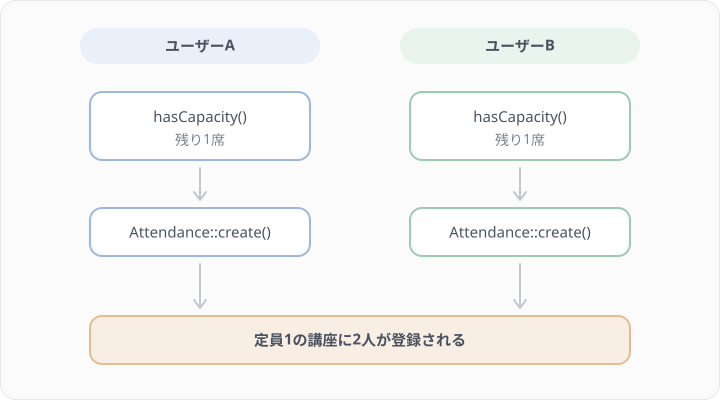

# Lesson 15 トランザクション処理

## 学習目標

このレッスンでは、データの整合性を保つためのトランザクション処理を適切に実装できるようになります。

### 到達目標
- トランザクションの必要性を理解する
- `DB::transaction()` を使える
- 例外発生時のロールバックを理解する
- 排他ロック（lockForUpdate）の必要性と仕組みを理解する
- デッドロック対策ができる
- Lesson 14 で作った `AttendCourse` にトランザクションとロックを足せる
- ロールバックされることをテストで確かめられる

> サンプルコードは、講座に「受講者数を保持するカラム」`courses.attendance_count` がある前提で書いています。このカラムは本プロジェクトには存在せず、このコースでも追加しません（実際の残席チェックは Lesson 10 で作った `Course::hasCapacity()` が `attendances` を数える方式です）。「1つの処理で複数のテーブル／行を更新する」状況を分かりやすく示すための仮の題材として読んでください。

> このレッスンでは、Eloquentが内部で発行するSQLや、MySQLのロックの仕組みが説明のために登場します。生のSQLを読み書きできる必要はありません。「Eloquentのこのメソッドを呼ぶと、DB側でこういうことが起きる」という対応関係だけ掴めれば十分です。SQLの行は日本語の説明とセットで読んでください。


## トランザクションとは？

### 問題のあるコード

受講登録処理を考えます。

```php
public function attend(User $user, Course $course)
{
    // 1. 受講レコードを作成
    $attendance = Attendance::create([
        'user_id' => $user->id,
        'course_id' => $course->id,
    ]);

    // 2. 講座の受講者数を更新
    $course->increment('attendance_count');

    // 3. 通知メールを送信（ここで例外発生！）
    Mail::to($user)->send(new AttendanceConfirmation($attendance));
    // ↑ メール送信に失敗すると例外がスローされる

    return $attendance;
}
```

メール送信で失敗した場合、以下のような問題が発生します。

- 受講レコードは作成済み ✓
- 講座の受講者数は更新済み ✓
- メールは送信されていない ✗

このようにデータの不整合が発生します。

> このレッスンのメール送信（`Mail::to(...)->send(...)` と `AttendanceConfirmation`）は、「DB以外の処理が途中で失敗する」場面を示すための説明用の例です。メールの送り方は Lesson 17 で学ぶので、ここでは書かなくて構いません。


## Step 1 DB::transaction() で解決

### 基本的な使い方

```php
use Illuminate\Support\Facades\DB;

public function attend(User $user, Course $course)
{
    return DB::transaction(function () use ($user, $course) {
        // 1. 受講レコードを作成
        $attendance = Attendance::create([
            'user_id' => $user->id,
            'course_id' => $course->id,
        ]);

        // 2. 講座の受講者数を更新
        $course->increment('attendance_count');

        // 3. メール送信（DB操作の外で行う）
        // ここでは行わない

        return $attendance;
    });
}
```

`DB::transaction()` 内で例外が発生すると、全ての変更がロールバックされます。

### メール送信はトランザクションの外で

```php
public function attend(User $user, Course $course)
{
    // トランザクション内でDB操作
    $attendance = DB::transaction(function () use ($user, $course) {
        $attendance = Attendance::create([
            'user_id' => $user->id,
            'course_id' => $course->id,
        ]);

        $course->increment('attendance_count');

        return $attendance;
    });

    // トランザクションの外でメール送信
    Mail::to($user)->send(new AttendanceConfirmation($attendance));

    return $attendance;
}
```

### 例外の再スロー

トランザクション内で例外をキャッチして処理する場合は以下のようにします。

```php
DB::transaction(function () {
    try {
        // 処理
    } catch (SomeException $e) {
        // ログに記録
        Log::error('エラー発生', ['message' => $e->getMessage()]);

        // 必ず再スローしてロールバック
        throw $e;
    }
});
```


## Step 2 手動トランザクション制御

### より細かい制御が必要な場合

```php
use Illuminate\Support\Facades\DB;

public function complexOperation()
{
    DB::beginTransaction();

    try {
        // 操作1
        $user = User::create([...]);

        // 操作2
        $course = Course::create([...]);

        // 操作3（条件付き）
        if ($someCondition) {
            Attendance::create([...]);
        }

        // 全て成功したらコミット
        DB::commit();

        return $user;

    } catch (\Exception $e) {
        // エラー時はロールバック
        DB::rollBack();

        Log::error('操作失敗', ['error' => $e->getMessage()]);

        throw $e;
    }
}
```

### DB::transaction() vs 手動制御

| 方法 | 利点 | 欠点 |
|------|------|------|
| `DB::transaction()` | シンプル、例外時に自動ロールバック | 細かい制御が難しい |
| 手動（begin/commit/rollback） | 柔軟な制御が可能 | 書き忘れのリスク |

特別な理由がなければ `DB::transaction()` を使うことを推奨します。


## Step 3 排他制御（ロック）

> 重要: このStepの説明は MySQL / PostgreSQL を前提としています。
> 本プロジェクトのDBは SQLite で、SQLite のドライバでは `lockForUpdate()` は
> 何も出力しません（`SELECT ... FOR UPDATE` は付かず、素の SELECT になります）。
>
> ```bash
> php artisan tinker --execute 'echo Course::whereKey(1)->lockForUpdate()->toRawSql();'
> # select * from "courses" where "courses"."id" = 1   ← FOR UPDATE が付かない
> ```
>
> つまり、このStepのコードをそのまま書いても、この環境では排他制御は効きません。
> 「実務でMySQLを使うときに何が起きるか」を理解するための座学パートとして読み進めてください。
> SQLite はDB全体をロックする方式のため、そもそも行単位のロックという概念がありません。

### 競合状態の問題

2人のユーザーが同時に残り1席の講座に申し込む場合を考えます。



AとBがほぼ同時に残席を確認し、どちらも「1席ある」と判断して登録を実行してしまいます。

### なぜ DB::transaction() だけでは不十分か

「トランザクションで囲めば安全」と思いがちですが、通常の SELECT はロックを取りません。

`DB::transaction()` 内で `Course::find($courseId)` を実行しても、その行にロックはかかりません。他のトランザクションも同じ行を同時に読み取れるため、上の競合状態は解決しません。

トランザクションが保証するのは「全部成功するか、全部なかったことにするか」であって、「処理の途中で他のリクエストに割り込まれないこと」ではありません。この2つは別の問題で、後者にはロックが必要です。

> 用語補足: MySQL のデフォルト分離レベル（REPEATABLE READ）では、トランザクション内の SELECT は MVCC（Multi-Version Concurrency Control）のスナップショット読み取りを使います。ざっくり言えば「トランザクションを開始した時点のデータのコピーを読む」仕組みで、他のトランザクションが同じ行を触っていても待たされません。読み取りを速くするための仕組みですが、その代わり「読んだ直後に他の人が更新してしまう」ことは防げません。分離レベルやMVCCの詳細は、いまの段階では覚えなくて構いません。

### lockForUpdate とは

`lockForUpdate()` は SQL の `SELECT ... FOR UPDATE` を発行し、対象の行に排他ロック（Xロック）を取得します。

```sql
-- lockForUpdate() が発行するSQL
SELECT * FROM courses WHERE id = 1 FOR UPDATE;
```

> 末尾の `FOR UPDATE` が「この行はこれから更新するので、他の人は触らないでほしい」という宣言です。SQLとして書けるようになる必要はなく、`lockForUpdate()` を付けるとこの宣言が付く、と理解できていれば十分です。

排他ロックを取得すると、他のトランザクションは同じ行のロック取得をブロックされます。つまり、先にロックを取ったトランザクションがコミットまたはロールバックするまで、後からのトランザクションは待機します。

### lockForUpdate で解決する

```php
public function attend(User $user, int $courseId)
{
    return DB::transaction(function () use ($user, $courseId) {
        // 行ロックを取得（他のトランザクションは待機）
        $course = Course::lockForUpdate()->find($courseId);

        if (!$course->hasCapacity()) {
            throw new CapacityExceededException();
        }

        $attendance = Attendance::create([
            'user_id' => $user->id,
            'course_id' => $course->id,
        ]);

        $course->increment('attendance_count');

        return $attendance;
    });
}
```

`lockForUpdate()` を使うことで、同時リクエストは以下のように直列化されます。



ユーザーBはユーザーAのコミット後にロックを取得するため、最新の残席数（0）を読み取り、正しく登録を拒否できます。

### 共有ロックと排他ロックの比較

以下は違いを整理した参考表です。このレッスンで使うのは `lockForUpdate()` だけなので、表を暗記する必要はありません。「読むだけなら共有ロック、読んだ値を元に更新するなら排他ロック」とだけ覚えておけば、必要になったときに調べ直せます。

| 項目 | `sharedLock()` | `lockForUpdate()` |
|------|---------------|-------------------|
| SQL | `SELECT ... LOCK IN SHARE MODE` | `SELECT ... FOR UPDATE` |
| ロック種別 | 共有ロック（Sロック） | 排他ロック（Xロック） |
| 他のSロック | 共存できる | ブロックする |
| 他のXロック | ブロックする | ブロックする |
| 主な用途 | 読み取り中の変更を防ぐ | 読み取り後に更新する |

今回のように「読み取った値に基づいて更新する」パターンでは、`lockForUpdate()` を使います。

### 通常の SELECT はブロックされない

排他ロックがかかっている行でも、通常の SELECT はブロックされません。MVCCにより、ロックを取得せずにスナップショットからデータを読み取るためです。

ブロックされるもの（ロック待ちになる）:
- `lockForUpdate()` / `SELECT ... FOR UPDATE`
- `sharedLock()` / `SELECT ... LOCK IN SHARE MODE`
- `UPDATE` / `DELETE` 文

ブロックされないもの:
- 通常の `SELECT`（`Course::find()` など）

したがって、排他ロックを使っても、ロックに関係しない通常の読み取りクエリ（一覧画面の表示など）には影響しません。


## Step 4 デッドロック対策

### デッドロックとは？

2つのトランザクションが互いにロックを待ち合う状態です。



### 対策1 ロック順序を統一

```php
// ✅ 常に同じ順序でロック
DB::transaction(function () {
    $course = Course::lockForUpdate()->find($courseId);
    $user = User::lockForUpdate()->find($userId);
    // ...
});
```

### 対策2 リトライ処理

デッドロックが起きたら、トランザクションを最初からやり直します。Laravel では `DB::transaction()` の第2引数に試行回数を渡すだけで、このやり直しをしてくれます。

```php
DB::transaction(function () use ($user, $course) {
    // 処理
}, 5);  // 合計5回まで試す（やり直しは最大4回）
```

第2引数は「リトライの回数」ではなく「合計の試行回数」です。`5` なら1回目に失敗しても、あと4回やり直します。やり直すのは、デッドロックやロック待ちのタイムアウトのような競合のエラーが起きたときだけです。バリデーションの例外など、ほかの例外はロールバックしたうえでそのまま投げ直されます。

> 注意: `try` / `catch` でやり直しを自前で書く場合、`Illuminate\Database\DeadlockException` を `catch` しても、一番外側のトランザクションで起きたデッドロックは捕まえられません。Laravel が `DeadlockException` を投げるのは、トランザクションを入れ子にしたときの内側だけです。外側では、元の `Illuminate\Database\QueryException` がそのまま投げられます。自前で書くより、第2引数を使ってください。


## Step 5 AttendCourse にトランザクションとロックを足す

Lesson 14 で作った `AttendCourse` は、定員を確かめてから受講を作ります。Step 3 で見た競合は、このコードでもそのまま起きます。



同じ受講者が2回申し込んだ場合は、Lesson 10 で付けた複合ユニーク制約が止めてくれます。しかし、別々の受講者が同時に申し込んで定員を超える場合は、今のコードでは止められません。Step 3 と同じように、講座の行にロックを取ってから定員を確かめる形に書き換えます。

### 書き換えたコード

`app/Services/Attendance/AttendCourse.php` の `__invoke` を、以下のように書き換えます。`validate()` は Lesson 14 のままです。

```php
<?php

namespace App\Services\Attendance;

use App\Enums\AttendanceStatus;
use App\Exceptions\AlreadyAttendingException;
use App\Exceptions\CapacityExceededException;
use App\Models\Attendance;
use App\Models\Course;
use App\Models\User;
use Illuminate\Database\UniqueConstraintViolationException;
use Illuminate\Support\Facades\DB;

class AttendCourse
{
    public function __invoke(User $user, Course $course): Attendance
    {
        $attendance = DB::transaction(function () use ($user, $course) {
            // ロックを付けて取り直す。受け取った $course の件数（withCount など）は使わない
            $lockedCourse = Course::lockForUpdate()->findOrFail($course->id);

            $this->validate($user, $lockedCourse);

            try {
                return Attendance::create([
                    'user_id' => $user->id,
                    'course_id' => $lockedCourse->id,
                    'status' => AttendanceStatus::Attending,
                    'attended_at' => now(),
                ]);
            } catch (UniqueConstraintViolationException) {
                throw new AlreadyAttendingException();
            }
        });

        return $attendance->load(['user', 'course.instructor']);
    }

    private function validate(User $user, Course $course): void
    {
        // Lesson 14 のまま
    }
}
```

ポイントは以下の通りです。

講座は、トランザクションの中で `Course::lockForUpdate()->findOrFail($course->id)` を使って取り直します。引数で受け取った `$course` は、ルートモデルバインディングがロックを取る前に読み込んだものです。同じ講座に申し込むリクエストは、どれもこの行のロックを取ろうとするので、Step 3 の図のように1つずつ順番に処理されます。

定員のチェックには、取り直した `$lockedCourse` を渡します。受け取った `$course` の件数は使いません。Lesson 16 では、講座一覧を速くするために `withCount` で数えた件数（`attendances_count`）を `hasCapacity()` が使うように改善します。ロックを取る前に数えた件数が `$course` に残っていると、それを使って判定してしまい、ロックを取った意味がなくなります。ロックを取ってから読み直した講座には、この件数が入っていないので、`hasCapacity()` はその場で数え直します。

一意制約の違反の `catch` は、トランザクションの中に置いたままにします。`AlreadyAttendingException` がクロージャの外に投げられると、`DB::transaction()` はロールバックしてから例外を投げ直すので、コントローラーには Lesson 14 と同じ 409 が返ります。

`load()` はトランザクションの外で呼びます。関連のユーザーや講師を読み込むのにロックは要らないので、コミットしてロックを手放してから読み込みます。ロックを持っている時間が短いほど、ほかのリクエストの待ち時間も短くなります。

> Step 4 の第2引数（試行回数）は、ここでは付けていません。このコードがロックを取るのは講座の1行だけなので、Step 4 で見たロックの順番によるデッドロックは起きにくいためです。付ける場合は `DB::transaction(function () { ... }, 3)` のように書きます。

### コントローラーは変えない

`AttendanceController` は Lesson 14 のままで、書き換える必要はありません。トランザクションとロックはサービスの中に閉じているので、呼び出す側は何も知らなくて構いません。ここがサービスクラスに切り出しておいた利点です。

書き換えたら `make test` を実行し、Lesson 12 で書いた受講登録のテストが緑のままであることを確かめてください。

### SQLite で確かめられること

Step 3 の冒頭で見たとおり、このプロジェクトの SQLite では `lockForUpdate()` は SQL に何も足しません。上のコードは、本番で MySQL や PostgreSQL を使うときに正しく動くように書いておくものです。同時に申し込まれても定員を超えないことを確かめるには、MySQL のような行ロックのあるデータベースで、2つの接続から同時にリクエストを送る必要があります。このコースの環境ではそこまでは行いません。テストも SQLite で動くので、ロックが効いていることは自動テストでは確かめられません。

一方、トランザクションのロールバックは SQLite でも動きます。次の Step では、こちらをテストで確かめます。

### TIPS: リレーション経由の作成で外部キーの指定を省略する

`AttendCourse` では `Attendance::create()` に `user_id` を明示的に渡していますが、Lesson 10 で定義した `attendances()` リレーションを使うと、もう少し短く書けます。

```php
// Before
$attendance = Attendance::create([
    'user_id' => $user->id,
    'course_id' => $course->id,
    'status' => AttendanceStatus::Attending,
    'attended_at' => now(),
]);

// After: $user->attendances() 経由で作成すると user_id が自動セットされる
$attendance = $user->attendances()->create([
    'course_id' => $course->id,
    'status' => AttendanceStatus::Attending,
    'attended_at' => now(),
]);
```

HasMany リレーションの `create()` は親モデルの外部キーを自動的にセットするため、`user_id` の指定が不要になります。外部キーの書き間違いも防げます。どちらで書いても動きは同じなので、`AttendCourse` を書き換えるかどうかは自由です。


## Step 6 トランザクションのテスト

Lesson 12 で学んだ書き方で、トランザクションが効いていることをテストで確かめます。`RefreshDatabase` は Lesson 12 の Step 0 で有効にしてあるので、テストごとに空のDBから始まります。

`make app` でコンテナに入ってから、テストファイルを作ります。

```bash
php artisan make:test Api/AttendCourseTransactionTest
```

### 失敗したリクエストがデータを残さないこと

`tests/Feature/Api/AttendCourseTransactionTest.php` を以下の内容にします。

```php
<?php

use App\Models\Attendance;
use App\Models\Course;
use App\Models\User;

test('定員オーバーのときは受講レコードが増えない', function () {
    $course = Course::factory()->create(['capacity' => 1]);

    // 1人目は成功
    $this->actingAs(User::factory()->student()->create())
        ->postJson("/api/courses/{$course->id}/attendances")
        ->assertCreated();

    // 2人目は失敗（定員オーバー）
    $this->actingAs(User::factory()->student()->create())
        ->postJson("/api/courses/{$course->id}/attendances")
        ->assertUnprocessable();

    // 受講レコードは1件のみ
    $this->assertDatabaseCount('attendances', 1);
});
```

このテストは、トランザクションがなくても通ります。定員のチェックは受講を作る前に行うので、2人目のリクエストではそもそも書き込みが起きないためです。トランザクションが効いていることを確かめるには、書き込んだあとで失敗させる必要があります。

### 書き込んだあとで失敗させる

同じファイルに、以下のテストを足します。

```php
test('受講を作った直後に例外が起きると、受講レコードは残らない', function () {
    $student = User::factory()->student()->create();
    $course = Course::factory()->create(['capacity' => 20]);

    // テストのためだけに、受講が作られた直後に例外を投げる処理を登録する
    Attendance::created(function () {
        throw new RuntimeException('テスト用の失敗');
    });

    $this->actingAs($student)
        ->postJson("/api/courses/{$course->id}/attendances")
        ->assertStatus(500);

    $this->assertDatabaseCount('attendances', 0);
});
```

`Attendance::created()` は、`Attendance` がDBに保存された直後に呼ばれる処理を登録するメソッドです（モデルイベントと呼びます）。ここでは、`AttendCourse` の `Attendance::create()` が INSERT を終えた直後に `RuntimeException` が投げられます。`BusinessException` ではないので、レスポンスは 500 になります。

INSERT はすでに終わっているので、トランザクションがなければ受講レコードが1件残ります。`DB::transaction()` の中で例外が起きたのでロールバックされ、件数は0件になります。登録した処理は、このテストの中だけで有効です。次のテストでは、受講を作っても例外は投げられません。

```bash
php artisan test tests/Feature/Api/AttendCourseTransactionTest.php
```

2つとも緑になったら、試しに `AttendCourse` を Lesson 14 の形（`DB::transaction()` を使わない形）に戻して、もう一度実行してみてください。2つ目のテストが「attendances に1件ある」という理由で落ちます。テストが本当にトランザクションを確かめていることが分かったら、`DB::transaction()` を使う形に戻しておきます。

> ロックについては、Step 5 で書いたとおり SQLite のテストでは確かめられません。このテストで確かめているのはロールバックだけです。

## 練習問題

### 問題1
以下のコードにトランザクションを追加してください。

```php
public function transfer(User $from, User $to, int $amount)
{
    $from->decrement('balance', $amount);
    $to->increment('balance', $amount);
}
```

<details>
<summary>解答例</summary>

```php
use Illuminate\Support\Facades\DB;

public function transfer(User $from, User $to, int $amount)
{
    DB::transaction(function () use ($from, $to, $amount) {
        $from->decrement('balance', $amount);
        $to->increment('balance', $amount);
    });
}
```
</details>

### 問題2
受講キャンセル処理を実装してください。受講ステータスを `cancelled` に変更し、講座の `attendance_count` を減らします。

> `attendance_count` は、冒頭の注記にある仮のカラムです。実際の受講キャンセルは Lesson 18 で作ります。そこでは更新するのが `attendances` の1行だけなので、トランザクションは使いません。

<details>
<summary>解答例</summary>

```php
use Illuminate\Support\Facades\DB;

public function cancel(User $user, Course $course): void
{
    DB::transaction(function () use ($user, $course) {
        $attendance = Attendance::where('user_id', $user->id)
            ->where('course_id', $course->id)
            ->where('status', AttendanceStatus::Attending)
            ->firstOrFail();

        $attendance->update([
            'status' => AttendanceStatus::Cancelled,
        ]);

        $course->decrement('attendance_count');
    });
}
```
</details>

## 参考資料

- [Laravel 公式ドキュメント - Database Transactions](https://laravel.com/docs/database#database-transactions)
- [Laravel 公式ドキュメント - Pessimistic Locking](https://laravel.com/docs/queries#pessimistic-locking)

## 次のレッスン

次は [ボス戦2 不具合の入った受講登録を直す](./boss-2-buggy-attendance.md) です。Lesson 14 と 15 で学んだことを使い、不具合の入った受講登録のクラスを、テストを書きながら直します。

ボス戦2 をクリアしたら、[Lesson 16 N+1問題を解決する](./16-n-plus-one.md) に進みます。
