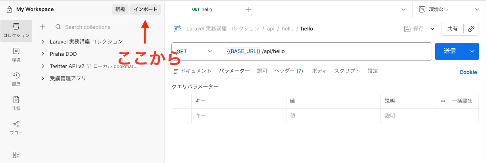
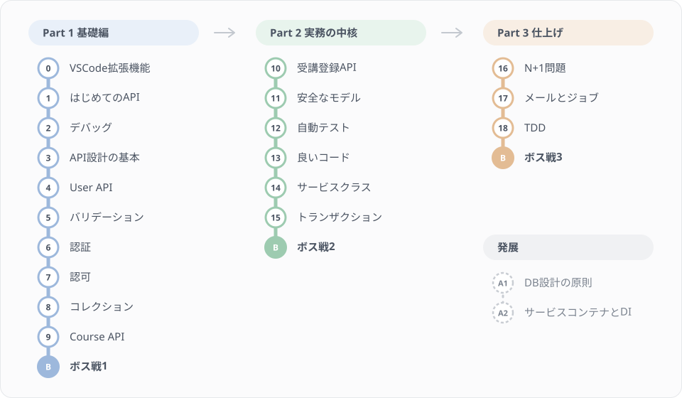

# バックエンドのレッスン

受講管理システムのAPIを、Lesson 0 から Lesson 18 まで順番に作っていきます。各 Part の最後には、コードを載せず仕様だけを渡す「ボス戦」があります。教材全体の構成と事前準備は [レッスンのトップ](../README.md) を参照してください。

## 始める前に

### Postmanのセットアップ

本レッスンではAPIの動作確認に [Postman](https://www.postman.com/) を使用します。

> 注意: ローカル環境（localhost）へリクエストを送るため、必ず デスクトップアプリ版のPostmanを使用してください。Web版（ブラウザ）ではlocalhostへのアクセスができません。

以下の手順でコレクションをインポートしてください。

1. Postmanを起動する
2. 「Use resources or import」をクリックし、開いたダイアログで「Import」タブを選ぶ
3. `postman/collections/laravel-tutorial.postman_collection.json` をドラッグ＆ドロップ（または「files」から選択）してインポートする

> 補足: Postman のバージョンによっては、左上に「Import」ボタンが直接表示されています。その場合はそのボタンをクリックしてください。



### ステージのクリア判定

各レッスンを「ステージ」として、クリアしたかどうかを自動で判定できます。レッスンを終えたら、ステージの番号を付けて実行してください。

```bash
make quest-10
```

ミッションが一覧で表示され、クリアしたものに ✅、まだのものに ❌ が付きます。❌ のミッションには、どこを見直せばよいかのヒントが出ます。まだ手を付けていないミッションは ⬜（未着手）です。

```
Stage 10  受講登録APIを作る                             ■■■■□□ 4/6  残りのメイン 1
  ✅ [前提] 講座一覧APIが動く
  ✅ [メイン] 生徒は講座に受講登録できる
  ❌ [メイン] 同じ講座に2回申し込むと 409 になる
     ヒント: 複合ユニーク制約の違反（UniqueConstraintViolationException）を catch して 409 を返します（返ってきたステータス: 500）
```

ミッションには3種類あります。「メイン」は本文の手順どおりに進めればクリアできるもので、メインがすべて ✅ になれば STAGE CLEAR です。「サイド」は練習問題に対応していて、クリアの条件には入りません。「前提」は、前のレッスンで作ったものが壊れていないかの確認です。

全ステージの進み具合は `make map` で見られます。判定を用意しているのは、いまのところ Lesson 10〜12 です。ほかのステージは順に追加していきます。

> 注意: 判定に使うテストは `tests/Quests` にあります。中身を読んでも構いませんが、書き換えないでください。書き換えると、`make quest-NN` の最後に警告が出ます。

### コードスタイル（Pint）

本プロジェクトは [Laravel Pint](https://laravel.com/docs/pint) でコードスタイルを統一しています。PHPファイルを編集したら、コミット前に整形してください。

```bash
vendor/bin/pint --dirty
```

各レッスンのサンプルコードは説明を優先して短く書いているため、Pintを実行すると差分が出ることがあります。代表的なのは以下です。サンプルとの差分が出ても間違いではありません。

- ファイル先頭に `declare(strict_types=1);` が追加される（型の暗黙変換を禁止する宣言）
- `use` 文の並び替え、クラス名の完全修飾からのインポート化

> 実務でも「整形はツールに任せ、人間はレビューで中身だけを見る」のが一般的です。手で整えようとせず、Pintに任せてください。

## Lesson 0: 環境準備

| # | タイトル | 学習目標 |
|---|---------|---------|
| 0 | [おすすめのVSCode拡張機能](./00-vscode-extensions.md) | Laravel開発に役立つVSCode拡張機能の導入 |

## Part 1: 基礎編 (Lesson 1-9)

| # | タイトル | 学習目標 |
|---|---------|---------|
| 1 | [はじめてのAPI](./01-first-api.md) | api.phpで最初のAPIを作成 |
| 2 | [デバッグ手法を身につける](./02-debugging.md) | Log、Telescope、dd()の使い分け |
| 3 | [API設計の基本](./03-api-design.md) | RESTful API設計原則を学ぶ |
| 4 | [User APIの実装](./04-user-api.md) | Controller、API Resourceの活用 |
| 5 | [バリデーション](./05-validation.md) | FormRequestによる堅牢なバリデーション |
| 6 | [認証の仕組みを理解する](./06-authentication.md) | Fortifyの認証フローを把握 |
| 7 | [認可（Gate/Policy）を実装する](./07-authorization.md) | 「誰が何をできるか」の制御 |
| 8 | [コレクション](./08-collection.md) | コレクションメソッドの活用 |
| 9 | [Course APIの実装](./09-course-api.md) | 講座APIの完成 |
| ボス戦1 | [講座のステータスを切り替えるAPI](./boss-1-course-status.md) | 仕様だけを見て、Part 1 の知識でAPIを作る |

## Part 2: 実務の中核 (Lesson 10-15)

実務でよく使う内容を集めた Part です。受講登録APIを作り、テストで動きを固定してから、コードを整理していきます。

| # | タイトル | 学習目標 |
|---|---------|---------|
| 10 | [受講登録APIを作る](./10-attendance-api.md) | 外部キー・複合ユニーク制約を使ったテーブル設計と、3本目のAPI |
| 11 | [安全なモデルの記述](./11-safe-model.md) | Mass Assignment対策、キャスト、アクセサ |
| 12 | [自動テストの書き方](./12-testing.md) | Pestでテストを書き、APIの動きを固定する |
| 13 | [良いコードを書く](./13-clean-code.md) | テストが緑のままリファクタリングする |
| 14 | [サービスクラスの設計](./14-service-class.md) | Fat Controller の解消と業務例外 |
| 15 | [トランザクション処理](./15-transaction.md) | データ整合性の担保、排他制御の理解 |
| ボス戦2 | [不具合の入った受講登録を直す](./boss-2-buggy-attendance.md) | テストを書いて不具合を見つけ、直す |

## Part 3: 仕上げ (Lesson 16-18)

| # | タイトル | 学習目標 |
|---|---------|---------|
| 16 | [N+1問題を解決する](./16-n-plus-one.md) | Eager Loadingの習得 |
| 17 | [メールとジョブ機能](./17-mail-job.md) | 非同期処理の基本 |
| 18 | [TDDで機能を追加する](./18-tdd.md) | テスト駆動開発の実践 |
| ボス戦3 | [講師向けの受講者一覧APIをTDDで作る](./boss-3-course-attendances.md) | 仕様だけを見て、TDDでAPIを作る |

## 発展

本線のレッスンとは独立した補足です。読まなくても本線は進められます。関連するレッスンを終えたあとに読むと、理解が深まります。

| # | タイトル | 関連するレッスン |
|---|---------|---------|
| A1 | [データベース設計の原則](./A1-database-design.md) | Lesson 10（外部キー・インデックス・NULL・マイグレーションの原則） |
| A2 | [サービスコンテナとDI](./A2-di-container.md) | Lesson 14（依存性注入とインターフェース） |

## 各Partで完成するもの

| Part | 完成物 |
|------|--------|
| Part 1 | User API、Course API（CRUD）、認証・認可・バリデーション |
| Part 2 | 受講登録API、受講登録のテスト、サービスクラスとトランザクションで整理した受講登録 |
| Part 3 | 自分の受講一覧API、受講確認メール、TDDで追加した受講キャンセル機能 |

## カリキュラム全体マップ



## レッスン中に参照する資料

- [API仕様一覧](../reference/api-spec.md)
- [ER図](../reference/er.md)

## 次に読むもの

ボス戦3 まで終えたら、[フロントエンド資料](../frontend/README.md) に進んでください。作ってきたAPIを画面から呼ぶときの設計とデータ取得の考え方を扱っています。
