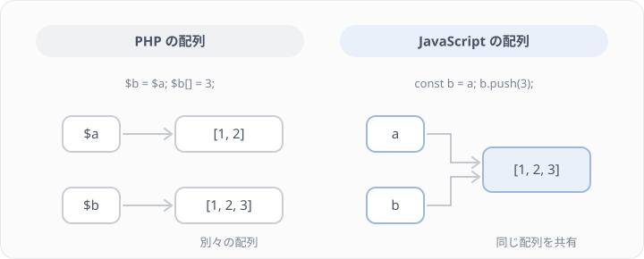

# F1 React に必要な JavaScript

## 学習目標

React のコードは JavaScript で書きます。このレッスンでは、React のコードを読み書きするのに必要な JavaScript の書き方を、PHP と比べながら学びます。JavaScript のすべてを扱うのではなく、F3 以降のコードに出てくるものにしぼります。

PHP と JavaScript は、見た目が似ているのに動きが違うところがあります。中でも大事なのが、配列とオブジェクトを代入したときの動き（値と参照の違い）です。React で「画面が更新されない」というバグのよくある原因がここにあるので、Step 4 で時間をかけて扱います。

### 到達目標
- JavaScript のコードを、コンテナの node で動かして確かめられる
- 配列の map・filter・find で、元の配列を変えずに新しい配列を作れる
- PHP の配列と JavaScript の配列の、代入したときの動きの違いを説明できる
- 分割代入、スプレッド構文、`?.`、`??` を読み書きできる
- 型注釈を、PHP の型宣言と対応づけて読める

## このレッスンで作るもの

`resources/js/practice/f1.js` に、講座の配列を扱う5つの関数を書きます（練習問題1）。Step 1〜8 で書き方を学び、練習問題で使います。講座のデータは、バックエンドで作った `GET /api/courses` が返す講座と同じ形です。

## Step 1 JavaScript を動かす

このプロジェクトのコンテナには Node.js（ブラウザの外で JavaScript を動かすもの）が入っています。PHP のファイルを `php ファイル名` で動かせるのと同じく、JavaScript のファイルは `node ファイル名` で動かせます。

```bash
docker compose exec app node --version
```

`v26` から始まるバージョンが表示されれば使えます。

このレッスンでは、試し書き用のファイルを作って、そこにコードを書いては動かします。`resources/js/practice/scratch.js` を作り、次の1行を書いてください。

```js
console.log('こんにちは', 1 + 2);
```

保存したら、ファイルを指定して動かします。

```bash
docker compose exec app node resources/js/practice/scratch.js
```

`こんにちは 3` と表示されれば成功です。`console.log()` は、PHP の `var_dump()` や Laravel の `dump()` のように、値を表示する関数です。配列やオブジェクトも中身まで表示されます。ブラウザで動かしたときは、デベロッパーツールの「Console」タブに表示されます。

以降の Step のコードは、scratch.js に書いて動かしてみてください。コメントの `// →` のあとに書いたのが、表示される値です。同じ Step の中のコードは、前のコードに続けて書き足すと動きます。同じ名前の変数を2回宣言すると「Identifier 'a' has already been declared」というエラーになるので、そのときは前のコードを消してから書いてください。

## Step 2 変数と関数

### const と let

JavaScript の変数には `$` を付けず、`const` か `let` を付けて宣言します。

```js
const title = 'React 入門';
let count = 0;
count = count + 1;
```

`const` で宣言した変数には、あとから別の値を代入できません。`let` は代入し直せます。迷ったら `const` を使い、代入し直す必要があるときだけ `let` にします。React のコードでも、ほとんどの変数は `const` です。

> 補足: 古いコードには `var` も出てきますが、使いません。`var` は有効な範囲が分かりにくく、思わぬところで値が上書きされることがあるためです。

### 文字列の埋め込み

文字列に変数を埋め込むときは、バッククォート（`` ` ``）で囲み、`${}` の中に式を書きます。PHP のダブルクォートの中に `{$count}` と書くのと同じです。

```js
const count = 3;
console.log(`講座は${count}件です`); // → 講座は3件です
```

### アロー関数

JavaScript の関数は、`function` で宣言するほかに、アロー関数（`=>`）でも書けます。PHP 7.4 で入ったアロー関数（`fn ($x) => ...`）とほとんど同じ形です。

```php
$double = fn (int $n) => $n * 2;
```

```js
const double = (n) => n * 2;
console.log(double(4)); // → 8
```

`=>` の右に式を1つだけ書くと、その値がそのまま返ります。処理が複数行になるときは `{}` で囲みますが、その場合は `return` を書かないと何も返りません（`undefined` になります）。

```js
const double = (n) => {
    const result = n * 2;
    return result;
};
```

もう1つ、オブジェクトを返すときは `()` で囲みます。囲まないと、`{}` が関数の中身の始まりと解釈されてしまうためです。

```js
const toItem = (title) => ({ title: title, selected: false });
console.log(toItem('React 入門')); // → { title: 'React 入門', selected: false }
```

React では、ボタンを押したときの処理などをアロー関数で書くことがよくあります。

## Step 3 配列を変換する

### map・filter・find

Lesson 8 では、Laravel のコレクションで配列を変換しました。JavaScript の配列にも、同じ名前で同じ働きのメソッドがあります。

```php
$titles = collect($courses)->map(fn ($course) => $course['title']);
$actives = collect($courses)->filter(fn ($course) => $course['status'] === 'active');
$course = collect($courses)->first(fn ($course) => $course['id'] === 2);
```

```js
const courses = [
    { id: 1, title: 'React 入門', status: 'active', capacity: 20 },
    { id: 2, title: '非同期処理の設計（下書き）', status: 'draft', capacity: 10 },
    { id: 3, title: 'TypeScript 実践（満席）', status: 'active', capacity: 2 },
];

const titles = courses.map((course) => course.title);
console.log(titles); // → [ 'React 入門', '非同期処理の設計（下書き）', 'TypeScript 実践（満席）' ]

const actives = courses.filter((course) => course.status === 'active');
console.log(actives.length); // → 2

const found = courses.find((course) => course.id === 2);
console.log(found.title); // → 非同期処理の設計（下書き）
```

JavaScript のオブジェクト（`{ id: 1, title: ... }`）は、PHP の連想配列にあたります。値は `course['title']` ではなく `course.title` で取り出します。

3つのメソッドは、どれも元の配列 `courses` を書き換えません。`map` と `filter` は新しい配列を作って返し、`find` は見つかった要素を返します。

PHP のコレクションと違うところが2つあります。1つ目は、見つからなかったときの値です。コレクションの `first()` は null を返しますが、JavaScript の `find()` は `undefined` を返します。`undefined` は「値がまだ決まっていない」ことを表す JavaScript の値で、null とは別物です。2つ目は、`filter` の結果の番号です。PHP の `array_filter` は元のキーを残すので、結果の番号が飛ぶことがありますが、JavaScript の `filter` の結果は 0 から振り直されます。

ここまでの内容で、練習問題1の `activeCourses`・`courseTitles`・`findCourse` が書けます。

### reduce で1つの値にまとめる

Lesson 8 では、定員の合計を `$courses->sum('capacity')` で求めました。JavaScript の配列には `sum` がないので、1つの値にまとめるときは `reduce` を使います。PHP の `array_reduce` と同じく、引数は「まとめる関数」と「最初の値」です。

```js
const total = courses.reduce((sum, course) => sum + course.capacity, 0);
console.log(total); // → 32
```

最初の値（ここでは `0`）は必ず書いてください。書かないと、空の配列に対して `reduce` を呼んだときにエラーになります。`reduce` が読みにくいと感じたら、`for...of` で書いても構いません。

```js
let total = 0;

for (const course of courses) {
    total += course.capacity;
}
```

`for...of` は、PHP の `foreach ($courses as $course)` にあたります。

## Step 4 値と参照

### 代入したときの動きが違う

ここが、PHP に慣れた人がいちばんつまずくところです。次の2つのコードを比べてください。

```php
$a = [1, 2];
$b = $a;
$b[] = 3;

var_dump($a); // [1, 2]
```

```js
const a = [1, 2];
const b = a;
b.push(3);

console.log(a); // → [ 1, 2, 3 ]
```

PHP では、`$b = $a` で配列がコピーされます。`$b` に要素を足しても、`$a` は変わりません。JavaScript では、`const b = a` で配列はコピーされず、`a` と `b` が同じ1つの配列を指します。そのため、`b` に要素を足すと、`a` から見ても要素が増えています。



数値や文字列はこうなりません。`let n = 1; let m = n; m = 2;` としても `n` は 1 のままです。共有されるのは、配列とオブジェクトです。

PHP にも同じ動きをするものがあります。`new` で作ったオブジェクトです。`$b = $a` としても、`$a` と `$b` は同じオブジェクトを指し、`$b->name` を書き換えると `$a->name` も変わります。JavaScript の配列とオブジェクトは、いつもこの「PHP のオブジェクト」と同じ動きをすると考えてください。

### 関数に渡したときも共有される

関数の引数でも同じことが起きます。PHP では、配列を関数に渡すとコピーが渡るので、関数の中で書き換えても呼び出し元には影響しません。JavaScript では同じ配列が渡るので、関数の中で書き換えると、呼び出し元の配列も変わります。

```js
function addSeats(course) {
    course.remaining_seats = 5;
    return course;
}

const original = { id: 1, title: 'React 入門', capacity: 20 };
const updated = addSeats(original);

console.log(original); // → { id: 1, title: 'React 入門', capacity: 20, remaining_seats: 5 }
console.log(updated === original); // → true
```

`addSeats` は、新しい講座を返しているように見えて、渡された講座そのものを書き換えています。`const` で宣言していても、中身の書き換えは止められません。`const` が禁止するのは「変数に別の値を代入すること」だけです。

### コピーしてから変える

元の値を変えずに、変更を加えた値がほしいときは、新しい配列やオブジェクトを作ります。作り方は Step 5 のスプレッド構文で説明します。配列のメソッドにも、元の配列を書き換えるものと、新しい配列を返すものがあります。

| 元の配列を書き換える | 新しい配列を返す |
|---|---|
| `push`、`splice`、`sort`、`reverse` | `map`、`filter`、`concat`、`toSorted`、`toReversed`、スプレッド構文 |

`sort` は並べ替えた配列を返すので新しい配列を作っているように見えますが、元の配列そのものを並べ替えています。元の順番を残したいときは `toSorted` を使います（練習問題2）。

### === は「同じものか」を比べる

配列やオブジェクトを `===` で比べると、中身が同じかではなく、同じ1つのものを指しているかを比べます。

```js
console.log([1, 2] === [1, 2]); // → false

const a = [1, 2];
const b = a;
console.log(a === b); // → true
```

PHP では `[1, 2] === [1, 2]` は true なので、ここも違います。

### React で大事になる理由

React は、画面の状態（state）が変わったかを、この `===` と同じ比べ方で判断します。配列に `push` してから「新しい状態です」と React に渡しても、渡したのは同じ配列なので、React は「変わっていない」と判断して画面を更新しません。そのため React では、状態の配列やオブジェクトを直接書き換えず、新しい配列やオブジェクトを作って渡します。F3 でこの書き方を練習します。

練習問題1の `withRemainingSeats` は、この「元を書き換えずに新しいオブジェクトを返す」練習です。

## Step 5 分割代入とスプレッド構文

### 分割代入

オブジェクトから値を取り出して変数にするときは、分割代入が使えます。PHP の `['title' => $title] = $course;` にあたります。

```js
const course = { id: 1, title: 'React 入門', status: 'active' };

const { title, status } = course;
console.log(title, status); // → React 入門 active
```

配列も、PHP の `[$first, $second] = $items;` と同じ形で取り出せます。

```js
const [first, second] = ['React 入門', 'TypeScript 実践'];
console.log(second); // → TypeScript 実践
```

React では、どちらもよく使います。F3 で使う `useState` は「今の値」と「値を変える関数」の2つを配列で返すので、`const [count, setCount] = useState(0);` と配列の分割代入で受け取ります。部品が受け取る props は、関数の引数でオブジェクトの分割代入を使って受け取ります。

```js
function courseLabel({ title, status }) {
    return `${title}（${status}）`;
}

console.log(courseLabel(course)); // → React 入門（active）
```

### スプレッド構文

`...` を前に付けると、配列やオブジェクトの中身を展開できます。PHP 8.1 から使える配列のスプレッド（`[...$a, 3]`）と同じです。

```php
$items = [...$a, 3];
$updated = [...$course, 'remaining_seats' => 5];
```

```js
const a = [1, 2];
const items = [...a, 3];
console.log(items); // → [ 1, 2, 3 ]
console.log(a); // → [ 1, 2 ]

const course = { id: 1, title: 'React 入門', capacity: 20 };
const updated = { ...course, remaining_seats: 5 };
console.log(updated); // → { id: 1, title: 'React 入門', capacity: 20, remaining_seats: 5 }
console.log(course); // → { id: 1, title: 'React 入門', capacity: 20 }
```

`{ ...course, remaining_seats: 5 }` は、`course` の中身を写した新しいオブジェクトを作り、`remaining_seats` を足します。同じ名前のキーを後ろに書けば、その値で上書きされます。Step 4 の `addSeats` を、元を書き換えない形に直すと次のようになります。

```js
function addSeats(course) {
    return { ...course, remaining_seats: 5 };
}
```

> 補足: スプレッド構文が写すのは1段目だけです。`{ ...course }` で作ったオブジェクトの `instructor`（講師のオブジェクト）は、元の講座と同じものを指したままです。中のオブジェクトも変えたいときは、`{ ...course, instructor: { ...course.instructor, name: '新しい名前' } }` のように、その段もスプレッドで作り直します。

## Step 6 比較と null の扱い

### == ではなく === を使う

PHP と同じく、JavaScript にも `==` と `===` があります。`==` は型を変換してから比べるので、`'1' == 1` が true になります。PHP と同じく、いつも `===`（と `!==`）を使ってください。

API から受け取った id は数値ですが、URL のクエリや `<input>` から取った値は文字列です。`findCourse(courses, '2')` のように文字列の id で探すと、`===` では一致しません。比べる前に、`Number('2')` で数値にそろえます。

### ?. と ??

PHP 8 の nullsafe 演算子（`?->`）と null 合体演算子（`??`）は、JavaScript では `?.` と `??` です。

```js
const course = { id: 1, title: 'React 入門', instructor: null };

console.log(course.instructor?.name); // → undefined
console.log(course.instructor?.name ?? '講師未定'); // → 講師未定
```

`course.instructor.name` と書くと、`instructor` が null なので「null の name は読めない」というエラー（TypeError）になります。`?.` を使うと、手前が null か undefined のときはエラーにせず `undefined` を返します。`??` は、左が null か undefined のときに右の値を使います。

> 補足: 古いコードでは `??` の代わりに `||` がよく使われています。`||` は、左が 0 や空文字のときにも右の値を使うので、`course.capacity || 10` は定員 0 の講座でも 10 になります。値がないときの代わりの値には `??` を使ってください。

### truthy と falsy

`if` の条件に書いたとき、true として扱われる値を truthy、false として扱われる値を falsy と呼びます。JavaScript の falsy は、`false`、`0`、`''`（空文字）、`null`、`undefined`、`NaN` だけです。それ以外はすべて truthy です。

PHP と違うのは、文字列の `'0'` と空の配列 `[]` です。PHP ではどちらも false として扱われますが、JavaScript ではどちらも true として扱われます。

特に気を付けたいのは空の配列です。PHP では `if ($courses)` で「講座が1件以上あるか」を確かめられますが、JavaScript の `if (courses)` は空の配列でも true です。件数を確かめるときは `courses.length > 0` と書きます。

```js
const courses = [];

if (courses) {
    console.log('ここは表示される');
}

if (courses.length === 0) {
    console.log('講座はありません');
}
```

> 補足: F3 では、React の `{courses.length && <p>…</p>}` という書き方で、画面に「0」と表示されてしまうことを扱います。`&&` は左が falsy のときに左の値（ここでは 0）をそのまま返し、React は数値の 0 を画面に表示するためです。

## Step 7 import と export

JavaScript では、1つのファイルを1つのモジュールとして扱います。ほかのファイルから使ってほしい関数には `export` を付け、使う側は `import` で読み込みます。PHP の `namespace` と `use` に近い仕組みです。

```js
export function double(n) {
    return n * 2;
}
```

```js
import { double } from './math.js';

console.log(double(4)); // → 8
```

試すときは、上のコードをそれぞれ `resources/js/practice/math.js` と scratch.js に書いてください。`./math.js` は「このファイルと同じディレクトリの math.js」という意味です。

`import { double }` の `{}` は、`export` で付けた名前を指定して読み込む形です（名前付きエクスポート）。もう1つ、ファイルに1つだけ「既定のもの」を決める `export default` もあります。このプロジェクトのページのファイル（`resources/js/pages/dashboard.tsx` など）は、ページの部品を `export default function Dashboard()` で書き出していて、読み込む側は `{}` なしで `import Dashboard from ...` と書きます。

> 補足: node でファイルを動かすときは、`./math.js` のように拡張子まで書きます。`resources/js` の中の tsx ファイルでは、`import { dashboard } from '@/routes';` のように拡張子を書かず、`@/` から始めます。`@/` は `resources/js/` を表す別名で、Vite と TypeScript の設定で決めています。

## Step 8 型注釈を読む

このプロジェクトの画面は TypeScript で書かれています。TypeScript は、JavaScript に型注釈を足したものです。型の考え方は F5 でまとめて学ぶので、ここでは読み方だけを PHP の型宣言と並べて見ておきます。F3 と F4 では、本文の型を写して使います。

```php
function findCourse(array $courses, int $id): ?array
```

```ts
function findCourse(courses: Course[], id: number): Course | null
```

PHP では型を変数名の前に書きますが、TypeScript では変数名のあとに `:` で書きます。戻り値の型は、`)` のあとの `:` に書きます。`Course[]` は「Course の配列」、`Course | null` は「Course か null のどちらか」という意味で、PHP の `?array` や PHPDoc の `Course[]` にあたります。

講座の形は、次のように `type` で名前を付けて書きます。

```ts
type Course = {
    id: number;
    title: string;
    status: 'draft' | 'active' | 'closed';
    capacity: number;
    instructor?: { id: number; name: string; email: string };
};
```

`status` の `'draft' | 'active' | 'closed'` は、「この3つの文字列のどれか」という型です。PHP の Enum（Lesson 9 の `CourseStatus`）と同じ役割で、`'published'` のような値を入れようとすると、エディタがエラーを出します。`instructor?:` の `?` は「このキーはないこともある」という意味です。`CourseResource` が `whenLoaded('instructor')` で、講師を読み込んだときだけ `instructor` を返すのに対応しています。

練習問題1のファイルは `.js` なので型注釈は書けませんが、代わりに JSDoc（PHPDoc と同じ形のコメント）で同じ書き方の型を付けています。VSCode では、関数にマウスを乗せるとこの型が表示されます。

## 練習問題

このレッスンでは、練習問題1がメインのミッションです。

### 問題1 講座の配列を扱う関数を書く

`resources/js/practice/f1.js` を作り、次のひな形を写してください。関数の名前と引数は変えずに、中身を書きます。それぞれの関数が何を返すかは、関数の上のコメントに書いてあります。

```js
// F1 React に必要な JavaScript の練習問題
// 関数の中身を書いて、make quest-f1 で確かめます。関数の名前と引数は変えないでください。

/**
 * 講座1件の形（GET /api/courses が返す講座のうち、ここで使う項目）
 *
 * @typedef {{
 *   id: number,
 *   title: string,
 *   status: 'draft' | 'active' | 'closed',
 *   capacity: number,
 *   starts_at: string,
 * }} Course
 */

/**
 * 公開中（status が active）の講座だけを返す
 *
 * @param {Course[]} courses
 * @returns {Course[]}
 */
export function activeCourses(courses) {}

/**
 * 講座のタイトルだけを並べた配列を返す
 *
 * @param {Course[]} courses
 * @returns {string[]}
 */
export function courseTitles(courses) {}

/**
 * 講座の定員（capacity）を合計して返す。講座が1件もなければ 0
 *
 * @param {Course[]} courses
 * @returns {number}
 */
export function totalCapacity(courses) {}

/**
 * 残席（remaining_seats）を足した新しい講座を返す。元の講座は書き換えない
 * 残席は「定員 − 受講中の人数」で、マイナスになるときは 0 にする
 *
 * @param {Course} course
 * @param {number} attendingCount 受講中の人数
 * @returns {Course & { remaining_seats: number }}
 */
export function withRemainingSeats(course, attendingCount) {}

/**
 * id が一致する講座を返す。見つからなければ null
 *
 * @param {Course[]} courses
 * @param {number} id
 * @returns {Course | null}
 */
export function findCourse(courses, id) {}
```

中身が空のあいだは、エディタが「使われていない引数がある」と警告することがあります。中身を書けば消えます。

書いた関数を試すときは、`resources/js/practice/f1-try.js` を作って、関数を呼び出します。

```js
import { activeCourses, courseTitles, findCourse, totalCapacity, withRemainingSeats } from './f1.js';

const courses = [
    { id: 1, title: 'React 入門', status: 'active', capacity: 20, starts_at: '2026-12-08 10:00:00' },
    { id: 2, title: '非同期処理の設計（下書き）', status: 'draft', capacity: 10, starts_at: '2027-01-07 10:00:00' },
    { id: 3, title: 'TypeScript 実践（満席）', status: 'active', capacity: 2, starts_at: '2026-11-28 10:00:00' },
];

console.log(activeCourses(courses));
console.log(courseTitles(courses));
console.log(totalCapacity(courses));

const course = withRemainingSeats(courses[0], 5);
console.log(course);
console.log(courses[0]);

console.log(findCourse(courses, 2));
console.log(findCourse(courses, 99));
```

```bash
docker compose exec app node resources/js/practice/f1-try.js
```

中身が空のままだと、関数は何も返さないので `undefined` が並びます。正しく書けると、`activeCourses` は id 1 と 3 の講座の配列、`courseTitles` は3つのタイトル、`totalCapacity` は `32` になります。`withRemainingSeats` の結果には `remaining_seats: 15` が付き、そのあとに表示する `courses[0]` には `remaining_seats` が付いていないはずです。`findCourse` は、id 2 の講座と `null` を表示します。

> ヒント: `findCourse` は、`find` が見つからなかったときに返す値に気を付けてください。`withRemainingSeats` は、Step 5 のスプレッド構文と、`Math.max(a, b)`（大きいほうを返す）を使います。

<details>
<summary>解答例</summary>

```js
export function activeCourses(courses) {
    return courses.filter((course) => course.status === 'active');
}

export function courseTitles(courses) {
    return courses.map((course) => course.title);
}

export function totalCapacity(courses) {
    return courses.reduce((sum, course) => sum + course.capacity, 0);
}

export function withRemainingSeats(course, attendingCount) {
    return {
        ...course,
        remaining_seats: Math.max(course.capacity - attendingCount, 0),
    };
}

export function findCourse(courses, id) {
    return courses.find((course) => course.id === id) ?? null;
}
```

`findCourse` は、`find` が見つからなかったときに `undefined` を返すので、`?? null` で null にそろえています。

`withRemainingSeats` で `course.remaining_seats = ...` と書いて `course` を返すと、Step 4 の `addSeats` と同じく元の講座を書き換えてしまいます。f1-try.js で `courses[0]` にも `remaining_seats` が付いていたら、この書き方になっていないかを確かめてください。

`Math.max(..., 0)` は、Lesson 10 の練習問題1で `CourseResource` に書いた `max($this->resource->capacity - $count, 0)` と同じく、残席がマイナスにならないようにするためです。
</details>

### 問題2 開始日時の早い順に並べる

`f1.js` に、講座を開始日時（`starts_at`）の早い順に並べた新しい配列を返す関数 `sortByStartsAt` を足してください。元の配列の順番は変えないこととします。

```js
/**
 * 開始日時（starts_at）の早い順に並べた新しい配列を返す。元の配列の順番は変えない
 *
 * @param {Course[]} courses
 * @returns {Course[]}
 */
export function sortByStartsAt(courses) {}
```

> ヒント: 並べ替えのメソッドには、Step 4 の表のとおり、元の配列を書き換えるものとそうでないものがあります。`starts_at` は `'2026-12-08 10:00:00'` の形の文字列なので、文字列のまま比べれば日時の順になります。文字列を比べるには `a.localeCompare(b)` が使えます（a が前なら負の数、後ろなら正の数を返します）。

<details>
<summary>解答例</summary>

```js
export function sortByStartsAt(courses) {
    return courses.toSorted((a, b) => a.starts_at.localeCompare(b.starts_at));
}
```

`courses.sort(...)` と書いても並べ替えた配列は返りますが、元の `courses` そのものが並べ替わります。React で props として受け取った配列を `sort` すると、ほかの部品が使っている同じ配列の順番まで変わってしまいます。`toSorted` を使うか、`[...courses].sort(...)` のようにコピーしてから並べ替えます。
</details>

## クリア判定

ここまでできたら、次のコマンドでクリアしたかを確かめましょう。

```bash
make quest-f1
```

判定では、`resources/js/practice/f1.js` の関数をいくつかの講座の配列で呼び出し、返り値を確かめます。練習問題1の5つの関数がメインのミッションで、`withRemainingSeats` では元の講座を書き換えていないこと、`findCourse` では見つからないときに `undefined` ではなく null を返すことも確かめます。練習問題2の `sortByStartsAt` はサイドのミッションで、元の配列の順番が変わっていないことも確かめます。

> 補足: scratch.js、math.js、f1-try.js は判定では使いません。残しておいても、消しても構いません。

## 参考資料

- [MDN - Array.prototype.map()](https://developer.mozilla.org/ja/docs/Web/JavaScript/Reference/Global_Objects/Array/map)
- [MDN - 分割代入](https://developer.mozilla.org/ja/docs/Web/JavaScript/Reference/Operators/Destructuring)
- [MDN - スプレッド構文](https://developer.mozilla.org/ja/docs/Web/JavaScript/Reference/Operators/Spread_syntax)
- [MDN - Falsy](https://developer.mozilla.org/ja/docs/Glossary/Falsy)
- [React 公式ドキュメント - state 内の配列の更新](https://ja.react.dev/learn/updating-arrays-in-state)
- [TypeScript 公式ドキュメント - Everyday Types](https://www.typescriptlang.org/docs/handbook/2/everyday-types.html)

## 次のレッスン

[F2 命令的に画面を作る](./02-imperative.md) では、このレッスンで学んだ書き方を使って、素の JavaScript で講座一覧の画面に機能を足していきます。
