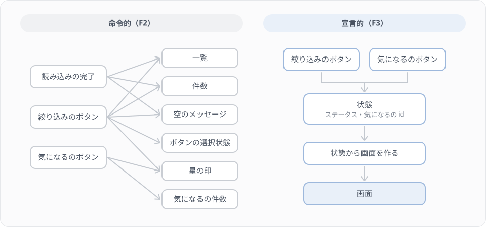

# F2 命令的に画面を作る

## 学習目標

このレッスンでは、React を使わずに、素の JavaScript で講座一覧の画面に機能を足していきます。ステータスの絞り込み、件数の表示、講座がないときの表示、「気になる」の印の4つです。

どれも小さな機能ですが、足すたびに「どの操作のときに、画面のどこを、どう書き換えるか」を自分で管理する必要が出てきます。このように、画面を書き換える手順を1つずつ書いていく書き方を「命令的」と呼びます。このレッスンの目的は、命令的に書いたときに管理するものがどう増えていくかを、手を動かして体験することです。次の F3 では、同じ画面を React で書き直し、この管理を React に任せます。

### 到達目標
- fetch と async/await で API からデータを取ってくるコードを読める
- DOM を取り出し、要素を作り、クリックに応じて書き換えるコードを書ける
- 表示がずれる不具合を見つけ、原因が「状態を DOM にだけ持っていたこと」にあると説明できる

## このレッスンで作るもの

講座一覧の画面（`public/lessons/f2/`）に、次の4つを足します。

| Step | 足す機能 |
|---|---|
| Step 1 | すべて・公開中・下書き・終了のボタンで、講座を絞り込む |
| Step 2 | 表示している講座の件数を出す |
| Step 3 | 条件に合う講座がないときに、メッセージを出す |
| Step 4 | 講座ごとに「気になる」の印（☆と★）を付け外しし、気になるの件数を出す |

Step 5 では、ここまでのコードに隠れている、表示がずれる不具合を探して直します。

## ひな形を開く

このレッスンのひな形は、`public/lessons/f2/` にある `index.html` と `app.js` の2つのファイルです。`public` の下のファイルは、Laravel がそのままブラウザに返します。Vite も React も使わない、素の HTML と JavaScript です。

ブラウザで http://localhost:8000/lessons/f2/ を開いてください。講座のタイトルとステータスが一覧で表示されれば準備できています。

> 注意: ファイルをダブルクリックして開く（アドレスが `file://` で始まる）と、講座の取得に失敗します。必ず http://localhost:8000/lessons/f2/ で開いてください。

このページは Vite を通していないので、ファイルを保存しても画面は自動で更新されません。保存したらブラウザを再読み込みしてください。直したはずなのに古い動きのままのときは、ブラウザが古い app.js を使っていることがあります。Cmd+Shift+R（Windows は Ctrl+Shift+R）で、キャッシュを使わずに読み込み直してください。

### ひな形のコードを読む

`public/lessons/f2/app.js` を開いてください。中身は大きく2つに分かれています。

1つ目の `appendCourse` は、講座1件を一覧の行（`<li>`）にして、画面に足す関数です。

```js
const list = document.querySelector('#course-list');

function appendCourse(course) {
    const item = document.createElement('li');
    item.dataset.id = String(course.id);

    const title = document.createElement('span');
    title.textContent = course.title;
    // ...
    item.append(title, status);
    list.append(item);
}
```

`document.querySelector('#course-list')` は、HTML の中から `id="course-list"` の要素を探して取り出します。`document.createElement('li')` で新しい `<li>` を作り、`textContent` に文字を入れ、`append` で子として足します。画面に表示されている HTML の要素を、JavaScript から扱うための仕組みを DOM と呼びます。このレッスンでは、この DOM を手で書き換えていきます。

2つ目の `loadCourses` は、バックエンドで作った講座一覧API（`GET /api/courses`）を呼んで、講座の配列を返す関数です。

```js
async function loadCourses() {
    const response = await fetch('/api/courses?per_page=100', {
        headers: { Accept: 'application/json' },
    });

    if (!response.ok) {
        throw new Error(`講座を取得できませんでした（${response.status}）`);
    }

    const json = await response.json();

    return json.data;
}

const courses = await loadCourses();
```

`fetch` は、ブラウザから HTTP のリクエストを送る関数です。Postman で送っていたリクエストを、JavaScript から送っていると考えてください。`Accept: application/json` を付けているのは、Postman のときと同じく、Laravel にエラーも JSON で返してもらうためです。

PHP で HTTP クライアント（`Http::get()`）を呼ぶと、応答が返ってくるまで次の行に進みません。JavaScript の `fetch` は違い、応答を待たずにすぐ戻ってきて、「あとで応答が入る入れ物」（Promise）を返します。`await` を付けると、その Promise に応答が入るまで待ってから、中身を取り出して次の行に進みます。`await` を使う関数には `async` を付けます。`async` を付けた関数も、すぐに Promise を返すので、呼び出す側でも `await loadCourses()` と書いて待ちます。

`response.ok` は、ステータスコードが 200 番台のときに true になります。`fetch` は 404 や 500 が返ってきてもエラーにならないので、自分で確かめて、失敗なら `throw` で止めています。`response.json()` で応答の本文を JSON として読み、Lesson 9 で見たとおり講座の配列は `data` の中に入っているので、`json.data` を返しています。

> 補足: 関数の外で `await` を書けるのは、`index.html` で `<script type="module">` として読み込んでいるためです。

最後の `for...of` で、取ってきた講座を1件ずつ `appendCourse` に渡し、一覧を作っています。

## Step 1 ステータスで絞り込む

### ボタンを置く

`public/lessons/f2/index.html` の `<!-- Step 1 で、ステータスの絞り込みのボタンをここに足します -->` の行を、次の4つのボタンに置き換えます。

`public/lessons/f2/index.html`

```html
            <button type="button" data-status="all" class="is-selected">すべて</button>
            <button type="button" data-status="active">公開中</button>
            <button type="button" data-status="draft">下書き</button>
            <button type="button" data-status="closed">終了</button>
```

`data-status` は、要素に好きな値を持たせるための属性です（data 属性）。JavaScript からは `button.dataset.status` で読めます。`is-selected` のクラスが付いたボタンは、選択中として色が変わるよう、ひな形の CSS に書いてあります。

### 押したときに一覧を作り直す

`app.js` の最後にある次の3行を消します。

```js
for (const course of courses) {
    appendCourse(course);
}
```

代わりに、ファイルの最後に次のコードを足します。

`public/lessons/f2/app.js`

```js
let currentStatus = 'all';

/**
 * 選んでいるステータスの講座だけを、一覧に表示し直す
 */
function showCourses() {
    const visibleCourses =
        currentStatus === 'all'
            ? courses
            : courses.filter((course) => course.status === currentStatus);

    list.replaceChildren();

    for (const course of visibleCourses) {
        appendCourse(course);
    }
}

const statusButtons = document.querySelectorAll('[data-status]');

for (const button of statusButtons) {
    button.addEventListener('click', () => {
        currentStatus = button.dataset.status;

        for (const other of statusButtons) {
            other.classList.toggle('is-selected', other === button);
        }

        showCourses();
    });
}

showCourses();
```

`currentStatus` は、いま選んでいるステータスを覚えておく変数です。ボタンを押すたびに書き換えるので、`const` ではなく `let` にしています。

`showCourses` は、`list.replaceChildren()` で一覧の中身を空にしてから、選んでいるステータスの講座だけを足し直します。`filter` は F1 で学んだとおり、元の `courses` を書き換えずに新しい配列を返します。

`addEventListener('click', ...)` は、ボタンが押されたときに呼ぶ関数を登録します。押されたら、`currentStatus` を書き換え、押したボタンにだけ `is-selected` を付け（`classList.toggle` の2つ目の引数が true なら付け、false なら外します）、一覧を作り直します。

再読み込みして、ボタンを押すたびに一覧が切り替わり、押したボタンの色が変わることを確かめてください。

この時点で、絞り込みのボタンを押したときに書き換える場所は、「一覧」と「ボタンの選択状態」の2つです。

## Step 2 件数を表示する

表示している講座の件数を、ボタンの右に出します。表示する場所（`<span id="course-count">`）は、ひな形の HTML に用意してあります。

`app.js` の上のほうにある `const list = ...` の行のすぐ下に、件数の要素を取り出す1行を足します。

`public/lessons/f2/app.js`

```js
const list = document.querySelector('#course-list');
const countLabel = document.querySelector('#course-count');
```

`showCourses` の最後（`for` の閉じかっこのあと）に、件数を書き込む1行を足します。

```js
function showCourses() {
    // ...

    for (const course of visibleCourses) {
        appendCourse(course);
    }

    countLabel.textContent = `${visibleCourses.length}件`;
}
```

再読み込みして、`7件` のように件数が出て、絞り込むと件数も変わることを確かめてください（件数は、入っているデータによって変わります）。

件数を一覧と別の場所に出したので、絞り込みのボタンを押したときに書き換える場所が、「件数」の1つ増えました。`showCourses` の中で書き換えているので、最初に表示したときにも件数が出ます。もしボタンを押したときの処理のほうに書いていたら、最初の表示では件数が空のままになっていたはずです。

## Step 3 条件に合う講座がないときの表示

絞り込んだ結果が0件のときは、一覧が空になるだけだと、読み込みに失敗したのか、本当に講座がないのか分かりません。そこで「条件に合う講座はありません。」と表示します。このメッセージ（`<p id="empty-message" hidden>`）も、ひな形の HTML に用意してあります。`hidden` 属性が付いている要素は表示されません。

`countLabel` の下に、メッセージの要素を取り出す1行を足します。

`public/lessons/f2/app.js`

```js
const list = document.querySelector('#course-list');
const countLabel = document.querySelector('#course-count');
const emptyMessage = document.querySelector('#empty-message');
```

`showCourses` の最後に、件数が0件でなければ隠す1行を足します。

```js
    countLabel.textContent = `${visibleCourses.length}件`;
    emptyMessage.hidden = visibleCourses.length > 0;
}
```

`emptyMessage.hidden` に true を入れると隠れ、false を入れると表示されます。

F0 で入れた練習用のデータには、どのステータスの講座も1件以上あるので、このままではメッセージが出るところを確かめられません。確かめるために、どの講座にも当てはまらないステータスのボタンを、一時的に `index.html` の「終了」のボタンの下に足します。

```html
            <button type="button" data-status="none">（確認用）</button>
```

再読み込みして「（確認用）」を押し、メッセージが出て件数が `0件` になること、ほかのボタンを押すとメッセージが消えることを確かめてください。確かめたら、確認用のボタンは消しておきます。

絞り込みのボタンを押したときに書き換える場所が、「空のメッセージ」の1つ増えて、4つになりました。

## Step 4 「気になる」の印を付ける

講座の行の左に☆のボタンを置き、押すと★に変わって行の色が変わるようにします。もう一度押すと☆に戻ります。あわせて、気になるを付けた講座の件数を、ボタンの右に出します。

### HTML と CSS を足す

`index.html` の `<span id="course-count"></span>` の下に、気になるの件数を出す場所を足します。

`public/lessons/f2/index.html`

```html
            <span id="course-count"></span>
            <span id="favorite-count">気になる 0件</span>
```

`<style>` の中の `.status { ... }` のあとに、☆のボタンと、気になるを付けた行の見た目を足します。

```css
            .favorite {
                border: none;
                background: none;
                cursor: pointer;
                font-size: 16px;
                margin-right: 8px;
            }
            #course-list li.is-favorite {
                background: #fdf6ec;
                border-color: #e3bc94;
            }
```

### 行に☆のボタンを足す

`app.js` の上のほうに、気になるの件数の要素を取り出す1行を足します。

`public/lessons/f2/app.js`

```js
const list = document.querySelector('#course-list');
const countLabel = document.querySelector('#course-count');
const emptyMessage = document.querySelector('#empty-message');
const favoriteCountLabel = document.querySelector('#favorite-count');
```

`appendCourse` の最後の2行（`item.append(title, status);` と `list.append(item);`）を、次のように書き換えます。あわせて、`appendCourse` の閉じかっこのあとに `updateFavoriteCount` 関数を足します。

```js
    const favoriteButton = document.createElement('button');
    favoriteButton.type = 'button';
    favoriteButton.className = 'favorite';
    favoriteButton.textContent = '☆';

    favoriteButton.addEventListener('click', () => {
        item.classList.toggle('is-favorite');
        favoriteButton.textContent = item.classList.contains('is-favorite') ? '★' : '☆';
        updateFavoriteCount();
    });

    item.append(favoriteButton, title, status);
    list.append(item);
}

/**
 * 気になるの件数を表示し直す
 */
function updateFavoriteCount() {
    const count = list.querySelectorAll('.is-favorite').length;
    favoriteCountLabel.textContent = `気になる ${count}件`;
}
```

☆のボタンを押すと、その行に `is-favorite` のクラスを付け外しし、ボタンの文字を★と☆で切り替え、`updateFavoriteCount` で件数を出し直します。件数は、一覧の中で `is-favorite` が付いている行を `querySelectorAll` で数えて求めています。

再読み込みして、☆を押すと★に変わって行の色が変わること、気になるの件数が増えたり減ったりすることを確かめてください。

<details>
<summary>ここまでの app.js 全体</summary>

うまく動かないときは、自分の app.js と見比べてください。

```js
// F2 命令的に画面を作る
// 講座を1回だけ取ってきて、一覧を表示するところまでを用意しています。
// このファイルに、レッスンの手順どおりに機能を足していきます。

const list = document.querySelector('#course-list');
const countLabel = document.querySelector('#course-count');
const emptyMessage = document.querySelector('#empty-message');
const favoriteCountLabel = document.querySelector('#favorite-count');

/**
 * 講座を1件、一覧の行として DOM に足す
 */
function appendCourse(course) {
    const item = document.createElement('li');
    item.dataset.id = String(course.id);

    const title = document.createElement('span');
    title.textContent = course.title;

    const status = document.createElement('span');
    status.className = 'status';
    status.textContent = course.status;

    const favoriteButton = document.createElement('button');
    favoriteButton.type = 'button';
    favoriteButton.className = 'favorite';
    favoriteButton.textContent = '☆';

    favoriteButton.addEventListener('click', () => {
        item.classList.toggle('is-favorite');
        favoriteButton.textContent = item.classList.contains('is-favorite') ? '★' : '☆';
        updateFavoriteCount();
    });

    item.append(favoriteButton, title, status);
    list.append(item);
}

/**
 * 気になるの件数を表示し直す
 */
function updateFavoriteCount() {
    const count = list.querySelectorAll('.is-favorite').length;
    favoriteCountLabel.textContent = `気になる ${count}件`;
}

async function loadCourses() {
    const response = await fetch('/api/courses?per_page=100', {
        headers: { Accept: 'application/json' },
    });

    if (!response.ok) {
        throw new Error(`講座を取得できませんでした（${response.status}）`);
    }

    const json = await response.json();

    return json.data;
}

const courses = await loadCourses();

let currentStatus = 'all';

/**
 * 選んでいるステータスの講座だけを、一覧に表示し直す
 */
function showCourses() {
    const visibleCourses =
        currentStatus === 'all'
            ? courses
            : courses.filter((course) => course.status === currentStatus);

    list.replaceChildren();

    for (const course of visibleCourses) {
        appendCourse(course);
    }

    countLabel.textContent = `${visibleCourses.length}件`;
    emptyMessage.hidden = visibleCourses.length > 0;
}

const statusButtons = document.querySelectorAll('[data-status]');

for (const button of statusButtons) {
    button.addEventListener('click', () => {
        currentStatus = button.dataset.status;

        for (const other of statusButtons) {
            other.classList.toggle('is-selected', other === button);
        }

        showCourses();
    });
}

showCourses();
```
</details>

## Step 5 表示のずれを探す

実は、Step 4 までのコードには、画面の表示がずれる不具合が1つあります。☆を押すだけ、絞り込むだけでは起きません。Step 1〜4 で足した機能を、いろいろな順番で組み合わせて操作し、表示がおかしくなる操作を探してください。見つけたら、なぜそうなるのかをコードから考え、直してみましょう。

<details>
<summary>ヒント（どの操作でずれるか）</summary>

2つの講座に★を付けて「気になる 2件」にしてから、「公開中」を押し、そのあと「すべて」を押してみてください。★が全部☆に戻っているのに、件数は「気になる 2件」のままです。そこで☆を1つ押すと、今度は「気になる 1件」になります。
</details>

<details>
<summary>解答例（原因と直し方）</summary>

### 原因

「どの講座に気になるを付けたか」という情報が、行の `<li>` に付けた `is-favorite` のクラスにしか残っていないことが原因です。

絞り込みのボタンを押すと、`showCourses` が `list.replaceChildren()` で行をすべて消し、`appendCourse` で新しい行を作り直します。新しい行には `is-favorite` が付いていないので、★の印はここで消えます。消えた印は、どこにも記録が残っていないので、「すべて」に戻しても復元できません。

件数のほうは、☆を押したときの `updateFavoriteCount` でしか書き換えていません。絞り込みのときには誰も書き換えないので、古い「気になる 2件」が残ります。また、`updateFavoriteCount` は画面に出ている行から数えているので、たとえ印が消えなかったとしても、「下書き」で絞り込んでいるあいだは、ほかのステータスの講座に付けた★を数えられません。

### 直し方

気になるを付けた講座の id を、DOM とは別に、JavaScript の変数で覚えておきます。画面の印と件数は、その変数から毎回作ります。

`app.js` の上のほうに、気になるを付けた講座の id を入れておく `Set`（重複しない値の集まり）を足します。

`public/lessons/f2/app.js`

```js
const favoriteCountLabel = document.querySelector('#favorite-count');

// 気になるを付けた講座の id
const favoriteIds = new Set();
```

`appendCourse` の☆のボタンの部分を、次のように書き換えます。行を作るときに `favoriteIds` を見て印を付け、押されたら `favoriteIds` を書き換えてから、一覧を作り直します。

```js
    const favoriteButton = document.createElement('button');
    favoriteButton.type = 'button';
    favoriteButton.className = 'favorite';

    const isFavorite = favoriteIds.has(course.id);
    item.classList.toggle('is-favorite', isFavorite);
    favoriteButton.textContent = isFavorite ? '★' : '☆';

    favoriteButton.addEventListener('click', () => {
        if (favoriteIds.has(course.id)) {
            favoriteIds.delete(course.id);
        } else {
            favoriteIds.add(course.id);
        }

        showCourses();
    });
```

`updateFavoriteCount` 関数は使わなくなるので消し、代わりに `showCourses` の最後で、`favoriteIds` の数から件数を書き込みます。

```js
    countLabel.textContent = `${visibleCourses.length}件`;
    emptyMessage.hidden = visibleCourses.length > 0;
    favoriteCountLabel.textContent = `気になる ${favoriteIds.size}件`;
}
```

再読み込みして、ヒントの操作をしても★と件数がずれないことを確かめてください。

直したあとの `appendCourse` と `showCourses` は、次のようになります。

```js
function appendCourse(course) {
    const item = document.createElement('li');
    item.dataset.id = String(course.id);

    const title = document.createElement('span');
    title.textContent = course.title;

    const status = document.createElement('span');
    status.className = 'status';
    status.textContent = course.status;

    const favoriteButton = document.createElement('button');
    favoriteButton.type = 'button';
    favoriteButton.className = 'favorite';

    const isFavorite = favoriteIds.has(course.id);
    item.classList.toggle('is-favorite', isFavorite);
    favoriteButton.textContent = isFavorite ? '★' : '☆';

    favoriteButton.addEventListener('click', () => {
        if (favoriteIds.has(course.id)) {
            favoriteIds.delete(course.id);
        } else {
            favoriteIds.add(course.id);
        }

        showCourses();
    });

    item.append(favoriteButton, title, status);
    list.append(item);
}
```

```js
function showCourses() {
    const visibleCourses =
        currentStatus === 'all'
            ? courses
            : courses.filter((course) => course.status === currentStatus);

    list.replaceChildren();

    for (const course of visibleCourses) {
        appendCourse(course);
    }

    countLabel.textContent = `${visibleCourses.length}件`;
    emptyMessage.hidden = visibleCourses.length > 0;
    favoriteCountLabel.textContent = `気になる ${favoriteIds.size}件`;
}
```
</details>

## Step 6 書いたコードを振り返る

ここまでに、操作ごとに書き換える場所がどう増えたかを並べると、次のようになります。

| 操作 | 書き換える場所 |
|---|---|
| 読み込みの完了 | 一覧、件数、空のメッセージ |
| 絞り込みのボタン | 一覧、件数、空のメッセージ、ボタンの選択状態、星の印 |
| 気になるのボタン | 星の印、気になるの件数 |

機能は4つしか足していないのに、操作と書き換える場所の組み合わせは10通りになりました。Step 5 の不具合は、この組み合わせのうち「絞り込みのボタンを押したら、星の印も作り直す必要がある」「件数も合わせる必要がある」という2つを見落としたことで起きています。機能が増えるほど組み合わせは増え、どれか1つを書き忘れると、画面のどこかが古いまま残ります。



Step 5 の直し方は、この問題への1つの答えになっています。気になるの情報を DOM ではなく変数（`currentStatus` と `favoriteIds`）に持ち、どの操作のあとでも `showCourses` で画面全体を作り直すようにしたので、「どの操作のときに、どこを書き換えるか」を考えなくて済むようになりました。図の右側のように、操作は状態を書き換えるだけにし、画面は状態から作る、という形です。

ただし、この書き方にも問題が残っています。☆を押すたびに、一覧の行をすべて消して作り直しているので、件数が増えると処理が重くなります。押したボタンそのものも作り直されるので、キーボードの Tab キーでボタンに移動して Enter で押すと、押したあとにどのボタンにも選択の枠（フォーカス）が残りません。入力欄がある画面なら、入力途中の文字も消えてしまいます。

React は、この「状態から画面を作る」書き方を、問題を残さずに行います。状態が変わると、新しい状態から画面を作り直したらどうなるかを計算し、前の画面と比べて、変わった部分の DOM だけを書き換えます。私たちは「状態がこうなら、画面はこう」とだけ書けばよく、どの DOM をどう書き換えるかは React に任せられます。このような書き方を「宣言的」と呼びます。

## 練習問題

### 問題1 気になるだけを表示する

「終了」のボタンの右に「気になるだけ」のボタンを足し、押すと気になるを付けた講座だけが表示されるようにしてください。もう一度押すと元に戻ります。ステータスの絞り込みと組み合わせて使えるようにします（「公開中」と「気になるだけ」を選ぶと、公開中で気になるを付けた講座だけが出る）。Step 5 で直したあとのコードから始めてください。

作ったら、気になるだけを表示しているときに★を☆に戻すと、その行が一覧から消え、件数も変わることを確かめてください。どの講座にも気になるを付けていなければ、Step 3 のメッセージが出るはずです。

> ヒント: 「気になるだけ」を選んでいるかどうかを、`currentStatus` と同じように変数で持ちます。ボタンには `data-status` を付けないでください。付けると、Step 1 の `querySelectorAll('[data-status]')` で、ステータスのボタンとして扱われてしまいます。

<details>
<summary>解答例</summary>

`index.html` の「終了」のボタンの下に、ボタンを足します。

```html
            <button type="button" id="favorite-only">気になるだけ</button>
```

`app.js` では、ボタンの要素と、選んでいるかどうかを覚える変数を足します。

```js
const favoriteCountLabel = document.querySelector('#favorite-count');
const favoriteOnlyButton = document.querySelector('#favorite-only');
```

```js
let currentStatus = 'all';
let favoriteOnly = false;
```

`showCourses` の `visibleCourses` を、2つの条件で絞り込む形に書き換えます。

```js
    const visibleCourses = courses
        .filter((course) => currentStatus === 'all' || course.status === currentStatus)
        .filter((course) => !favoriteOnly || favoriteIds.has(course.id));
```

ファイルの最後の `showCourses();` の前に、ボタンを押したときの処理を足します。

```js
favoriteOnlyButton.addEventListener('click', () => {
    favoriteOnly = !favoriteOnly;
    favoriteOnlyButton.classList.toggle('is-selected', favoriteOnly);
    showCourses();
});
```

☆を押したときに、行が消えるかどうかを判断するコードは書いていません。☆を押すと `favoriteIds` が変わり、`showCourses` が新しい `favoriteIds` で絞り込み直すので、気になるを外した行は自然に一覧から外れます。Step 4 のまま、DOM を直接書き換える書き方を続けていたら、☆を押したときの処理に「気になるだけを表示しているなら、この行を消し、件数と空のメッセージも書き換える」という分岐を足すことになっていたはずです。
</details>

## クリア判定

ここまでできたら、次のコマンドを実行しましょう。

```bash
make quest-f2
```

このレッスンは画面の動きを確かめるものなので、自動で判定するミッションはなく、セルフチェックの確認項目だけが ⬜ で並びます。http://localhost:8000/lessons/f2/ で操作して、1つずつ確かめてください。

確認項目は、ステータスの絞り込み（Step 1）、件数の表示（Step 2）、講座がないときのメッセージ（Step 3）、気になるの印と件数（Step 4）、気になるを付けてから絞り込みを切り替えても★と件数がずれないこと（Step 5）の5つです。練習問題1の「気になるだけ」は、サイドの確認項目です。

## 参考資料

- [MDN - DOM の紹介](https://developer.mozilla.org/ja/docs/Web/API/Document_Object_Model/Introduction)
- [MDN - fetch の使用](https://developer.mozilla.org/ja/docs/Web/API/Fetch_API/Using_Fetch)
- [MDN - async function](https://developer.mozilla.org/ja/docs/Web/JavaScript/Reference/Statements/async_function)
- [React 公式ドキュメント - state を使って入力に反応する](https://ja.react.dev/learn/reacting-to-input-with-state)

## 次のレッスン

[F3 React で宣言的に書き直す](./03-react.md) では、このレッスンと同じ講座一覧を React で書き直します。気になるの印や絞り込みを状態として持ち、「状態がこうなら画面はこう」と書くだけで、このレッスンで手で管理していた書き換えを React に任せます。
