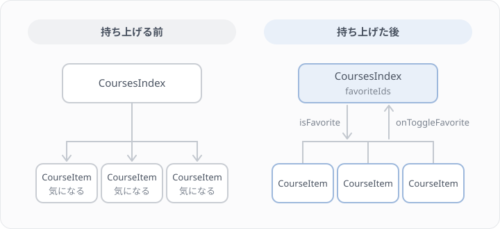
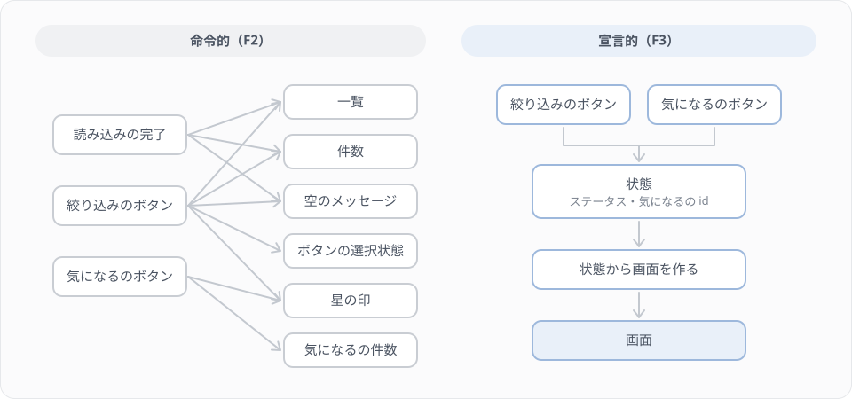

# F3 React で宣言的に書き直す

## 学習目標

F2 では、素の JavaScript で講座一覧にステータスの絞り込み、件数、空のときの表示、「気になる」の印を足しました。機能を足すたびに「どの DOM を、いつ書き換えるか」を自分で管理する必要があり、書き換え忘れると表示がずれました。

このレッスンでは、同じ4つの機能を React で書き直します。React では、DOM をどう書き換えるかを書く代わりに、「この状態のときは、画面はこうなる」とだけ書きます。最後に F2 のコードと並べて、何が減り、なぜ表示がずれなくなるのかを確かめます。

### 到達目標
- JSX の決まり（`className`、`{}` に書けるのは式、親要素は1つ）を守ってページを書ける
- useState で状態を持ち、ボタンのクリックで状態を変えて、画面を描き直させられる
- リストに key を付ける理由と、`&&` で 0 が表示されてしまう理由を説明できる
- 子のコンポーネントから親へイベントを伝え、複数の部品で使う状態を親に持ち上げられる
- 状態から計算できる値を state にしない、state を直接書き換えない、という2つの決まりを守れる

## このレッスンで作るもの

画面の見た目と機能は F2 と同じです。違うのは、データを受け取ったあとの表示の部分だけを React で書くことです。

F2 では、ページを開いたあとに `fetch` で講座の一覧を取ってきました。このレッスンでは、Laravel が講座の一覧をページに渡す形にします。このプロジェクトの画面は Inertia で作られていて、コントローラーが渡した値を、React のコンポーネントが props（コンポーネントの引数）として受け取ります。どちらも「講座の配列を1回だけ受け取り、あとは手元の配列を相手に表示を変える」点は同じなので、比べるのは受け取ったあとのコードです。

作るファイルは次の4つです。

| ファイル | 中身 |
|---|---|
| routes/web.php | 講座一覧のページを開くための仮のルート（F4 でコントローラーに置き換える） |
| resources/js/types/course.ts | 講座の型 |
| resources/js/lib/course-filter.ts | 絞り込みと件数を計算する関数 |
| resources/js/pages/courses/index.tsx | 講座一覧のページ |

Step 1〜2 でページを表示し、JSX の決まりを確かめます。Step 3〜5 で絞り込み、件数、空のときの表示を作り、Step 6〜7 で「気になる」の印を作りながら、部品の分け方と状態の置き場所を考えます。Step 8 で React では書かなくてよいコードを確かめ、Step 9 で F2 と比べます。

## Step 1 仮のルートとページを用意する

### 仮のルートを足す

講座一覧のページを開くためのルートを `routes/web.php` に足します。ログインしている人だけが見られるよう、ダッシュボードと同じ `auth`・`verified` のグループに入れます。

`routes/web.php`

```php
<?php

declare(strict_types=1);

use App\Http\Resources\CourseResource;
use App\Mail\AttendanceConfirmation;
use App\Models\Attendance;
use App\Models\Course;
use Illuminate\Support\Facades\Route;
use Inertia\Inertia;
use Laravel\Fortify\Features;

Route::get('/', function () {
    return Inertia::render('welcome', [
        'canRegister' => Features::enabled(Features::registration()),
    ]);
})->name('home');

Route::middleware(['auth', 'verified'])->group(function () {
    Route::get('dashboard', function () {
        return Inertia::render('dashboard');
    })->name('dashboard');

    // F3 の仮のルート（F4 でコントローラーに置き換えます）
    Route::get('courses', function () {
        return Inertia::render('courses/index', [
            'courses' => CourseResource::collection(Course::orderBy('id')->get()),
        ]);
    })->name('courses.index');
});

require __DIR__.'/settings.php';

// 開発環境のみ: 受講確認メールのプレビュー（Lesson 17）
if (app()->environment('local')) {
    Route::get('/mail-preview/attendance', function () {
        $attendance = Attendance::with(['user', 'course'])->first();

        return new AttendanceConfirmation($attendance);
    });
}
```

> 補足: 最後の `/mail-preview/attendance` は、Lesson 17 で足したルートです。自分のファイルに足したものが違っていれば、自分のものを残し、`use` 文2つと `courses` のルートだけを足してください。

`Inertia::render('courses/index', [...])` は、`resources/js/pages/courses/index.tsx` のコンポーネントを、2つめの引数の配列を props として描画する、という意味です。API のコントローラーが `return CourseResource::collection(...)` で JSON を返していたのに対し、こちらはページを返します。

渡している `CourseResource::collection(...)` は、Lesson 9 で作った講座一覧 API と同じ形の配列です。ページでは `courses.data` に講座の配列が入って届きます。`data` で包まれる理由は F4 で説明します。

コントローラーを作らずにルートに関数を書いているのは、このレッスンの主役がページのほうだからです。F4 で `App\Http\Controllers\Web\CourseController` を作り、このルートを置き換えます。

### 講座の型を写す

このプロジェクトの画面は TypeScript で書かれていて、型を付けないとエディタに赤線が出て、型の検査も落ちます。F1 で見た型注釈の書き方で、講座の型を用意します。中身は CourseResource が返す JSON と同じ形です。

`resources/js/types/course.ts`

```ts
export type CourseStatus = 'draft' | 'active' | 'closed';

export type Course = {
    id: number;
    title: string;
    description: string | null;
    instructor?: { id: number; name: string; email: string };
    capacity: number;
    remaining_seats?: number;
    status: CourseStatus;
    status_label: string;
    starts_at: string;
    attendances_count?: number;
    created_at: string;
};
```

`'draft' | 'active' | 'closed'` は「この3つの文字列のどれか」、`string | null` は「文字列か null」、`instructor?:` の `?` は「このキーはないこともある」という意味です。PHP の `?string` や enum に近いものだと思って、いまは写して使ってください。型の考え方は F5 でまとめて学びます。

### ページを作る

`resources/js/pages/courses/index.tsx` を新しく作ります。まずは講座の一覧を表示するだけです。

`resources/js/pages/courses/index.tsx`

```tsx
import type { Course } from '@/types/course';
import { Head } from '@inertiajs/react';

type CoursesPageProps = {
    courses: { data: Course[] };
};

export default function CoursesIndex({ courses }: CoursesPageProps) {
    return (
        <>
            <Head title="講座一覧" />
            <div className="flex flex-col gap-4 p-4">
                <h1 className="text-xl font-semibold">講座一覧</h1>

                <ul className="grid gap-2">
                    {courses.data.map((course) => (
                        <li key={course.id} className="rounded-lg border p-4">
                            <span className="font-medium">{course.title}</span>
                            <span className="ml-2 text-sm text-muted-foreground">
                                {course.status_label}
                            </span>
                        </li>
                    ))}
                </ul>
            </div>
        </>
    );
}
```

React のコンポーネントは、大文字で始まる名前の関数です。引数で props を受け取り、画面の形を返します。`{ courses }: CoursesPageProps` は、F1 で見た分割代入に型注釈を付けたもので、「props の中の `courses` を取り出す。props の形は `CoursesPageProps`」という意味です。

`<Head title="講座一覧" />` は Inertia の部品で、ブラウザのタブに出るタイトルを変えます。

ログインした状態で http://localhost:8000/courses を開き、講座の一覧が表示されることを確かめてください。React Developer Tools の Components タブで `CoursesIndex` を選ぶと、props の `courses.data` に講座の配列が入っているのが見えます。

> 補足: 「Unable to locate file in Vite manifest」と出たら、Vite の開発サーバーが止まっています。F0 の Step 4 を見て起動してください。

## Step 2 JSX の決まりを確かめる

`return` の中の HTML のような部分を JSX と呼びます。見た目は HTML ですが、中身は JavaScript の式で、ビルドのときに関数の呼び出しに変換されます。そのため、HTML と違う決まりがいくつかあります。Step 1 のコードで1つずつ確かめます。

1つめは、属性の名前です。`class` は JavaScript の予約語なので、JSX では `className` と書きます。`onclick` のようなイベントも `onClick` のようにキャメルケースで書きます。

2つめは、`{}` の中に JavaScript の式を書けることです。`{course.title}` は講座のタイトルを、その場所に文字として入れます。`{}` に書けるのは値になる「式」だけで、`if` 文や `for` 文は書けません。そこで、配列を一覧にするときは `for` の代わりに `map` を使います（F1 で見た配列のメソッドです）。`map` は講座1件ごとに `<li>` を返し、その `<li>` の配列が画面に並びます。

3つめは、`return` で返せる要素は1つだけ、という決まりです。Step 1 では `<Head>` と `<div>` の2つを返したいので、`<>` と `</>` で包んでいます。これはフラグメントと呼ばれる、画面には何も出ない入れ物です。ほかに、`<li>` や `<br />` のように閉じタグのない要素も、JSX では必ず閉じる必要があります。

`map` で作った `<li>` に付けている `key={course.id}` は、React が「どの `<li>` がどの講座のものか」を見分けるための目印です。key の役割は Step 6 で、実際に間違えてみて確かめます。

### 画面は状態から作る

F2 では、最初に一覧を表示したあと、ボタンが押されるたびに「件数の要素の文字を書き換える」「空のメッセージの hidden を外す」のように、変わる場所を1つずつ書き換えました。

React のコンポーネントは、それとは考え方が違います。コンポーネントは、props と state（このあと使う、コンポーネントが持つ状態）を受け取って、画面の形を返す関数です。状態が変わると React はこの関数をもう一度呼び、返ってきた画面の形と、いま表示している画面とを比べて、違うところだけを DOM に反映します。DOM を書き換えるコードは React が受け持つので、私たちが書くのは「この状態のときの画面」だけになります。

## Step 3 絞り込みと件数を関数にする

ボタンを作る前に、「ステータスで絞り込む」「ステータスごとに数える」計算を、画面と関係のない関数として書いておきます。

`resources/js/lib/course-filter.ts`

```ts
import type { Course, CourseStatus } from '@/types/course';

/**
 * 選んだステータスの講座だけを返す（'all' ならすべて）
 */
export function filterCourses(
    courses: Course[],
    status: CourseStatus | 'all',
): Course[] {
    if (status === 'all') {
        return courses;
    }

    return courses.filter((course) => course.status === status);
}

/**
 * ステータスごとの講座の数を数える
 */
export function countByStatus(courses: Course[]): Record<CourseStatus, number> {
    const counts: Record<CourseStatus, number> = {
        draft: 0,
        active: 0,
        closed: 0,
    };

    for (const course of courses) {
        counts[course.status] += 1;
    }

    return counts;
}
```

`Record<CourseStatus, number>` は、「キーが `draft`・`active`・`closed` で、値が数値のオブジェクト」という型です。`countByStatus` は、たとえば `{ draft: 1, active: 4, closed: 1 }` を返します。

どちらの関数も、同じ引数を渡せば必ず同じ値を返し、引数の配列を書き換えず、画面にも触りません。このような関数を純粋な関数と呼びます。純粋な関数は、ブラウザを開かなくても `node --test` で動きを確かめられます（クリア判定でもそうしています）。

1行目の `import type` は、型だけを読み込む書き方です。型は実行するときには消えるので、この関数のファイルは、ほかのファイルを1つも読み込まずに動きます。判定で node から直接読み込めるよう、`lib/course-filter.ts` には `import type` 以外の `import` を書かないでください。

## Step 4 useState で絞り込みを作る

絞り込みのボタンを作ります。どのボタンが選ばれているかは、ボタンを押すたびに変わる値なので、state として持ちます。ページ全体を次の内容に書き換えてください。

`resources/js/pages/courses/index.tsx`

```tsx
import { Button } from '@/components/ui/button';
import { countByStatus, filterCourses } from '@/lib/course-filter';
import type { Course, CourseStatus } from '@/types/course';
import { Head } from '@inertiajs/react';
import { useState } from 'react';

type StatusOption = CourseStatus | 'all';

const statusOptions: { value: StatusOption; label: string }[] = [
    { value: 'all', label: 'すべて' },
    { value: 'draft', label: '下書き' },
    { value: 'active', label: '公開中' },
    { value: 'closed', label: '終了' },
];

type CoursesPageProps = {
    courses: { data: Course[] };
};

export default function CoursesIndex({ courses }: CoursesPageProps) {
    const [status, setStatus] = useState<StatusOption>('all');

    const visibleCourses = filterCourses(courses.data, status);
    const counts = countByStatus(courses.data);

    return (
        <>
            <Head title="講座一覧" />
            <div className="flex flex-col gap-4 p-4">
                <h1 className="text-xl font-semibold">講座一覧</h1>

                <div className="flex gap-2">
                    {statusOptions.map((option) => {
                        const count =
                            option.value === 'all'
                                ? courses.data.length
                                : counts[option.value];

                        return (
                            <Button
                                key={option.value}
                                variant={
                                    option.value === status
                                        ? 'default'
                                        : 'outline'
                                }
                                size="sm"
                                onClick={() => setStatus(option.value)}
                            >
                                {option.label}（{count}）
                            </Button>
                        );
                    })}
                </div>

                <p className="text-sm text-muted-foreground">
                    {visibleCourses.length} 件
                </p>

                <ul className="grid gap-2">
                    {visibleCourses.map((course) => (
                        <li key={course.id} className="rounded-lg border p-4">
                            <span className="font-medium">{course.title}</span>
                            <span className="ml-2 text-sm text-muted-foreground">
                                {course.status_label}
                            </span>
                        </li>
                    ))}
                </ul>
            </div>
        </>
    );
}
```

ボタンを押すと、選んだボタンの色が変わり、件数と一覧がそのステータスの講座だけになることを確かめてください。

### useState

```tsx
const [status, setStatus] = useState<StatusOption>('all');
```

`useState` は、コンポーネントに状態を持たせる関数です。引数の `'all'` が最初の値で、戻り値は「いまの値」と「値を変える関数」の2つを並べた配列です。F1 で見た配列の分割代入で、それぞれ `status` と `setStatus` という名前を付けています。`<StatusOption>` は、この state に入る値の型です。

`setStatus('active')` を呼ぶと、React は `status` が `'active'` の状態で `CoursesIndex` の関数をもう一度呼びます。これを再描画と呼びます。もう一度呼ばれた関数の中では、`filterCourses(courses.data, 'active')` が計算し直され、ボタンの色、件数、一覧がすべて新しい `status` に合った形で返ります。

ふつうの変数（`let status = 'all'`）を書き換えても、画面は変わりません。React に「状態が変わったので描き直してほしい」と伝えるのが `setStatus` の役割です。また、`setStatus` を呼んだ直後に `status` を読んでも、まだ古い値のままです。新しい値が入るのは、次に関数が呼ばれたときです。

### イベント

```tsx
onClick={() => setStatus(option.value)}
```

`onClick` には、クリックされたときに呼んでほしい関数を渡します。ここで `onClick={setStatus(option.value)}` と書くと、関数を渡すのではなく、描画している最中に `setStatus` を呼んでしまいます。呼ぶたびに再描画が起き、再描画のたびにまた呼ぶので、React は「Too many re-renders」というエラーで止まります。引数を付けて呼びたいときは、`() => ...` のアロー関数で包んで渡します。

`Button` は `resources/js/components/ui/button.tsx` にある既製の部品です。`variant` で見た目を切り替えられるので、選ばれているボタンだけを `'default'`（塗りつぶし）にしています。

## Step 5 空のときの表示を作る

ステータスによっては、講座が1件もないことがあります。そのときは一覧の代わりに「条件に合う講座はありません。」と表示します。

JSX の `{}` には `if` 文を書けないので、条件で表示を変えるときは、式の形の書き方を使います。2つのうちどちらかを出すときは、三項演算子が向いています。Step 4 の `<ul>` の部分を、次のように書き換えてください。

`resources/js/pages/courses/index.tsx`

```tsx
{visibleCourses.length === 0 ? (
    <p>条件に合う講座はありません。</p>
) : (
    <ul className="grid gap-2">
        {visibleCourses.map((course) => (
            <li key={course.id} className="rounded-lg border p-4">
                <span className="font-medium">{course.title}</span>
                <span className="ml-2 text-sm text-muted-foreground">
                    {course.status_label}
                </span>
            </li>
        ))}
    </ul>
)}
```

下書きや終了の講座がない場合は、空のときの表示を確かめにくいかもしれません。F0 の `make seed-frontend` を実行していれば、下書きと終了の講座が1件ずつ入っています。確かめたいときは、`filterCourses(courses.data, status)` の `courses.data` を、一時的に `[]` に書き換えてみてください。

### && と 0 の罠

「条件に合うときだけ出し、合わなければ何も出さない」ときは、`&&` を使う書き方がよく使われます。

```tsx
{visibleCourses.length > 0 && <p>{visibleCourses.length} 件見つかりました</p>}
```

ここで `> 0` を省いて `{visibleCourses.length && ...}` と書くと、講座が0件のときに画面に `0` とだけ表示されます。試しに、Step 4 の件数の `<p>` を次のように書き換えてみてください。

```tsx
{visibleCourses.length && (
    <p className="text-sm text-muted-foreground">
        {visibleCourses.length} 件
    </p>
)}
```

練習用のデータでは、どのステータスにも講座が1件以上あるので、ボタンを押しても0件にはなりません。上の空のときの表示と同じく、`filterCourses(courses.data, status)` の `courses.data` を一時的に `[]` に書き換えて、件数の場所に `0` が出ることを確かめてください。

F1 で見たとおり、`A && B` は、A が falsy ならその A を、そうでなければ B を返します。0件のときは `0 && ...` が `0` になります。React は `false`・`null`・`undefined` を受け取ると何も表示しませんが、数値の `0` は文字として表示します。そのため、`0` だけが画面に残ります。

`&&` の左には、`> 0` や `=== 0` のように、必ず true か false になる式を書いてください。確かめたら、件数の `<p>` を Step 4 の形に戻し、`[]` も `courses.data` に戻します。

## Step 6 部品に分けて「気になる」を付ける

### 部品に分ける

「気になる」のボタンを付ける前に、ページを部品に分けます。絞り込みのボタンの並びを `StatusFilter`、講座1件の行を `CourseItem` というコンポーネントにします。ページ全体を次の内容に書き換えてください。

`resources/js/pages/courses/index.tsx`

```tsx
import { Button } from '@/components/ui/button';
import { countByStatus, filterCourses } from '@/lib/course-filter';
import type { Course, CourseStatus } from '@/types/course';
import { Head } from '@inertiajs/react';
import { useState } from 'react';

type StatusOption = CourseStatus | 'all';

const statusOptions: { value: StatusOption; label: string }[] = [
    { value: 'all', label: 'すべて' },
    { value: 'draft', label: '下書き' },
    { value: 'active', label: '公開中' },
    { value: 'closed', label: '終了' },
];

type CoursesPageProps = {
    courses: { data: Course[] };
};

export default function CoursesIndex({ courses }: CoursesPageProps) {
    const [status, setStatus] = useState<StatusOption>('all');

    const visibleCourses = filterCourses(courses.data, status);
    const counts = countByStatus(courses.data);

    return (
        <>
            <Head title="講座一覧" />
            <div className="flex flex-col gap-4 p-4">
                <h1 className="text-xl font-semibold">講座一覧</h1>

                <StatusFilter
                    selected={status}
                    counts={counts}
                    total={courses.data.length}
                    onChange={setStatus}
                />

                <p className="text-sm text-muted-foreground">
                    {visibleCourses.length} 件
                </p>

                {visibleCourses.length === 0 ? (
                    <p>条件に合う講座はありません。</p>
                ) : (
                    <ul className="grid gap-2">
                        {visibleCourses.map((course) => (
                            <CourseItem key={course.id} course={course} />
                        ))}
                    </ul>
                )}
            </div>
        </>
    );
}

type StatusFilterProps = {
    selected: StatusOption;
    counts: Record<CourseStatus, number>;
    total: number;
    onChange: (status: StatusOption) => void;
};

function StatusFilter({
    selected,
    counts,
    total,
    onChange,
}: StatusFilterProps) {
    return (
        <div className="flex gap-2">
            {statusOptions.map((option) => {
                const count =
                    option.value === 'all' ? total : counts[option.value];

                return (
                    <Button
                        key={option.value}
                        variant={
                            option.value === selected ? 'default' : 'outline'
                        }
                        size="sm"
                        onClick={() => onChange(option.value)}
                    >
                        {option.label}（{count}）
                    </Button>
                );
            })}
        </div>
    );
}

type CourseItemProps = {
    course: Course;
};

function CourseItem({ course }: CourseItemProps) {
    const [isFavorite, setIsFavorite] = useState(false);

    return (
        <li className="flex items-center justify-between rounded-lg border p-4">
            <div>
                <span className="font-medium">{course.title}</span>
                <span className="ml-2 text-sm text-muted-foreground">
                    {course.status_label}
                </span>
            </div>
            <Button
                variant={isFavorite ? 'default' : 'outline'}
                size="sm"
                onClick={() => setIsFavorite(!isFavorite)}
            >
                {isFavorite ? '★ 気になる' : '☆ 気になる'}
            </Button>
        </li>
    );
}
```

部品にした `StatusFilter` と `CourseItem` は、ページと同じファイルに書いています。このページでしか使わない部品なので、いまはこれで十分です。別のファイルに分けるかどうかの判断は F6 で扱います。

`<StatusFilter selected={status} ... />` のように、部品に渡す値は HTML の属性と同じ形で書きます。部品の側では、それを props として受け取ります。

### 子から親へイベントを伝える

`StatusFilter` は、どのボタンが押されたかを知っていますが、`status` の state を持っているのはページ（`CoursesIndex`）です。子の部品が親の state を直接書き換えることはできません。そこで、親は「ボタンが押されたら呼んでほしい関数」を `onChange` という props で渡し、子はボタンが押されたときにその関数を呼びます。

```tsx
onClick={() => onChange(option.value)}
```

子から親へは、このように「親から受け取った関数を呼ぶ」ことで伝えます。親から子へは props で値を渡し、子から親へは関数の呼び出しで伝える、というのが React の部品どうしのやりとりの基本です。props の型の `onChange: (status: StatusOption) => void` は、「`StatusOption` を1つ受け取り、何も返さない関数」という意味です。`onChange` という名前は、`onClick` のような組み込みのイベントに合わせて、`on` で始めるのが慣例です。

### 「気になる」を部品の state で持つ

`CourseItem` は、自分の講座が「気になる」かどうかを `isFavorite` という state で持っています。ボタンを押すと印が `☆` と `★` で切り替わることを確かめてください。

### key を間違えてみる

ここで、Step 2 で後回しにした key の役割を確かめます。ページの `CourseItem` の key を、講座の id から、配列の何番目かを表す `index` に変えてみてください。

`resources/js/pages/courses/index.tsx`

```tsx
{visibleCourses.map((course, index) => (
    <CourseItem key={index} course={course} />
))}
```

一覧の1件目に「気になる」を付けてから、「下書き」のボタンを押します。1件目に付けたはずの `★` が、下書きの講座に付いて見えるはずです。

React は、再描画の前と後で同じ key の部品を「同じもの」とみなし、その部品の state を引き継ぎます。key が `index` だと、絞り込みで1件目の講座が入れ替わっても、key は同じ `0` のままです。そのため、1件目の `CourseItem` が持っていた `isFavorite` の state が、新しく1件目になった別の講座に引き継がれます。

key には、並び順が変わっても変わらない、データの id を使ってください。確かめたら `key={course.id}` に戻します。

## Step 7 状態を持ち上げる

`CourseItem` に state を持たせる形には、2つの問題があります。

1つめは、ページの側から「気になる」が何件あるかが分からないことです。F2 と同じく、件数の横に「（気になる 2 件）」と出したくても、印の state は `CourseItem` の1つ1つの中にあり、ページからは読めません。

2つめは、絞り込みで印が消えることです。1件目に印を付けてから「下書き」を押し、「すべて」に戻してみてください。印が消えています。絞り込みで一覧から外れた `CourseItem` は画面から取り除かれ、そのときに持っていた state も一緒に捨てられるためです。F2 の Step 5 で探した不具合で、行を作り直したときに★が消えたのと同じことが起きています。

どちらも、印の state を `CourseItem` から親のページに移すと解決します。複数の部品で使う state を、それらの共通の親に移すことを、状態の持ち上げと呼びます。



持ち上げた後は、ページが「気になる」講座の id の配列 `favoriteIds` を持ちます。`CourseItem` は、自分が気になるかどうかを `isFavorite` という props で受け取って表示するだけになり、ボタンが押されたら `onToggleFavorite` でページに伝えます。ページ全体を次の内容に書き換えてください。

`resources/js/pages/courses/index.tsx`

```tsx
import { Button } from '@/components/ui/button';
import { countByStatus, filterCourses } from '@/lib/course-filter';
import type { Course, CourseStatus } from '@/types/course';
import { Head } from '@inertiajs/react';
import { useState } from 'react';

type StatusOption = CourseStatus | 'all';

const statusOptions: { value: StatusOption; label: string }[] = [
    { value: 'all', label: 'すべて' },
    { value: 'draft', label: '下書き' },
    { value: 'active', label: '公開中' },
    { value: 'closed', label: '終了' },
];

type CoursesPageProps = {
    courses: { data: Course[] };
};

export default function CoursesIndex({ courses }: CoursesPageProps) {
    const [status, setStatus] = useState<StatusOption>('all');
    const [favoriteIds, setFavoriteIds] = useState<number[]>([]);

    const visibleCourses = filterCourses(courses.data, status);
    const counts = countByStatus(courses.data);

    function handleToggleFavorite(id: number) {
        setFavoriteIds((ids) =>
            ids.includes(id)
                ? ids.filter((favoriteId) => favoriteId !== id)
                : [...ids, id],
        );
    }

    return (
        <>
            <Head title="講座一覧" />
            <div className="flex flex-col gap-4 p-4">
                <h1 className="text-xl font-semibold">講座一覧</h1>

                <StatusFilter
                    selected={status}
                    counts={counts}
                    total={courses.data.length}
                    onChange={setStatus}
                />

                <p className="text-sm text-muted-foreground">
                    {visibleCourses.length} 件
                    {favoriteIds.length > 0 &&
                        `（気になる ${favoriteIds.length} 件）`}
                </p>

                {visibleCourses.length === 0 ? (
                    <p>条件に合う講座はありません。</p>
                ) : (
                    <ul className="grid gap-2">
                        {visibleCourses.map((course) => (
                            <CourseItem
                                key={course.id}
                                course={course}
                                isFavorite={favoriteIds.includes(course.id)}
                                onToggleFavorite={handleToggleFavorite}
                            />
                        ))}
                    </ul>
                )}
            </div>
        </>
    );
}

type StatusFilterProps = {
    selected: StatusOption;
    counts: Record<CourseStatus, number>;
    total: number;
    onChange: (status: StatusOption) => void;
};

function StatusFilter({
    selected,
    counts,
    total,
    onChange,
}: StatusFilterProps) {
    return (
        <div className="flex gap-2">
            {statusOptions.map((option) => {
                const count =
                    option.value === 'all' ? total : counts[option.value];

                return (
                    <Button
                        key={option.value}
                        variant={
                            option.value === selected ? 'default' : 'outline'
                        }
                        size="sm"
                        onClick={() => onChange(option.value)}
                    >
                        {option.label}（{count}）
                    </Button>
                );
            })}
        </div>
    );
}

type CourseItemProps = {
    course: Course;
    isFavorite: boolean;
    onToggleFavorite: (id: number) => void;
};

function CourseItem({ course, isFavorite, onToggleFavorite }: CourseItemProps) {
    return (
        <li className="flex items-center justify-between rounded-lg border p-4">
            <div>
                <span className="font-medium">{course.title}</span>
                <span className="ml-2 text-sm text-muted-foreground">
                    {course.status_label}
                </span>
            </div>
            <Button
                variant={isFavorite ? 'default' : 'outline'}
                size="sm"
                onClick={() => onToggleFavorite(course.id)}
            >
                {isFavorite ? '★ 気になる' : '☆ 気になる'}
            </Button>
        </li>
    );
}
```

印を付けると件数の横に「（気になる N 件）」が出ること、絞り込みを切り替えて戻しても印が残ることを確かめてください。印の state はページにあり、ページは絞り込みでは取り除かれないので、印も消えません。

件数の横の表示は、Step 5 で見たとおり `favoriteIds.length > 0 &&` と書いています。`> 0` を省くと、印が1つもないときに、件数の後ろに 0 が付いて「11 件0」のように表示されます。

### state を直接書き換えない

`handleToggleFavorite` は、`favoriteIds` の配列に id を足したり外したりしています。このとき、配列そのものを書き換えずに、新しい配列を作って `setFavoriteIds` に渡しています。

```tsx
setFavoriteIds((ids) =>
    ids.includes(id)
        ? ids.filter((favoriteId) => favoriteId !== id)
        : [...ids, id],
);
```

`filter` は条件に合う要素だけの新しい配列を返し、`[...ids, id]` はスプレッド構文で「元の要素に id を足した新しい配列」を作ります。どちらも元の `ids` は変えません。

`setFavoriteIds` には、新しい値の代わりに「いまの値を受け取って新しい値を返す関数」を渡せます。ここではその形を使い、関数の引数 `ids` で、その時点の最新の配列を受け取っています。

試しに、`handleToggleFavorite` を次のように書き換えて、印を付けてみてください。

```tsx
function handleToggleFavorite(id: number) {
    favoriteIds.push(id);
    setFavoriteIds(favoriteIds);
}
```

ボタンを押しても、印も件数も変わりません。F1 で見たとおり、JavaScript の配列は代入しても共有されるので、`push` は state の配列そのものを書き換えます。そのあと `setFavoriteIds` に渡しているのは同じ配列なので、React は前の値と比べて「同じものだから描き直さなくてよい」と判断します。React は、state が変わったかどうかを中身ではなく、同じ配列かどうか（参照）で比べるためです。

state の配列やオブジェクトは読むだけにして、変えるときは新しいものを作って set する、と覚えてください。確かめたら元のコードに戻します。

> 補足: この `push` の書き方は、Step 8 で使う ESLint のルールでも見つけられません。練習問題1で、この処理を純粋な関数に切り出し、`node --test` で確かめられるようにします。

## Step 8 書かなくてよいコードを知る

React を書き始めると、書かなくてよいコードを書いてしまうことがよくあります。このプロジェクトの ESLint と React Compiler に関係するものを3つ確かめます。

### 計算できる値を state にしない

絞り込んだ一覧 `visibleCourses` は、`courses.data` と `status` があれば計算できます。それを state にして、`status` が変わるたびに useEffect で計算し直す、という書き方を見かけることがあります。

```tsx
const [visibleCourses, setVisibleCourses] = useState(courses.data);

useEffect(() => {
    setVisibleCourses(filterCourses(courses.data, status));
}, [courses.data, status]);
```

useEffect は、描画が終わったあとに呼ばれる処理を登録する関数です。この書き方では、ボタンを押すと、まず古い `visibleCourses` のまま描画され、そのあと useEffect で新しい値が set されて、もう一度描画されます。描画が2回になるうえ、1回目は「ボタンは公開中なのに一覧はすべて」という食い違った画面になります。また、同じ情報を `status` と `visibleCourses` の2か所に持つことになり、片方だけ変えるバグの入り口になります。

このプロジェクトの ESLint（eslint-plugin-react-hooks の `set-state-in-effect` のルール）は、この書き方をエラーにします。試しにページに書いて、次のコマンドで確かめてみてください。

```bash
docker compose exec app npx eslint resources/js/pages/courses/index.tsx
```

`Calling setState synchronously within an effect can trigger cascading renders` というエラーが出ます。計算できる値は、Step 4 のように描画のたびに普通の変数として計算してください。useEffect が必要になるのは、React の外にあるもの（ブラウザの API、タイマー、外部のライブラリなど）と同期するときです。このページには、useEffect が必要な場面はありません。確かめたら元に戻します。

### useMemo と useCallback を書かない

以前の React では、描画のたびに重い計算をし直さないよう `useMemo` で結果を覚えさせたり、部品に渡す関数が毎回作り直されないよう `useCallback` で包んだりしていました。

```tsx
const visibleCourses = useMemo(
    () => filterCourses(courses.data, status),
    [courses.data, status],
);
```

このプロジェクトでは、`vite.config.ts` で React Compiler を有効にしています。React Compiler は、ビルドのときにコンポーネントを読み、値や関数を覚えておく処理を自動で入れます。そのため、このレッスンでも以降のレッスンでも、`useMemo` と `useCallback` は書きません。ほかのプロジェクトや古い記事でこれらを見かけたら、「React Compiler がない環境で、手で同じことをしている」と読んでください。

React Compiler は、コンポーネントが「描画中に state や props を書き換えない」といった React の決まりを守っている前提で動きます。決まりを破ったコードは、ESLint の react-hooks のルールで見つけられるものがあります。

### 開発中は2回呼ばれる

`resources/js/app.tsx` を開くと、アプリ全体が `<StrictMode>` で包まれています。

```tsx
root.render(
    <StrictMode>
        <App {...props} />
    </StrictMode>,
);
```

StrictMode は、開発中だけ働く確認の仕組みです。StrictMode の中では、React はコンポーネントの関数や、state を更新する関数（`setFavoriteIds` に渡した関数など）を、わざと2回呼びます。同じ入力で2回呼んでも同じ結果になるかを確かめ、描画中に何かを書き換えるコードを見つけやすくするためです。useEffect も、開発中は「登録、片付け、もう一度登録」の順に動きます。

試しに、`CoursesIndex` の関数の先頭（`useState` の行の下）に次の1行を足し、ブラウザのコンソールを開いてボタンを押してみてください。

```tsx
console.log('CoursesIndex を描画', status);
```

1回押すたびに、同じ出力が2回ずつ出ます（React Developer Tools を入れていると、2回目は薄い色で表示されます）。本番用のビルド（`npm run build`）では1回しか呼ばれません。開発中にログが2回出ても、バグではありません。確かめたら、足した1行を消してください。

## Step 9 F2 と比べる

F2 と F3 で、同じ機能を作るために書いたコードを比べます。



F2 では、ボタンが押されるたびに、変わる場所を自分で書き換えました。絞り込みのボタン1つでも、一覧、件数、空のメッセージ、ボタンの選択状態、星の印と、書き換える場所がいくつもあります。機能を1つ足すと、「この機能で変わる場所」と「この場所を変える機能」の両方を探して、書き換えのコードを足す必要がありました。

F3 では、ボタンが押されたときに書いたのは `setStatus` と `setFavoriteIds` だけです。一覧、件数、空のときの表示、印は、どれも JSX の中で `status` と `favoriteIds` から作っています。

| | F2（命令的） | F3（宣言的） |
|---|---|---|
| 状態 | 変数や DOM（クラスや文字）に散らばる | state にだけ持つ |
| ボタンを押したとき | 状態を変え、変わる場所の DOM を1つずつ書き換える | set で状態を変えるだけ |
| 機能を足すとき | 新しい表示を作り、その表示を変えるべきイベントすべてに書き換えを足す | JSX に「その状態のときの表示」を足す |

### 表示がずれるバグが起きない理由

F2 の Step 5 で探した不具合では、気になるを付けてから絞り込みを切り替えると、★は消えたのに「気になる 2件」が残りました。原因は2つありました。どの講座に気になるを付けたかを DOM のクラスにしか持っていなかったことと、絞り込みのときに気になるの件数を書き換えていなかったことです。命令的なコードでは、画面のどこかを書き換え忘れると、そこだけが古いまま残ります。F2 では、気になるの id を変数に持ち、一覧を作り直すたびに印と件数も書き直す形にして直しました。

F3 では、F2 で直した形が最初から React の決まりになっています。気になるの id は `favoriteIds` の state にだけあり、状態が変わるたびにコンポーネントの関数が最初から呼ばれて、一覧、印、件数がすべてそのときの state から作り直されます。「一部だけ古いまま残る」画面を作るコードが、そもそもありません。同じ理由で、Step 8 の useEffect で state を同期する書き方は、F2 と同じ「2か所に同じ情報を持つ」形に戻ってしまうので避けます。

### 行数を比べる

行数も数えてみます。

```bash
wc -l public/lessons/f2/app.js resources/js/pages/courses/index.tsx resources/js/lib/course-filter.ts
```

行数は、F3 のほうが少し多いか、ほぼ同じになるはずです。F3 には、F2 では index.html に書いていたマークアップ（JSX）と、型の定義が入っているためです。比べてほしいのは、表示を書き換えるためだけのコードです。F2 の app.js から、`textContent`、`hidden`、`classList` などで DOM を書き換えている行と、それを呼んでいる行を数えてみてください。F3 には、それに当たる行が1行もありません。

## 練習問題

### 問題1

Step 7 の `handleToggleFavorite` の中の、配列に id を足したり外したりする処理を、純粋な関数 `toggleFavorite` として `resources/js/lib/favorites.ts` に切り出してください。ページの `handleToggleFavorite` は、この関数を使う形に書き換えます。

- `toggleFavorite(favoriteIds: number[], id: number): number[]`
- `favoriteIds` に `id` が入っていれば外した配列を、入っていなければ末尾に足した配列を返す
- 引数の `favoriteIds` は書き換えず、新しい配列を返す

たとえば `toggleFavorite([1, 2], 3)` は `[1, 2, 3]` を、`toggleFavorite([1, 2, 3], 2)` は `[1, 3]` を返します。このファイルにも、`import type` 以外の `import` は書かないでください。

<details>
<summary>解答例</summary>

`resources/js/lib/favorites.ts`

```ts
/**
 * id が入っていれば外し、入っていなければ足した新しい配列を返す
 */
export function toggleFavorite(favoriteIds: number[], id: number): number[] {
    if (favoriteIds.includes(id)) {
        return favoriteIds.filter((favoriteId) => favoriteId !== id);
    }

    return [...favoriteIds, id];
}
```

ページでは、`import { toggleFavorite } from '@/lib/favorites';` を足して、`handleToggleFavorite` を次のように書き換えます。

`resources/js/pages/courses/index.tsx`

```tsx
function handleToggleFavorite(id: number) {
    setFavoriteIds((ids) => toggleFavorite(ids, id));
}
```

`toggleFavorite` は元の配列を書き換えないので、`push` で書いてしまうバグを、ブラウザを開かずに `node --test` で見つけられるようになります。
</details>

### 問題2

一覧の上に「気になるだけ表示」のチェックボックスを足してください。F2 の練習問題1と同じ機能です。チェックを入れると、ステータスの絞り込みに加えて、「気になる」を付けた講座だけが表示されます。気になる講座が1件もなければ、Step 5 の「条件に合う講座はありません。」が出ます。

> ヒント: チェックボックスの状態（チェックが入っているか）は state で持ちます。表示する一覧は、`filterCourses` の結果をさらに絞り込んだ値として、描画のたびに計算します。state にするのはチェックの有無だけで、絞り込んだ一覧は state にしません。チェックボックスは `<input type="checkbox" checked={...} onChange={(event) => ...} />` の形で書き、`event.target.checked` でチェックの有無を読めます。

<details>
<summary>解答例</summary>

`CoursesIndex` に state を1つ足し、表示する一覧の計算を変えます。

`resources/js/pages/courses/index.tsx`

```tsx
const [onlyFavorites, setOnlyFavorites] = useState(false);

const filteredCourses = filterCourses(courses.data, status);
const visibleCourses = onlyFavorites
    ? filteredCourses.filter((course) => favoriteIds.includes(course.id))
    : filteredCourses;
```

`StatusFilter` の下に、チェックボックスを足します。

`resources/js/pages/courses/index.tsx`

```tsx
<label className="flex items-center gap-2 text-sm">
    <input
        type="checkbox"
        checked={onlyFavorites}
        onChange={(event) => setOnlyFavorites(event.target.checked)}
    />
    気になるだけ表示
</label>
```

`visibleCourses` は `status`・`onlyFavorites`・`favoriteIds` から計算できるので、state にはしません。気になるだけを表示しているときに印を外すと、その講座はすぐ一覧から消えます。これも、描画のたびに state から一覧を作り直しているためです。
</details>

## クリア判定

ここまでできたら、次のコマンドでクリアしたかを確かめましょう。

```bash
make quest-f3
```

メインのミッションは、次の4つです。

- ログインして `/courses`（`courses.index` のルート）を開くと、`courses/index` のページが講座の一覧（`courses.data`）を受け取って表示されること（Step 1）
- `resources/js/lib/course-filter.ts` の `filterCourses` と `countByStatus` が、ステータスで絞り込み、ステータスごとに数えられること（Step 3）
- 型の検査（`tsc`）が通ること
- ページと `course-filter.ts` が ESLint のルール（react-hooks のルールを含む）に、警告も含めて違反していないこと

練習問題1の `toggleFavorite` はサイドのミッションです。最後に ⬜ で並ぶセルフチェックは、`&&` で 0 が表示されるのを見たこと（Step 5）、key を `index` にして印がずれるのを見たこと（Step 6）、StrictMode でログが2回出るのを見たこと（Step 8）、F2 と比べたこと（Step 9）、練習問題2のチェックボックスです。

## 参考資料

- [React 公式ドキュメント - UI の記述（JSX、条件付きレンダー、リストのレンダー）](https://ja.react.dev/learn/describing-the-ui)
- [React 公式ドキュメント - state：コンポーネントのメモリ](https://ja.react.dev/learn/state-a-components-memory)
- [React 公式ドキュメント - コンポーネント間で state を共有する](https://ja.react.dev/learn/sharing-state-between-components)
- [React 公式ドキュメント - state 内の配列の更新](https://ja.react.dev/learn/updating-arrays-in-state)
- [React 公式ドキュメント - エフェクトは必要ないかもしれない](https://ja.react.dev/learn/you-might-not-need-an-effect)
- [React 公式ドキュメント - React Compiler](https://ja.react.dev/learn/react-compiler)
- [React 公式ドキュメント - StrictMode](https://ja.react.dev/reference/react/StrictMode)

## 次のレッスン

[F4 Inertia でページをつなぐ](./04-inertia.md) では、このレッスンの仮のルートをコントローラーに置き換え、URL のクエリでの絞り込み、講座を作るフォーム、サイドバーとパンくずを作って、ページどうしをつなぎます。
