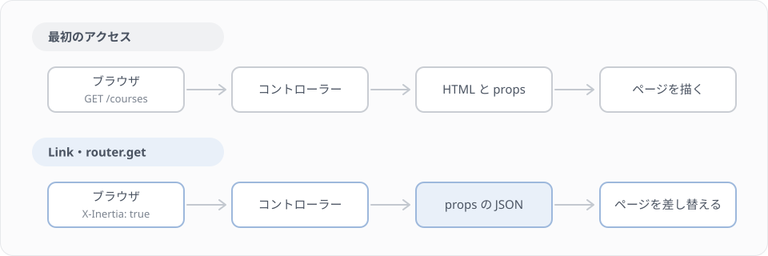

# F4 Inertia でページをつなぐ

## 学習目標

F3 では、仮のルートから講座の一覧を受け取り、React で表示しました。このレッスンでは、その仮のルートをコントローラーに置き換え、このプロジェクトの画面の作り方（Inertia）に沿って、ページどうしをつなぎます。

スターターキットのダッシュボードやログインのページは、最初から `<Link>`、`<Form>`、レイアウト、Wayfinder を使っています。このレッスンで、それぞれが何をしているのかを、自分でページを作りながら確かめます。

### 到達目標
- web のコントローラーから `Inertia::render` で props を渡し、ページで受け取れる
- JsonResource を props に渡すと `data` で包まれて届く理由を説明できる
- `router.get` と URL のクエリで絞り込み、`preserveState` で手元の state を残せる
- `<Form>` と Wayfinder でフォームを作り、FormRequest のエラーをフォームに表示できる
- 共有 props の `auth.user` を使って、講師にだけリンクを出せる
- 業務例外を catch して `back()->withErrors()` にする理由を説明できる

## このレッスンで作るもの

講座一覧のページを仕上げ、講師が講座を作るページを足します。

| メソッド | URL | 名前 | コントローラー |
|---|---|---|---|
| GET | /courses | courses.index | Web\CourseController@index |
| GET | /courses/create | courses.create | Web\CourseController@create |
| POST | /courses | courses.store | Web\CourseController@store |

コントローラーは `app/Http/Controllers/Web` に置きます。バックエンドで作った `Api\CourseController` と名前が同じなので、ディレクトリ（名前空間）で分けておきます。

Step 1 で仮のルートをコントローラーに置き換え、Step 2 でレイアウトとサイドバーにつなぎます。Step 3 で URL のクエリを使った絞り込みに変え、Step 4〜5 で講座を作るページと、そのエラーの表示を作ります。

### Inertia のページの開き方

作り始める前に、Inertia がページを開くときの流れを確かめておきます。



ブラウザのアドレスバーに URL を入れて開いたときは、Laravel が HTML を返します。この HTML には、どのページのコンポーネントを、どんな props で描くかが JSON で埋め込まれていて、React がそれを読んでページを描きます。

いったんページが開いたあとに、`<Link>` や `router.get` でほかのページへ移るときは、ブラウザは画面全体を読み込み直しません。Inertia が `X-Inertia: true` というヘッダーを付けたリクエストを送り、Laravel は HTML の代わりに「コンポーネントの名前と props」の JSON だけを返します。Inertia はその JSON で、表示中のページのコンポーネントを差し替えます。

どちらの場合も、コントローラーのコードは同じ `Inertia::render(...)` です。HTML で返すか JSON で返すかは、Inertia がリクエストのヘッダーを見て決めます。

## Step 1 コントローラーに置き換える

### コントローラーを作る

```bash
docker compose exec app php artisan make:controller Web/CourseController
```

`app/Http/Controllers/Web/CourseController.php` を次の内容にします。

`app/Http/Controllers/Web/CourseController.php`

```php
<?php

declare(strict_types=1);

namespace App\Http\Controllers\Web;

use App\Enums\AttendanceStatus;
use App\Http\Controllers\Controller;
use App\Http\Resources\CourseResource;
use App\Models\Course;
use Inertia\Inertia;
use Inertia\Response;

class CourseController extends Controller
{
    /**
     * 講座一覧の画面
     */
    public function index(): Response
    {
        $courses = Course::with('instructor')
            ->withCount(['attendances' => fn ($query) => $query->where('status', AttendanceStatus::Attending)])
            ->orderBy('id')
            ->get();

        return Inertia::render('courses/index', [
            'courses' => CourseResource::collection($courses),
        ]);
    }
}
```

F3 の仮のルートとの違いは、`with('instructor')` と `withCount(...)` を足したところです。どちらも、Lesson 16 で講座一覧 API に書いたものと同じです。

CourseResource の `instructor` は `whenLoaded`、`remaining_seats` と `attendances_count` は `whenCounted` で書かれていて、読み込んでいないときはキーごと JSON から消えます（Lesson 10・16）。web のコントローラーでも、API と同じように `with` と `withCount` を書かないと、ページには講師の名前も残席も届きません。F3 で写した `Course` の型で、`instructor?:` と `remaining_seats?:` に `?` が付いていたのは、このためです。

戻り値の型の `Inertia\Response` は、`Inertia::render()` が返すものの型です。API のコントローラーが `JsonResponse` や JsonResource を返していたのに対し、web のコントローラーはページを返します。

### ルートを置き換える

`routes/web.php` の F3 の仮のルートを、コントローラーを呼ぶ形に置き換えます。F3 で足した `CourseResource` と `Course` の `use` 文は使わなくなるので消し、代わりに `CourseController` の `use` 文を足します。

`routes/web.php`

```php
use App\Http\Controllers\Web\CourseController;

Route::middleware(['auth', 'verified'])->group(function () {
    Route::get('dashboard', function () {
        return Inertia::render('dashboard');
    })->name('dashboard');

    Route::get('courses', [CourseController::class, 'index'])->name('courses.index');
});
```

`routes/api.php` にも `CourseController` を `use` していますが、そちらは `App\Http\Controllers\Api\CourseController` です。`routes/web.php` では `Web` のほうを `use` していることを確かめてください。

### props の形を確かめる

http://localhost:8000/courses を開き、F3 と同じ一覧が表示されることを確かめます。React Developer Tools で `CoursesIndex` の props を見ると、`courses` は次の形になっています。

```json
{
    "data": [
        {
            "id": 1,
            "title": "React 入門",
            "instructor": { "id": 2, "name": "Test User 2", "full_name": "Test User 2さん", "email": "test2@example.com", "created_at": "..." },
            "capacity": 20,
            "remaining_seats": 19,
            "status": "active",
            "status_label": "公開中",
            "attendances_count": 1,
            "...": "..."
        }
    ]
}
```

講座の配列が、`data` というキーの中に入っています。これは Lesson 4 で見た API のレスポンスと同じ形です。`CourseResource::collection()` が作るのはリソースのコレクションで、Inertia はそれを props にするとき、API のレスポンスにするときと同じ変換（`data` で包む）をかけます。そのため、ページの props の型も `courses: { data: Course[] }` と書いていました。

API の講座一覧ではページネーション（`paginate`）を使っていたので、`data` のほかに `links` と `meta` も付いていました。ここでは `get()` で全件を取っているので、`data` だけです。

### 講師の名前と残席を表示する

届くようになった講師の名前と残席を、一覧に表示します。`CourseItem` を次のように書き換えてください。

`resources/js/pages/courses/index.tsx`

```tsx
function CourseItem({ course, isFavorite, onToggleFavorite }: CourseItemProps) {
    return (
        <li className="flex items-center justify-between rounded-lg border p-4">
            <div className="flex flex-col gap-1">
                <div>
                    <span className="font-medium">{course.title}</span>
                    <span className="ml-2 text-sm text-muted-foreground">
                        {course.status_label}
                    </span>
                </div>
                <div className="flex gap-3 text-sm text-muted-foreground">
                    <span>講師 {course.instructor?.name}</span>
                    <span>残り {course.remaining_seats} 席</span>
                </div>
            </div>
            <Button
                variant={isFavorite ? 'default' : 'outline'}
                size="sm"
                onClick={() => onToggleFavorite(course.id)}
            >
                {isFavorite ? '★ 気になる' : '☆ 気になる'}
            </Button>
        </li>
    );
}
```

`course.instructor?.name` の `?.` は、F1 で見たオプショナルチェーンです。`instructor` がないときは、エラーにならずに `undefined` になり、画面には何も出ません。

試しに、コントローラーの `with('instructor')` を消して一覧を開き直してみてください。講師の名前が空になります。エラーにはならないので、気付きにくい間違いです。確かめたら元に戻します。

## Step 2 レイアウトとサイドバーにつなぐ

### レイアウトとパンくず

いまの講座一覧は、ダッシュボードにあるサイドバーやヘッダーがない、ページだけの画面です。ダッシュボードと同じく、`AppLayout` で包みます。`resources/js/pages/dashboard.tsx` と同じ書き方です。

`resources/js/pages/courses/index.tsx` の `import` に2行足し、パンくずの定義を足します。

`resources/js/pages/courses/index.tsx`

```tsx
import AppLayout from '@/layouts/app-layout';
import { index } from '@/routes/courses';
import type { BreadcrumbItem } from '@/types';

const breadcrumbs: BreadcrumbItem[] = [
    {
        title: '講座一覧',
        href: index().url,
    },
];
```

`breadcrumbs` は、ファイルの上のほう（`statusOptions` の下）に置きます。そして、`CoursesIndex` の `return` の一番外側の `<>` と `</>` を、`<AppLayout breadcrumbs={breadcrumbs}>` と `</AppLayout>` に置き換えます。

`resources/js/pages/courses/index.tsx`

```tsx
return (
    <AppLayout breadcrumbs={breadcrumbs}>
        <Head title="講座一覧" />
        {/* ここから下は、これまでの <div> のまま */}
    </AppLayout>
);
```

一覧を開き直すと、サイドバーとヘッダーが付き、ヘッダーに「講座一覧」のパンくずが出ます。`AppLayout` は `resources/js/layouts/app-layout.tsx` にある部品で、`children`（タグで挟んだ中身）をサイドバー付きの枠の中に表示します。`breadcrumbs` は、ヘッダーに出すパンくずの配列です。

### Wayfinder で URL を作る

`index().url` は、Wayfinder が作った関数で `/courses` という URL を作っています。Wayfinder は、`routes/web.php` のルートの名前 `courses.index` から、`@/routes/courses` の `index` という関数を生成します（F0 の Step 5）。

URL を `'/courses'` と文字列で書かずに Wayfinder の関数を使うと、ルートの URL を変えたときに、ページの側を直し忘れることがなくなります。ルートを消したり名前を変えたりすると、関数が生成されなくなり、型の検査（`npm run types`）が落ちて気付けます。Blade で `route('courses.index')` と書いていたのと同じ考え方です。

### サイドバーに足す

サイドバーから講座一覧へ移れるようにします。サイドバーの項目は `resources/js/components/app-sidebar.tsx` の `mainNavItems` に並んでいます。`import` に1行足し、アイコンの `import` に `GraduationCap` を足して、`mainNavItems` に講座一覧を足します。

`resources/js/components/app-sidebar.tsx`

```tsx
import { dashboard } from '@/routes';
import { index as coursesIndex } from '@/routes/courses';
import { type NavItem } from '@/types';
import { Link } from '@inertiajs/react';
import { BookOpen, Folder, GraduationCap, LayoutGrid } from 'lucide-react';
import AppLogo from './app-logo';

const mainNavItems: NavItem[] = [
    {
        title: 'Dashboard',
        href: dashboard(),
        icon: LayoutGrid,
    },
    {
        title: '講座一覧',
        href: coursesIndex(),
        icon: GraduationCap,
    },
];
```

`index` という名前はほかの画面でも使われそうなので、`as coursesIndex` で別の名前を付けて読み込んでいます。

サイドバーの「講座一覧」と「Dashboard」を交互に押してみてください。ページが切り替わっても、ブラウザは画面全体を読み込み直しません。サイドバーの項目は、スターターキットの `NavMain`（`resources/js/components/nav-main.tsx`）の中で、Inertia の `<Link>` を使って描かれているためです。

デベロッパーツールの Network タブを開いてもう一度押すと、`courses` へのリクエストのヘッダーに `X-Inertia: true` が付き、レスポンスが HTML ではなく JSON になっていることが分かります。このページの冒頭の図の、下の流れです。

> 補足: `<Link>` は、クリックされると画面全体を読み込み直す代わりに、Inertia のリクエストを送る `<a>` タグです。ページの中で別のページへのリンクを書くときは、`<a href>` ではなく `<Link href>` を使います。`<a href>` で書くと、移るたびに HTML、JavaScript、CSS をすべて読み込み直します。

## Step 3 URL のクエリで絞り込む

### いまの絞り込みの困るところ

F3 の絞り込みは、ボタンで選んだステータスを state に持っています。この形には、Web のページとして困るところがあります。「公開中」を選んでからページを再読み込みすると、「すべて」に戻ります。「公開中」の一覧を見ている URL を人に送っても、相手には「すべて」が表示されます。ブラウザの戻るボタンでも、前の絞り込みには戻れません。

選んでいるステータスを `/courses?status=active` のように URL のクエリに入れると、これらが解決します。ここでは、Lesson 9 の講座一覧 API と同じく、サーバーで絞り込む形にします。

### コントローラーで絞り込む

`index` を次のように書き換えます。ファイル全体を載せます。

`app/Http/Controllers/Web/CourseController.php`

```php
<?php

declare(strict_types=1);

namespace App\Http\Controllers\Web;

use App\Enums\AttendanceStatus;
use App\Enums\CourseStatus;
use App\Http\Controllers\Controller;
use App\Http\Resources\CourseResource;
use App\Models\Course;
use Illuminate\Http\Request;
use Inertia\Inertia;
use Inertia\Response;

class CourseController extends Controller
{
    /**
     * 講座一覧の画面
     */
    public function index(Request $request): Response
    {
        // ?status=active のような値を CourseStatus に変える（なければ、正しくなければ null）
        $status = $request->enum('status', CourseStatus::class);

        $courses = Course::with('instructor')
            ->withCount(['attendances' => fn ($query) => $query->where('status', AttendanceStatus::Attending)])
            ->when($status, fn ($query) => $query->where('status', $status))
            ->orderBy('id')
            ->get();

        return Inertia::render('courses/index', [
            'courses' => CourseResource::collection($courses),
            'filters' => [
                'status' => $status?->value,
            ],
        ]);
    }
}
```

`$request->enum('status', CourseStatus::class)` は、クエリの `status` を CourseStatus の enum に変えて返します。`?status=active` なら `CourseStatus::Active`、クエリがないときや `?status=published` のような正しくない値のときは `null` です。`when($status, ...)` は、`$status` が null でないときだけ、2つめの関数で条件を足します。

新しく渡している `filters` は、いまどのステータスで絞り込んでいるかを、ページに伝えるための props です。ページは、URL を自分で読む代わりに、この `filters.status` を見てボタンの色を決めます。

http://localhost:8000/courses?status=active を開くと、公開中の講座だけが届くことを React Developer Tools で確かめてください（ページの側はまだ直していないので、ボタンは「すべて」のままです）。

### ページで router.get を使う

ページを、ボタンが押されたら URL のクエリを変えてページを開き直す形に書き換えます。ページ全体を次の内容にしてください。Step 2 のレイアウトとパンくずも入っています。

`resources/js/pages/courses/index.tsx`

```tsx
import { Button } from '@/components/ui/button';
import AppLayout from '@/layouts/app-layout';
import { index } from '@/routes/courses';
import type { BreadcrumbItem } from '@/types';
import type { Course, CourseStatus } from '@/types/course';
import { Head, router } from '@inertiajs/react';
import { useState } from 'react';

type StatusOption = CourseStatus | 'all';

const statusOptions: { value: StatusOption; label: string }[] = [
    { value: 'all', label: 'すべて' },
    { value: 'draft', label: '下書き' },
    { value: 'active', label: '公開中' },
    { value: 'closed', label: '終了' },
];

const breadcrumbs: BreadcrumbItem[] = [
    {
        title: '講座一覧',
        href: index().url,
    },
];

type CoursesPageProps = {
    courses: { data: Course[] };
    filters: { status: CourseStatus | null };
};

export default function CoursesIndex({ courses, filters }: CoursesPageProps) {
    const [favoriteIds, setFavoriteIds] = useState<number[]>([]);

    const selected = filters.status ?? 'all';

    function handleChangeStatus(status: StatusOption) {
        router.get(index.url(), status === 'all' ? {} : { status }, {
            preserveState: true,
            preserveScroll: true,
        });
    }

    function handleToggleFavorite(id: number) {
        setFavoriteIds((ids) =>
            ids.includes(id)
                ? ids.filter((favoriteId) => favoriteId !== id)
                : [...ids, id],
        );
    }

    return (
        <AppLayout breadcrumbs={breadcrumbs}>
            <Head title="講座一覧" />
            <div className="flex flex-col gap-4 p-4">
                <h1 className="text-xl font-semibold">講座一覧</h1>

                <StatusFilter
                    selected={selected}
                    onChange={handleChangeStatus}
                />

                <p className="text-sm text-muted-foreground">
                    {courses.data.length} 件
                    {favoriteIds.length > 0 &&
                        `（気になる ${favoriteIds.length} 件）`}
                </p>

                {courses.data.length === 0 ? (
                    <p>条件に合う講座はありません。</p>
                ) : (
                    <ul className="grid gap-2">
                        {courses.data.map((course) => (
                            <CourseItem
                                key={course.id}
                                course={course}
                                isFavorite={favoriteIds.includes(course.id)}
                                onToggleFavorite={handleToggleFavorite}
                            />
                        ))}
                    </ul>
                )}
            </div>
        </AppLayout>
    );
}

type StatusFilterProps = {
    selected: StatusOption;
    onChange: (status: StatusOption) => void;
};

function StatusFilter({ selected, onChange }: StatusFilterProps) {
    return (
        <div className="flex gap-2">
            {statusOptions.map((option) => (
                <Button
                    key={option.value}
                    variant={option.value === selected ? 'default' : 'outline'}
                    size="sm"
                    onClick={() => onChange(option.value)}
                >
                    {option.label}
                </Button>
            ))}
        </div>
    );
}

type CourseItemProps = {
    course: Course;
    isFavorite: boolean;
    onToggleFavorite: (id: number) => void;
};

function CourseItem({ course, isFavorite, onToggleFavorite }: CourseItemProps) {
    return (
        <li className="flex items-center justify-between rounded-lg border p-4">
            <div className="flex flex-col gap-1">
                <div>
                    <span className="font-medium">{course.title}</span>
                    <span className="ml-2 text-sm text-muted-foreground">
                        {course.status_label}
                    </span>
                </div>
                <div className="flex gap-3 text-sm text-muted-foreground">
                    <span>講師 {course.instructor?.name}</span>
                    <span>残り {course.remaining_seats} 席</span>
                </div>
            </div>
            <Button
                variant={isFavorite ? 'default' : 'outline'}
                size="sm"
                onClick={() => onToggleFavorite(course.id)}
            >
                {isFavorite ? '★ 気になる' : '☆ 気になる'}
            </Button>
        </li>
    );
}
```

「公開中」を押すと、URL が `/courses?status=active` になり、一覧が公開中の講座だけになることを確かめてください。その状態で再読み込みしても、「公開中」のまま表示されます。

`router.get(url, data, options)` は、`<Link>` と同じく Inertia のリクエストを送ってページを開き直す関数です。2つめの引数のオブジェクトは、GET のときは URL のクエリになります。`{ status: 'active' }` を渡すと `/courses?status=active` を開き、「すべて」のときは空のオブジェクトを渡して `/courses` を開きます。

F3 から変わったところを確かめます。選んでいるステータスの `useState` がなくなりました。ステータスは URL に入り、サーバーが `filters.status` として返してくれるので、ページで state として持つ必要がなくなったためです。ボタンの色は `filters.status ?? 'all'` から決めています（`??` は F1 で見た、null のときに右の値を使う演算子です）。

もう1つ、`filterCourses` と `countByStatus` を使わなくなりました。絞り込みはサーバーで済んでいるので、届いた `courses.data` をそのまま表示すればよいからです。その代わり、ボタンの横のステータスごとの件数も出せなくなりました。サーバーで絞り込むと、手元には選んだステータスの講座しか届かないので、ほかのステータスの件数は数えられません。件数は F7 で、サーバーで数えた値を受け取って表示します。`lib/course-filter.ts` は消さずに残しておいてください（F3 の判定と、F6 で使います）。

手元で絞り込むか、サーバーで絞り込むかは、データの量で選びます。講座が数十件なら、F3 のように全部受け取って手元で絞り込むほうが、ボタンを押した瞬間に切り替わります。講座が増えて全部を一度に送れなくなったら（API ではページネーションを使っていました）、サーバーで絞り込むしかありません。このレッスンでは、URL に絞り込みを残すことと、実際の業務の画面に近い形にすることを優先して、サーバーで絞り込んでいます。

### preserveState

`router.get` の3つめの引数の `preserveState: true` は、ページを開き直しても、ページのコンポーネントの state を残す、という指定です。`preserveScroll: true` は、スクロールの位置を残す指定です。

試しに `preserveState: true` の行を消してから、講座に「気になる」を付けて、「公開中」を押してみてください。印が消えます。

Inertia は、ページを開き直すとき、何も指定しなければページのコンポーネントを新しく作り直します。作り直すと、`useState` の state は最初の値（`favoriteIds` なら空の配列）に戻ります。F3 の Step 6 で、絞り込みで一覧から外れた `CourseItem` の state が捨てられたのと同じことが、ページ全体で起きています。同じページの中で絞り込みを変えるだけなら、`preserveState: true` を付けて、作り直さずに props だけを差し替えさせます。確かめたら、消した行を戻してください。

> 補足: 「気になる」の印は、ページの state にしかありません。ページを再読み込みしたり、ブラウザの戻るボタンで戻ったりすると消えます。ログアウトしても残したい情報なら、URL かサーバー（データベース）に置く必要があります。

## Step 4 講座を作るページを作る

講師が講座を作るページを作ります。バックエンドの Lesson 9 で `POST /api/courses` を作り、Lesson 14 でその中身を `CreateCourse` に切り出しました。画面からの作成でも、同じ `Course\StoreRequest` と `CreateCourse` を使います。

### ルートとコントローラー

`routes/web.php` の講座一覧のルートの下に、2つ足します。

`routes/web.php`

```php
Route::get('courses', [CourseController::class, 'index'])->name('courses.index');
Route::get('courses/create', [CourseController::class, 'create'])->name('courses.create');
Route::post('courses', [CourseController::class, 'store'])->name('courses.store');
```

コントローラーに `create` と `store` を足します。まず、ファイルの先頭の `use` 文に3つ足します。

`app/Http/Controllers/Web/CourseController.php`

```php
use App\Http\Requests\Course\StoreRequest;
use App\Services\Course\CreateCourse;
use Illuminate\Http\RedirectResponse;
```

`index` の下に、2つのメソッドを足します。

`app/Http/Controllers/Web/CourseController.php`

```php
    /**
     * 講座作成の画面
     */
    public function create(): Response
    {
        $this->authorize('create', Course::class);

        return Inertia::render('courses/create');
    }

    /**
     * 講座を作成する
     */
    public function store(StoreRequest $request, CreateCourse $createCourse): RedirectResponse
    {
        $this->authorize('create', Course::class);

        $createCourse($request->validated(), $request->user());

        return redirect()->route('courses.index');
    }
```

`$this->authorize('create', Course::class)` は、Lesson 9 で作った `CoursePolicy::create`（講師だけ true）を呼びます。生徒が `/courses/create` を開くと 403 になります。

`store` では、API のコントローラーと違い、作った講座を JSON で返さずに、講座一覧へリダイレクトします。Inertia では、データを変える処理（POST・PUT・DELETE）のあとは、ページを返さずにリダイレクトするのが基本です。リダイレクト先のページ（ここでは講座一覧）が、作った講座を含めた最新の props で開き直されます。

`CreateCourse` は、Lesson 14 ではコンストラクタで受け取っていました。ここでは `store` の引数で受け取っています。Laravel は、コントローラーのメソッドの引数に書いたクラスも、コンストラクタと同じくサービスコンテナから作って渡してくれます。このコントローラーで `CreateCourse` を使うのは `store` だけなので、引数で受け取るほうが短く書けます。

### フォームのページ

`resources/js/pages/courses/create.tsx` を新しく作ります。

`resources/js/pages/courses/create.tsx`

```tsx
import CourseController from '@/actions/App/Http/Controllers/Web/CourseController';
import InputError from '@/components/input-error';
import { Button } from '@/components/ui/button';
import { Input } from '@/components/ui/input';
import { Label } from '@/components/ui/label';
import { Spinner } from '@/components/ui/spinner';
import AppLayout from '@/layouts/app-layout';
import { create, index } from '@/routes/courses';
import type { BreadcrumbItem } from '@/types';
import { Form, Head, Link } from '@inertiajs/react';

const breadcrumbs: BreadcrumbItem[] = [
    {
        title: '講座一覧',
        href: index().url,
    },
    {
        title: '講座を作る',
        href: create().url,
    },
];

export default function CoursesCreate() {
    return (
        <AppLayout breadcrumbs={breadcrumbs}>
            <Head title="講座を作る" />
            <div className="max-w-xl p-4">
                <h1 className="mb-6 text-xl font-semibold">講座を作る</h1>
                <Form
                    {...CourseController.store.form()}
                    className="flex flex-col gap-6"
                >
                    {({ processing, errors }) => (
                        <>
                            <div className="grid gap-2">
                                <Label htmlFor="title">タイトル</Label>
                                <Input id="title" name="title" required />
                                <InputError message={errors.title} />
                            </div>

                            <div className="grid gap-2">
                                <Label htmlFor="description">説明</Label>
                                <textarea
                                    id="description"
                                    name="description"
                                    rows={4}
                                    className="rounded-md border border-input bg-transparent px-3 py-2 text-sm"
                                />
                                <InputError message={errors.description} />
                            </div>

                            <div className="grid gap-2">
                                <Label htmlFor="capacity">定員</Label>
                                <Input
                                    id="capacity"
                                    name="capacity"
                                    type="number"
                                    required
                                />
                                <InputError message={errors.capacity} />
                            </div>

                            <div className="grid gap-2">
                                <Label htmlFor="status">ステータス</Label>
                                <select
                                    id="status"
                                    name="status"
                                    defaultValue="draft"
                                    className="h-9 rounded-md border border-input bg-transparent px-3 text-sm"
                                >
                                    <option value="draft">下書き</option>
                                    <option value="active">公開中</option>
                                    <option value="closed">終了</option>
                                </select>
                                <InputError message={errors.status} />
                            </div>

                            <div className="grid gap-2">
                                <Label htmlFor="starts_at">開始日時</Label>
                                <Input
                                    id="starts_at"
                                    name="starts_at"
                                    type="datetime-local"
                                    required
                                />
                                <InputError message={errors.starts_at} />
                            </div>

                            <div className="flex items-center gap-4">
                                <Button type="submit" disabled={processing}>
                                    {processing && <Spinner />}
                                    作成する
                                </Button>
                                <Link
                                    href={index()}
                                    className="text-sm text-muted-foreground underline"
                                >
                                    一覧に戻る
                                </Link>
                            </div>
                        </>
                    )}
                </Form>
            </div>
        </AppLayout>
    );
}
```

講師（test2@example.com）でログインし、http://localhost:8000/courses/create を開いて講座を作ってみてください。作成すると講座一覧に戻り、作った講座が一覧の最後に出ます。

### `<Form>` と Wayfinder

`<Form>` は Inertia のフォームの部品です。中の入力欄の `name` と値を集めて、Inertia のリクエストとして送ります。入力欄の値を state で持つ必要はありません。ログインのページ（`resources/js/pages/auth/login.tsx`）も同じ書き方です。

`{...CourseController.store.form()}` の `CourseController` は、Wayfinder が `app/Http/Controllers/Web/CourseController.php` から生成した `@/actions/App/Http/Controllers/Web/CourseController` です。`store.form()` は `{ action: '/courses', method: 'post' }` を返し、`{...}` のスプレッド構文で `<Form action="/courses" method="post">` と書いたのと同じになります。

Wayfinder の関数には、ルートの名前から作る `@/routes/courses`（`index`、`create`）と、コントローラーから作る `@/actions/...`（`CourseController.store` など）の2種類があります。中身は同じルートを指しているので、どちらを使っても構いません。このレッスンでは、ページへのリンクにはルートの名前、フォームの送り先にはコントローラーのメソッドを使っています。

`<Form>` の中身は、`{({ processing, errors }) => (...)}` という関数で書きます。Inertia は送信の状態に合わせてこの関数を呼び直し、`processing`（送信中なら true）と `errors`（サーバーから返ったエラー）を渡します。送信中はボタンを無効にし、エラーがあれば入力欄の下に出しています。

### FormRequest のエラーを表示する

定員に `200` を入れて送信してみてください。定員の下にエラーメッセージが出ます。`Course\StoreRequest` の `'capacity' => ['required', 'integer', 'min:1', 'max:100']` に違反したためです。入力した値は消えずに残っています。

API では、バリデーションに失敗すると 422 と JSON のエラーが返りました。Inertia のリクエストでは、Laravel はエラーをセッションに入れて、送信元のページにリダイレクトします。Inertia はリダイレクト先のページを開くとき、セッションのエラーを `errors` という props で渡し、`<Form>` はそれを `errors.capacity` のように受け取ります。コントローラーにもページにも、エラーを受け渡すコードを書いていないのは、このためです。

### 講師にだけリンクを出す

最後に、講座一覧に「講座を作る」へのリンクを出します。講座を作れるのは講師だけなので、生徒には出しません。

ログインしているユーザーは、どのページでも `auth.user` という props で受け取れます。`app/Http/Middleware/HandleInertiaRequests.php` の `share()` で、すべてのページに渡しているためです（共有 props と呼びます）。F0 の Step 6 で、ダッシュボードの props に `auth.user` があるのを見ました。

```php
'auth' => [
    'user' => $request->user(),
],
```

`auth.user` は User モデルを JSON にしたものなので、Lesson 7 で足した `role`（`'student'` か `'instructor'`）も入っています。

`resources/js/pages/courses/index.tsx` の `import` を3か所変えます。

`resources/js/pages/courses/index.tsx`

```tsx
import { create, index } from '@/routes/courses';
import type { BreadcrumbItem, SharedData } from '@/types';
import { Head, Link, router, usePage } from '@inertiajs/react';
```

`CoursesIndex` の先頭で共有 props を受け取ります。

`resources/js/pages/courses/index.tsx`

```tsx
const { auth } = usePage<SharedData>().props;
```

見出しの `<h1>` を、見出しとリンクを横に並べる形に書き換えます。

`resources/js/pages/courses/index.tsx`

```tsx
<div className="flex items-center justify-between">
    <h1 className="text-xl font-semibold">講座一覧</h1>
    {auth.user.role === 'instructor' && (
        <Button asChild size="sm">
            <Link href={create()}>講座を作る</Link>
        </Button>
    )}
</div>
```

`usePage()` は、いま表示しているページの情報を返す Inertia の関数で、`.props` で共有 props も含めたすべての props を読めます。ページのコンポーネントの引数で受け取るのはそのページだけの props（`courses`、`filters`）で、共有 props は `usePage()` で受け取る、と使い分けます。`SharedData` は、共有 props の型です（`resources/js/types/index.d.ts`）。

`<Button asChild>` は、ボタンの見た目で中の `<Link>` を表示する、という指定です。

講師でログインすると「講座を作る」が出て、押すと作成のページへ移ることを確かめてください。生徒（test@example.com）でログインし直すと、リンクは出ません。

リンクを隠しても、生徒が URL を直接入れれば `/courses/create` は開けてしまいます。そのときに 403 を返しているのは、コントローラーの `authorize` です。操作してよいかはバックエンドで確かめ、画面では使える操作だけを見せるようにします。

> 補足: `SharedData` の `User` の型には、まだ `role` がありません。`auth.user.role` の型は `unknown`（何が入っているか分からない値）になりますが、`=== 'instructor'` で比べるだけならエラーになりません。F5 で、`User` の型に `role` を足します。

## Step 5 業務例外をフォームのエラーにする

### 業務例外がモーダルになる

講師の test2@example.com には、練習用のデータで「React 入門」という講座があります。講座を作るページで、タイトルに「React 入門」と入れて、ほかの欄も埋めて送信してみてください。

ページの上に、次のメッセージと JSON が書かれたモーダルが出ます。

```
All Inertia requests must receive a valid Inertia response, however a plain JSON response was received.
{"message":"同じタイトルの講座が既に存在します。","error_code":"DUPLICATE_COURSE_TITLE"}
```

Lesson 14 で、`CreateCourse` は同じ講師に同じタイトルの講座があると `DuplicateCourseTitleException` を投げるようにしました。この例外の親の `BusinessException` には `render()` があり、API 向けに 422 の JSON を返します。

Inertia のリクエストには、Inertia の応答（ページの JSON）かリダイレクトを返す決まりです。それ以外の応答が返ると、Inertia は開発中に原因を見られるよう、届いた中身をそのままモーダルに表示します。ここでは `render()` の JSON が返ったので、「Inertia の応答ではなく、ただの JSON が返ってきた」というメッセージになっています。

FormRequest のバリデーションのエラー（ValidationException）では、こうなりませんでした。Laravel は、JSON を求めていないリクエストのバリデーションエラーを、自動でエラー付きのリダイレクトにするためです。業務例外は自分で作った例外なので、自分でリダイレクトに変える必要があります。

### catch して back()->withErrors() にする

`store` で業務例外を catch し、エラーメッセージ付きで元のページへ戻します。コントローラーのファイル全体を載せます。

`app/Http/Controllers/Web/CourseController.php`

```php
<?php

declare(strict_types=1);

namespace App\Http\Controllers\Web;

use App\Enums\AttendanceStatus;
use App\Enums\CourseStatus;
use App\Exceptions\BusinessException;
use App\Http\Controllers\Controller;
use App\Http\Requests\Course\StoreRequest;
use App\Http\Resources\CourseResource;
use App\Models\Course;
use App\Services\Course\CreateCourse;
use Illuminate\Http\RedirectResponse;
use Illuminate\Http\Request;
use Inertia\Inertia;
use Inertia\Response;

class CourseController extends Controller
{
    /**
     * 講座一覧の画面
     */
    public function index(Request $request): Response
    {
        // ?status=active のような値を CourseStatus に変える（なければ、正しくなければ null）
        $status = $request->enum('status', CourseStatus::class);

        $courses = Course::with('instructor')
            ->withCount(['attendances' => fn ($query) => $query->where('status', AttendanceStatus::Attending)])
            ->when($status, fn ($query) => $query->where('status', $status))
            ->orderBy('id')
            ->get();

        return Inertia::render('courses/index', [
            'courses' => CourseResource::collection($courses),
            'filters' => [
                'status' => $status?->value,
            ],
        ]);
    }

    /**
     * 講座作成の画面
     */
    public function create(): Response
    {
        $this->authorize('create', Course::class);

        return Inertia::render('courses/create');
    }

    /**
     * 講座を作成する
     */
    public function store(StoreRequest $request, CreateCourse $createCourse): RedirectResponse
    {
        $this->authorize('create', Course::class);

        try {
            $createCourse($request->validated(), $request->user());
        } catch (BusinessException $e) {
            return back()->withErrors(['title' => $e->getMessage()]);
        }

        return redirect()->route('courses.index');
    }
}
```

`back()->withErrors(['title' => ...])` は、バリデーションのエラーと同じ形で、エラーをセッションに入れて送信元のページへ戻します。そのため、ページの側は何も変えずに、`errors.title` としてタイトルの下にメッセージが出ます。

もう一度「React 入門」で送信し、タイトルの下に「同じタイトルの講座が既に存在します。」と出ることを確かめてください。講師の講座が10件に達するまで作ると、講座数の上限の `CourseLimitExceededException` も、同じくタイトルの下に出ます。

catch するのは `BusinessException` なので、`DuplicateCourseTitleException` と `CourseLimitExceededException` の両方を1か所で受け止められます。Lesson 14 で業務例外に共通の親クラスを作っておいたおかげです。また、`CreateCourse` の中身は1行も変えていません。API のコントローラーは例外を `render()` で JSON にし、web のコントローラーは catch してリダイレクトにする、という違いだけで、同じサービスクラスを API と画面の両方から使えています。

> 補足: API のコントローラーでは catch せず、`render()` に任せていました。API の利用者は JSON のエラーを受け取って自分で表示を決めるので、それで困らないためです。同じ例外でも、誰に返すかで返し方を変えています。

## 練習問題

### 問題1

講座を作ったあと、講座一覧に「講座を作りました。」というメッセージを出してください。メッセージは、作った直後に開いた講座一覧にだけ出て、再読み込みすると消えるようにします。

> ヒント: Inertia v3 の flash データを使います。コントローラーでリダイレクトの前に `Inertia::flash('message', '講座を作りました。')` を呼ぶと、次に開いたページにだけ、その値が届きます。ページでは `usePage()` の戻り値の `flash` で受け取れます。`flash.message` の型は `unknown` なので、表示するときは `typeof flash.message === 'string' &&` で文字列のときだけ表示します。

<details>
<summary>解答例</summary>

`store` のリダイレクトの前に1行足します。

`app/Http/Controllers/Web/CourseController.php`

```php
Inertia::flash('message', '講座を作りました。');

return redirect()->route('courses.index');
```

講座一覧のページでは、`usePage()` から `props` と `flash` の両方を受け取ります。

`resources/js/pages/courses/index.tsx`

```tsx
const { props, flash } = usePage<SharedData>();
const { auth } = props;
```

見出しの `<div>` の下に、メッセージを足します。

`resources/js/pages/courses/index.tsx`

```tsx
{typeof flash.message === 'string' && (
    <p className="rounded-md bg-green-50 p-3 text-sm text-green-700">
        {flash.message}
    </p>
)}
```

flash データは、共有 props と違って、ブラウザの履歴にも残りません。戻るボタンでこのページに戻っても、メッセージはもう一度出ません。
</details>

### 問題2

Step 3 の絞り込みのボタンを、`router.get` を呼ぶボタンから、`<Link>` で書き換えてください。見た目と動き（URL のクエリ、気になるの印が残ること）は変えません。`<Link>` にすると、ボタンが本物のリンク（`<a href>`）になるので、Cmd キーを押しながらクリックすると新しいタブで開けるようになります。

> ヒント: Wayfinder の関数は、`index({ query: { status: 'active' } })` のようにクエリを付けた URL を作れます。`<Link>` にも `preserveState` と `preserveScroll` を付けられます。`<Button asChild>` で、ボタンの見た目のまま `<Link>` を表示できます（Step 4）。

<details>
<summary>解答例</summary>

`StatusFilter` を、`onChange` を受け取らない形に書き換えます。ページの `handleChangeStatus` は使わなくなるので消し、`<StatusFilter selected={selected} />` と呼びます。

`resources/js/pages/courses/index.tsx`

```tsx
type StatusFilterProps = {
    selected: StatusOption;
};

function StatusFilter({ selected }: StatusFilterProps) {
    return (
        <div className="flex gap-2">
            {statusOptions.map((option) => (
                <Button
                    key={option.value}
                    asChild
                    variant={option.value === selected ? 'default' : 'outline'}
                    size="sm"
                >
                    <Link
                        href={index({
                            query: {
                                status:
                                    option.value === 'all'
                                        ? undefined
                                        : option.value,
                            },
                        })}
                        preserveState
                        preserveScroll
                    >
                        {option.label}
                    </Link>
                </Button>
            ))}
        </div>
    );
}
```

`status` に `undefined` を渡すと、Wayfinder はそのクエリを URL に付けないので、「すべて」は `/courses` になります。`import` の `router` は使わなくなるので消してください。
</details>

## クリア判定

ここまでできたら、次のコマンドでクリアしたかを確かめましょう。

```bash
make quest-f4
```

メインのミッションは次のとおりです。

- `courses.index` が `Web\CourseController` で `courses/index` のページを返し、講座に講師（`instructor`）と残席（`remaining_seats`）が入っていること（Step 1）
- `?status=active` で公開中の講座だけが返り、`filters.status` に選んだステータスが入ること。正しくない値やクエリなしのときは全件で、`filters.status` が null になること（Step 3）
- 講師は `courses.create` で `courses/create` のページを開け、生徒は 403 になること（Step 4）
- 講師が `courses.store` に送ると講座ができて講座一覧へリダイレクトし、入力が正しくなければ `title` などのエラーが返ること。生徒は 403 になること（Step 4）
- 同じタイトルや講座数の上限のときに、JSON ではなく、`title` のエラー付きのリダイレクトが返ること（Step 5）
- 型の検査（`tsc`）が通り、2つのページとサイドバーが ESLint のルールに違反していないこと

練習問題1の flash のメッセージはサイドのミッションです。最後に ⬜ で並ぶセルフチェックは、サイドバーとパンくずから講座一覧へ移れること（Step 2）、`preserveState` を消すと「気になる」が消えるのを見たこと（Step 3）、講師にだけ「講座を作る」が出ること（Step 4）、catch しないとエラーのモーダルが出るのを見たこと（Step 5）、練習問題2の `<Link>` の絞り込みです。

## 参考資料

- [Inertia.js 公式ドキュメント - Pages](https://inertiajs.com/docs/v3/the-basics/pages)
- [Inertia.js 公式ドキュメント - Responses](https://inertiajs.com/docs/v3/the-basics/responses)
- [Inertia.js 公式ドキュメント - Links](https://inertiajs.com/docs/v3/the-basics/links)
- [Inertia.js 公式ドキュメント - Manual Visits（State Preservation）](https://inertiajs.com/docs/v3/the-basics/manual-visits)
- [Inertia.js 公式ドキュメント - Forms](https://inertiajs.com/docs/v3/the-basics/forms)
- [Inertia.js 公式ドキュメント - Validation](https://inertiajs.com/docs/v3/the-basics/validation)
- [Inertia.js 公式ドキュメント - Shared Data](https://inertiajs.com/docs/v3/data-props/shared-data)
- [Inertia.js 公式ドキュメント - Flash Data](https://inertiajs.com/docs/v3/data-props/flash-data)
- [Laravel Wayfinder](https://github.com/laravel/wayfinder)

## 次のレッスン

[F5 TypeScript で画面を守る](./05-typescript.md) では、F3・F4 で写して使ってきた講座の型や、`auth.user.role` の型を見直し、ありえない値を書けないようにします。
