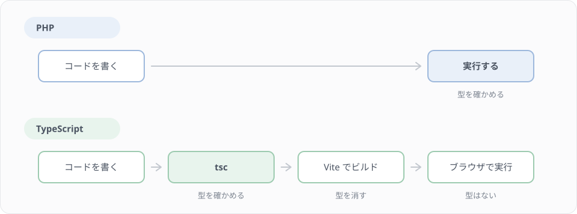
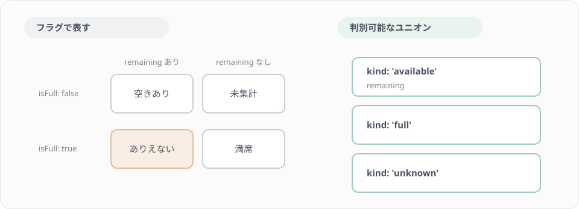

# F5 TypeScript で画面を守る

## 学習目標

F3 では、講座の型（resources/js/types/course.ts）を本文から写して作り、F4 までそのまま使ってきました。このレッスンでは、その型を自分で読み解き、API の形と見比べて書き直します。題材は、バックエンドで作った CourseResource と AttendanceResource が返す JSON です。JSON の形を見て型を書き、型が画面をどこまで守ってくれて、どこから先は守ってくれないのかを、PHP の型宣言と比べながら確かめます。

### 到達目標
- JsonResource が返す JSON を見て型を書き、null になる値とキーごとなくなる値を書き分けられる
- ステータスのような決まった値をユニオン型で表し、判別可能なユニオンでありえない状態を作れなくできる
- 共有 props の User に role を足し、Wayfinder の型が何を確かめてくれるかを説明できる
- any を使わない理由を説明し、代わりに具体的な型や unknown を選べる

## このレッスンで作るもの

| ファイル | 中身 |
|---|---|
| resources/js/types/course.ts（F3 で写したものを書き直す） | 講座の型（CourseStatus、UserSummary、Course、CourseStats） |
| resources/js/types/attendance.ts（新規） | 受講の型（AttendanceStatus、Attendance） |
| resources/js/lib/course-seats.ts（新規） | 残席の状態を表す型と、表示の文を作る関数 |
| resources/js/types/index.d.ts（変更） | 共有 props の User に role を足す |
| resources/js/pages/courses/index.tsx（変更） | 残席の表示を、course-seats.ts の関数に置き換える |

Step 1 で PHP の型との違いを確かめ、Step 2〜4 で API の形を型にします。Step 5・6 では型を使ってありえない値やありえない状態を防ぎ、Step 7・8 で Wayfinder の型と any の扱いを見ます。

## Step 1 PHP の型と TypeScript の型の違い

バックエンドでは、`declare(strict_types=1)` と型宣言を付けて PHP を書いてきました。

```php
public function store(Request $request, Course $course): JsonResponse
```

PHP の型宣言は、実行したときに確かめられます。int を受け取る関数に文字列を渡すと、その行を実行した時点で TypeError になります。

TypeScript の型は、実行する前に tsc（TypeScript のコンパイラ）が確かめます。Vite がブラウザ向けにビルドするときには型をすべて取り除くので、ブラウザで動く JavaScript には型が残りません。



この違いから、TypeScript の型について2つのことが言えます。

1つ目は、間違いを早く見つけられることです。PHP では、その行を通るテストを書くか、実際に動かすまで型の間違いに気付けません。TypeScript なら、ファイルを保存した時点でエディタが赤線を出し、`npm run types`（中身は `tsc --noEmit`）でプロジェクト全体を確かめられます。

2つ目は、型は「データがこの形で届く」という約束にすぎないことです。サーバーから届いた JSON が型と違っていても、ブラウザでは誰も止めてくれません。たとえば API の応答から `remaining_seats` を消しても、画面の型を直さなければ tsc は通り、画面には「残り 席」のように数の抜けた表示が出ます。そのため、型は API が実際に返す形に合わせて書き、API を変えたら型も直します。このレッスンのクリア判定でも、CourseResource が実際に返す JSON と、みなさんが書いた型を照らし合わせます。

PHP と TypeScript の書き方を並べると、次のようになります。

| 意味 | PHP | TypeScript |
|---|---|---|
| null かもしれない文字列 | `?string` | `string \| null` |
| 決まった値のどれか | `enum CourseStatus: string` | `'draft' \| 'active' \| 'closed'` |
| 何が入っているか分からない値 | `mixed` | `unknown` |
| 型を確かめない | 型宣言を書かない | `any` |
| 厳しく確かめる設定 | `declare(strict_types=1)` | tsconfig.json の `"strict": true` |

このプロジェクトの tsconfig.json は、最初から `"strict": true` です。null かもしれない値をそのまま使う書き方や、型の分からない引数は、すべてエラーになります。

## Step 2 Course の型を書く

### API が返す JSON を見る

型を書く前に、CourseResource が実際に返す JSON を見ます。`make app` でコンテナに入り、次のコマンドを実行してください。

```bash
php artisan tinker --execute 'echo json_encode(App\Http\Resources\CourseResource::make(App\Models\Course::with("instructor")->withCount("attendances")->first()), JSON_PRETTY_PRINT | JSON_UNESCAPED_UNICODE);'
```

次のような JSON が表示されます（値は環境によって違います）。

```json
{
    "id": 1,
    "title": "React 入門",
    "description": "フロントエンド編の練習用の講座です。",
    "instructor": {
        "id": 2,
        "name": "Test User 2",
        "full_name": "Test User 2さん",
        "email": "test2@example.com",
        "created_at": "2026-11-07 15:20:36"
    },
    "capacity": 20,
    "remaining_seats": 19,
    "status": "active",
    "status_label": "公開中",
    "starts_at": "2026-12-07 10:00:00",
    "attendances_count": 1,
    "created_at": "2026-11-07 15:20:36"
}
```

続けて、`with("instructor")` と `withCount("attendances")` を付けずに実行してみてください。

```bash
php artisan tinker --execute 'echo json_encode(App\Http\Resources\CourseResource::make(App\Models\Course::first()), JSON_PRETTY_PRINT | JSON_UNESCAPED_UNICODE);'
```

今度は `instructor`、`remaining_seats`、`attendances_count` の3つのキーが、JSON から丸ごと消えます。CourseResource では、この3つを `whenLoaded()` と `whenCounted()` で出しているためです（Lesson 10 の練習問題、Lesson 16）。

### null と「キーがない」を書き分ける

JSON の値が「ない」ことには、2つの形があります。

| JSON の形 | TypeScript の型 | PHP の側の理由 |
|---|---|---|
| キーはあり、値が `null`（`"description": null`） | `description: string \| null` | null を許すカラム |
| キーそのものがない | `instructor?: UserSummary` | `whenLoaded()`・`whenCounted()` |

プロパティ名の後ろの `?` は「このキーはないことがある」という意味で、値の型は `UserSummary | undefined` になります。`?` の付いたプロパティを確かめずに使うと、tsc がエラーにします。

```text
error TS18048: 'course.remaining_seats' is possibly 'undefined'.
```

`remaining_seats` を計算に使ったり、メソッドを呼んだりすると、このエラーが出ます。型が「この値はないことがある」と教えてくれているので、ないときにどうするかを決めて書きます。直し方は Step 6 で扱います。

### types/course.ts を書き直す

F3 で写した `resources/js/types/course.ts` を開き、さきほどの JSON と見比べてください。ほとんど同じですが、`instructor` が `{ id: number; name: string; email: string }` になっていて、JSON にある `full_name` と `created_at` が抜けています。画面では講師の名前しか使わないので今まで困りませんでしたが、型は API の形とずれていました。

ファイルの中身を、次のものに置き換えます。

`resources/js/types/course.ts`

```ts
export type CourseStatus = 'draft' | 'active' | 'closed';

export type UserSummary = {
    id: number;
    name: string;
    full_name: string;
    email: string;
    created_at: string;
};

export type Course = {
    id: number;
    title: string;
    description: string | null;
    instructor?: UserSummary;
    capacity: number;
    remaining_seats?: number;
    status: CourseStatus;
    status_label: string;
    starts_at: string;
    attendances_count?: number;
    created_at: string;
};

export type CourseStats = Record<CourseStatus, number>;
```

上から順に説明します。

`CourseStatus` は、3つの文字列のどれかだけを取るユニオン型です。PHP の `enum CourseStatus` と同じ役割で、`'published'` のような値を入れると型エラーになります。TypeScript にも `enum` はありますが、API から届くのはただの文字列なので、文字列をそのまま扱えるユニオン型を使います。

`UserSummary` は、UserResource（Lesson 4）が返すユーザーの形で、講師（`instructor`）の型として使います。F3 では `instructor` の中に型を直接書いていましたが、Step 3 の受講の型でも同じ形を使うので、名前を付けて取り出しました。共有 props の `auth.user`（スターターキットの `User` 型）とは中身が違います。`auth.user` はモデルをそのまま配列にしたもので `role` や `email_verified_at` を含み、UserResource は `full_name` を足して `role` を出していません。同じ「ユーザー」でも、届く形が違えば別の型にします。

`Course` は、さきほどの JSON をそのまま型にしたもので、F3 の型から変わったのは `instructor` だけです。`description` は null を許すカラムなので `string | null`、`instructor`・`remaining_seats`・`attendances_count` はキーごとなくなるので `?` を付けます。`starts_at` は Lesson 10 で NOT NULL にしたカラムなので `string` です。

`CourseStats` の `Record<CourseStatus, number>` は、「CourseStatus のどの値もキーに持ち、値はすべて number」という型です。`{ draft: number; active: number; closed: number }` と書いたのと同じで、F3 の `countByStatus()` が返す形でもあります。F7 で、サーバーから届く講座の数（統計）の型として使います。キーを1つでも書き忘れるとエラーになるので、CourseStatus に新しい値を足したときに、直し忘れた場所を tsc が教えてくれます。

> スターターキットの `resources/js/types/index.d.ts` は `interface User { ... }` のように interface で書かれています。オブジェクトの形を表すだけなら、type と interface のどちらでもかまいません。このレッスンでは、ユニオン型と書き方をそろえるために type を使います。

`Course` には、スターターキットの `User` にある `[key: string]: unknown`（どんな名前のキーでも許す書き方）を付けていません。これを付けると、`course.titel` のような打ち間違いも「中身の分からない値」として通ってしまいます。付けなければ、次のように打ち間違いをすぐに教えてくれます。

```text
error TS2551: Property 'titel' does not exist on type 'Course'. Did you mean 'title'?
```

## Step 3 Attendance の型を書く

受講の型も、JSON を見てから書きます。F0 の `make seed-frontend` で受講のデータが入っているはずです。

```bash
php artisan tinker --execute 'echo json_encode(App\Http\Resources\AttendanceResource::make(App\Models\Attendance::with(["user", "course.instructor"])->first()), JSON_PRETTY_PRINT | JSON_UNESCAPED_UNICODE);'
```

```json
{
    "id": 1,
    "user": {
        "id": 1,
        "name": "Test User",
        "full_name": "Test Userさん",
        "email": "test@example.com",
        "created_at": "2026-11-07 15:20:36"
    },
    "course": {
        "id": 3,
        "title": "Inertia でつくる画面（開始間近）",
        "description": "フロントエンド編の練習用の講座です。",
        "instructor": {
            "id": 2,
            "name": "Test User 2",
            "full_name": "Test User 2さん",
            "email": "test2@example.com",
            "created_at": "2026-11-07 15:20:36"
        },
        "capacity": 10,
        "status": "active",
        "status_label": "公開中",
        "starts_at": "2026-11-10 10:00:00",
        "created_at": "2026-11-07 15:20:36"
    },
    "status": "attending",
    "status_label": "受講中",
    "attended_at": "2026-11-07 15:20:37"
}
```

`course` の中に `remaining_seats` がないことに注目してください。受講の一覧では講座ごとの受講者数を数えていないので、`whenCounted()` のキーが消えています。Course の型で `remaining_seats` を省略できる（`?`）ようにしておいたので、この JSON も同じ Course 型で表せます。

`resources/js/types/attendance.ts` を新しく作ります。

`resources/js/types/attendance.ts`

```ts
import type { Course, UserSummary } from '@/types/course';

export type AttendanceStatus = 'attending' | 'completed' | 'cancelled';

export type Attendance = {
    id: number;
    user: UserSummary;
    course: Course;
    status: AttendanceStatus;
    status_label: string;
    attended_at: string;
};
```

`import type` は、型だけを読み込む書き方です。型はビルドのときに消えるので、`import type` の行もまるごと消えます。F3 で、判定に使う純粋な関数は「`import type` 以外の import を持たない」と決めたのはこのためです。node --test は型を取り除いてから .ts を実行するので、`import type` の行は残らず、`@/types/course` のような Vite の別名を node が探しにいくこともありません。

この型はボス戦F の「自分の受講一覧」で使います。

## Step 4 ページの props を型で表す

### JsonResource のコレクションは data で包まれる

F4 で見たとおり、コントローラーで `CourseResource::collection(...)` を props に渡すと、ページには `{ data: [...] }` の形で届きます。JsonResource のコレクションは、配列を `data` というキーで包むためです。`paginate()` の結果を渡した場合は、さらに `links` と `meta` が付きます（練習問題1で型を書きます）。

### ページの props の型を読む

F3・F4 で写した courses/index.tsx には、すでにページの props の型が書かれています。

`resources/js/pages/courses/index.tsx`（一部）

```tsx
import type { Course, CourseStatus } from '@/types/course';

type CoursesPageProps = {
    courses: { data: Course[] };
    filters: { status: CourseStatus | null };
};
```

`courses` は `CourseResource::collection(...)` なので `{ data: Course[] }`、`filters` は F4 のコントローラーが返す `['status' => $status?->value]` なので `{ status: CourseStatus | null }` です。PHP の側で返す配列の形と、1対1で対応しています。この型はこのページの props を表すものなので、types/course.ts ではなくページのファイルに置いています。

Step 2 で types/course.ts を書き直したら、型の検査を実行します。

```bash
npm run types
```

エラーが出なければ完了です。courses/index.tsx と lib/course-filter.ts は、F3 から `import type { Course, CourseStatus } from '@/types/course';` で型を読み込んでいるので、型のファイルを書き直すだけで両方に反映されます。

`filters.status` の型は `CourseStatus | null` ですが、この型はサーバーが CourseStatus か null を送ってくると約束しているだけで、ブラウザで値を確かめてはいません。約束を守っているのは、F4 のコントローラーの `$request->enum('status', CourseStatus::class)` です。`?status=published` のような正しくない値は、ここで null に変わります。型で守れるのはブラウザの中のコードまでで、外から届く値はサーバーで確かめます。

## Step 5 共有 props の User に role を足す

### auth.user はどこから来るか

`auth.user` は、すべてのページに渡る共有 props です。app/Http/Middleware/HandleInertiaRequests.php の `share()` で、`$request->user()`（User モデル）がそのまま渡されています。

```php
'auth' => [
    'user' => $request->user(),
],
```

モデルは JSON にするときに配列に変わるので、Lesson 7 で足した `role` カラムも `"role": "student"` のように届きます。ところが、スターターキットの User 型には role がありません。

### role がないと何が起きるか

F4 では、講師にだけ「講座を作る」のリンクを出すために `auth.user.role === 'instructor'` と書きました。スターターキットの User 型には `[key: string]: unknown` があるので、role が型になくてもエラーにはなりません。ただし、値の型は unknown（何が入っているか分からない）になります。unknown は文字列と比べられるので、次のような打ち間違いも黙って通ります。

```tsx
auth.user.role === 'instuctor'
```

この条件は常に false なので、講師にだけ出すはずのボタンが誰にも出ません。

### User に role を足す

`resources/js/types/index.d.ts` の User に、`role` の行を足します。

`resources/js/types/index.d.ts`（User の部分）

```ts
export interface User {
    id: number;
    name: string;
    email: string;
    role: 'student' | 'instructor';
    avatar?: string;
    email_verified_at: string | null;
    two_factor_enabled?: boolean;
    created_at: string;
    updated_at: string;
    [key: string]: unknown; // This allows for additional properties...
}
```

足したあとで同じ打ち間違いをすると、tsc が教えてくれます。

```text
error TS2367: This comparison appears to be unintentional because the types '"student" | "instructor"' and '"instuctor"' have no overlap.
```

F4 で書いた `usePage<SharedData>()` の `<SharedData>` は、「このページの props は SharedData の形をしている」と usePage に型を渡す書き方です（ジェネリクスと呼びます。練習問題1でもう一度扱います）。User に role を足したので、`auth.user.role` の型は `'student' | 'instructor'` になり、エディタで `auth.user.role === '` まで打つと2つの候補が出るようになります。

## Step 6 判別可能なユニオンで、ありえない状態を作れなくする

### フラグで状態を表すと、ありえない組み合わせができる

講座カードに残席を出すことを考えます。Step 2 で見たとおり `remaining_seats` はないことがあり、0 なら満席です。この状態を、真偽値のフラグで表してみます。

```ts
type SeatInfo = {
    isFull: boolean;
    remaining?: number;
};
```

この型では、`{ isFull: true, remaining: 3 }`（満席なのに残り3席）も作れてしまいます。フラグとプロパティの組み合わせのうち、意味を持たないものまで型が許しているからです。



### 判別可能なユニオンで書く

状態ごとに別の型を書き、`kind` のような共通のプロパティで見分けられるようにしたユニオン型を、判別可能なユニオンと呼びます。

```ts
type SeatAvailability =
    | { kind: 'available'; remaining: number }
    | { kind: 'full' }
    | { kind: 'unknown' };
```

残席の数を持てるのは `kind: 'available'` のときだけです。満席に残席の数を持たせようとすると、型エラーになります。

```ts
const seats: SeatAvailability = { kind: 'full', remaining: 3 };
```

```text
error TS2353: Object literal may only specify known properties, and 'remaining' does not exist in type '{ kind: "full"; }'.
```

### lib/course-seats.ts を作る

講座から残席の状態を作る関数と、状態から表示の文を作る関数を、`resources/js/lib/course-seats.ts` に書きます。

`resources/js/lib/course-seats.ts`

```ts
import type { Course } from '@/types/course';

export type SeatAvailability =
    | { kind: 'available'; remaining: number }
    | { kind: 'full' }
    | { kind: 'unknown' };

export function seatAvailability(course: Course): SeatAvailability {
    if (course.remaining_seats === undefined) {
        return { kind: 'unknown' };
    }

    if (course.remaining_seats === 0) {
        return { kind: 'full' };
    }

    return { kind: 'available', remaining: course.remaining_seats };
}

export function seatLabel(availability: SeatAvailability): string {
    switch (availability.kind) {
        case 'available':
            return `残り ${availability.remaining} 席`;
        case 'full':
            return '満席';
        case 'unknown':
            return '残席は集計していません';
    }
}
```

`seatAvailability()` の中では、`if (course.remaining_seats === undefined)` で return したあと、tsc は `remaining_seats` を number として扱います。if で確かめた結果を使って型を狭めるこの動きを、型の絞り込み（narrowing）と呼びます。

`seatLabel()` の switch も同じです。`case 'available':` の中では availability が `{ kind: 'available'; remaining: number }` に絞り込まれるので、`availability.remaining` が使えます。`case 'full':` の中で `availability.remaining` と書くとエラーになります。

試しに `case 'unknown':` の2行を消して、`npm run types` を実行してください。

```text
error TS2366: Function lacks ending return statement and return type does not include 'undefined'.
```

すべての kind を扱っていない（どの case にも当たらないと何も返さない）ことを、tsc が見つけてくれます。あとで状態を増やしたときに、表示の文を書き忘れる心配がありません。確かめたら、消した2行を元に戻してください。

このファイルも、F3 の lib/course-filter.ts と同じく `import type` 以外の import を持たないようにします。クリア判定で、node --test から .ts のまま読み込むためです。

### 画面で使う

courses/index.tsx の CourseItem で残席を出している `<span>残り {course.remaining_seats} 席</span>` を、`seatLabel(seatAvailability(course))` に置き換えます。import も足してください。

```tsx
import { seatAvailability, seatLabel } from '@/lib/course-seats';
```

```tsx
<span>{seatLabel(seatAvailability(course))}</span>
```

満席の講座（練習用のデータの「TypeScript 実践（満席）」）が「残り 0 席」ではなく「満席」と表示されることを、ブラウザで確かめてください。F6 では、この表示を講座カードの部品に移します。

## Step 7 Wayfinder の型

F4 で使った Wayfinder は、Laravel のルートとコントローラーから、URL を作る TypeScript の関数を生成します。生成された関数にも型が付いています。

`resources/js/routes/courses/index.ts` を開くと、次のようなコードが生成されています（一部）。

```ts
export const index = (options?: RouteQueryOptions): RouteDefinition<'get'> => ({
    url: index.url(options),
    method: 'get',
})

index.definition = {
    methods: ["get","head"],
    url: '/courses',
} satisfies RouteDefinition<["get","head"]>
```

`index()` は `{ url: '/courses', method: 'get' }` を返し、型は `RouteDefinition<'get'>` です。Inertia の `<Link href>` や `router.get()` は、この形のオブジェクトをそのまま受け取れます。

`satisfies` は「この値がこの型に合っているかを確かめる。ただし値の型は書いたとおりのまま残す」という演算子です。`: RouteDefinition<...>` と型注釈を付けると値の型が RouteDefinition に広がりますが、`satisfies` なら `url` が `'/courses'` という具体的な値のまま残ります。このレッスンのクリア判定でも、API の JSON が Course 型に合うかを `satisfies` で確かめます。

### URL のパラメーターは型で守られる

URL にパラメーターがあるルートでは、パラメーターを渡し忘れると型エラーになります。Lesson 9 で作った講座詳細 API（`GET /api/courses/{course}`）で試してみます。courses/index.tsx の import の下に次の4行を一時的に書き、`npm run types` を実行してください。確かめたら消します。

```ts
import { show } from '@/actions/App/Http/Controllers/Api/CourseController';

show(1).url; // '/api/courses/1'
show({ course: 1 }).url; // '/api/courses/1'
show(); // エラー
```

```text
error TS2554: Expected 1-2 arguments, but got 0.
```

### クエリは型で守られない

一方、`?status=` のようなクエリには型が付きません。Wayfinder はコントローラーが受け付けるクエリまでは知らないので、次のコードは通ってしまいます。

```ts
index({ query: { status: 'published' } });
```

クエリに入れる値は、自分のコードの側で `CourseStatus` のような型を付けて守ります。F6 では、絞り込みの状態をクエリに変える関数を、CourseStatus を受け取る形で作ります。

> ルートを足したり変えたりしたあとに `Cannot find module '@/routes/...'` が出たら、`php artisan wayfinder:generate --with-form` を実行して、関数を作り直してください。`npm run dev` が動いていれば、routes/web.php を保存したときに自動で作り直されます。

## Step 8 any を使わない

### any は型の検査を止める

`any` は「この値の型は確かめない」という意味の型です。any の値は、どのプロパティを読んでも、どこに渡してもエラーになりません。

```ts
function titleOf(course: any): string {
    return course.titel; // 打ち間違いだが、エラーにならない
}
```

any の値をほかの変数に入れると、その変数も any になり、確かめない範囲が広がっていきます。気付きにくいのは、自分で `any` と書かなくても any が入ってくる場面です。F2 で使った `res.json()` は、戻り値の型が `Promise<any>` です。

```ts
const json = await res.json(); // json は any
json.data.titel; // エラーにならない
```

### eslint の no-explicit-any

このプロジェクトの eslint は、typescript-eslint の推奨設定を使っています。その中の `@typescript-eslint/no-explicit-any` が、`any` と書いた箇所をエラーにします。上の titleOf を書いたファイルを eslint にかけると、次のように表示されます。

```bash
npx eslint --max-warnings 0 <titleOf を書いたファイル>
```

```text
error  Unexpected any. Specify a different type  @typescript-eslint/no-explicit-any
```

`// eslint-disable-next-line` のコメントでこのエラーを消すこともできますが、クリア判定ではコメントによる無効化を効かなくして（`--no-inline-config`）実行します。any を書かずに済ませてください。

### any の代わりに書くもの

型が分かっているなら、その型を書きます。このレッスンで作った Course や Attendance がそうです。

何が届くか本当に分からない値には、`unknown` を使います。unknown は any と違い、確かめるまで何もできません。PHP の `mixed` を `is_string()` で確かめてから使うのと同じで、typeof や自分で書いた関数で確かめてから使います。

```ts
import type { CourseStatus } from '@/types/course';

const courseStatuses: CourseStatus[] = ['draft', 'active', 'closed'];

function isCourseStatus(value: unknown): value is CourseStatus {
    return courseStatuses.some((status) => status === value);
}

const raw = new URLSearchParams(window.location.search).get('status');
const status = isCourseStatus(raw) ? raw : 'all';
```

`value is CourseStatus` は、「この関数が true を返したら、value は CourseStatus だ」と tsc に伝える書き方です。`isCourseStatus(raw)` が true の側では、`raw` が `string | null` から CourseStatus に絞り込まれます。`courseStatuses.includes(value)` と書くと、unknown を CourseStatus の配列に渡すことになり、型エラーになります。

このプロジェクトでは、ページのデータは Inertia が props で渡してくれるので、自分で fetch した JSON を確かめる場面はほとんどありません。any を書きたくなったら、まず「その値の形を表す型を書けないか」を考えてください。

## 練習問題

### 問題1
Lesson 9 で作った講座一覧 API（`GET /api/courses`）は `paginate()` を使っているので、`data` のほかに `links` と `meta` が付きます。どの API の一覧にも使えるよう、ページネーションの型 `Paginated<T>` を `resources/js/types/api.ts` に書いてください。`Paginated<Course>` が講座一覧 API の JSON と合う型になれば完成です。

JSON は次のコマンドで確かめられます（Postman の `api > courses > 講座一覧` でもかまいません）。

```bash
php artisan tinker --execute 'echo json_encode(App\Http\Resources\CourseResource::collection(App\Models\Course::paginate(2))->response()->getData(true), JSON_PRETTY_PRINT | JSON_UNESCAPED_UNICODE);'
```

> ヒント: `Paginated<T>` の `T` は、型を受け取る引数です（ジェネリクス）。`Paginated<Course>` と書くと T が Course に、`Paginated<Attendance>` と書くと T が Attendance になります。Laravel の PHPDoc で `Collection<int, Course>` と書くのと似た考え方です。`meta.from`・`meta.to` は、データが1件もないページでは null になります。

<details>
<summary>解答例</summary>

`resources/js/types/api.ts`

```ts
export type PaginationLink = {
    url: string | null;
    label: string;
    page: number | null;
    active: boolean;
};

export type Paginated<T> = {
    data: T[];
    links: {
        first: string;
        last: string;
        prev: string | null;
        next: string | null;
    };
    meta: {
        current_page: number;
        from: number | null;
        last_page: number;
        links: PaginationLink[];
        path: string;
        per_page: number;
        to: number | null;
        total: number;
    };
};
```

`links.prev` は1ページ目で、`links.next` は最後のページで null になります。`meta.links` は「前へ」「1」「2」「次へ」のようなページ送りのボタンの一覧で、押せないボタン（1ページ目の「前へ」など）は `url` と `page` が null です。

使うときは、次のように書きます。

```ts
import type { Paginated } from '@/types/api';
import type { Course } from '@/types/course';

type CoursePage = Paginated<Course>;
```
</details>

### 問題2
次の3つのコードは、どれも tsc でエラーになります。どんなエラーになるかと、どう直すかを考えてください（`course` は Course 型、`auth` は SharedData の auth とします）。

```ts
const text = `残り ${course.remaining_seats.toString()} 席`;
```

```ts
const status: CourseStatus = 'published';
```

```ts
const isAdmin = auth.user.role === 'admin';
```

<details>
<summary>解答例</summary>

1つ目は `TS18048: 'course.remaining_seats' is possibly 'undefined'.` です。remaining_seats は省略できるプロパティなので、ないときの扱いを決める必要があります。Step 6 の `seatLabel(seatAvailability(course))` を使うのが一番簡単です。

2つ目は `TS2322: Type '"published"' is not assignable to type 'CourseStatus'.` です。講座のステータスは draft・active・closed の3つだけなので、`'active'` などの正しい値にします。新しいステータスが本当に必要なら、バックエンドの CourseStatus に case を足し、TypeScript の CourseStatus にも同じ値を足します。

3つ目は `TS2367: This comparison appears to be unintentional because the types '"student" | "instructor"' and '"admin"' have no overlap.` です。このシステムに管理者の役割はないので、比べている条件そのものが間違っています。何を確かめたかったのか（講師かどうかなら `'instructor'`）を考えて直します。
</details>

## クリア判定

ここまでできたら、次のコマンドでクリアしたかを確かめましょう。

```bash
make quest-f5
```

メインのミッションは、型が API の形と合っていることです。判定では、判定専用の tsconfig を使い、CourseResource・AttendanceResource が返す JSON の形を写したデータ（判定のファイル `tests/Quests/frontend/types/f5.types.ts` に書いてあります）を `satisfies Course`・`satisfies Attendance` で型検査します。そのため、キーの名前だけでなく、null になるか（`string | null`）、キーごと省略されることがあるか（`?`）まで、Step 2・3 で見た JSON と合っている必要があります。JSON にあるキーを型に書き忘れても、JSON にないキーを必須にしても落ちます。講師と受講者数を読み込んだ講座、読み込んでいない講座、description が null の講座の3通りを確かめます。

あわせて、ありえない値が型エラーになることも確かめます。status に `'published'` を入れた Course、closed のキーがない CourseStats、`'pending'` の AttendanceStatus、role が `'admin'` の User、`{ kind: 'full', remaining: 3 }` の SeatAvailability です。CourseStatus を `string` にしてしまうと、ここで落ちます。

lib/course-seats.ts は node --test で、`seatAvailability()` が remaining_seats のないときに unknown、0 のときに full、それ以外で available と残席の数を返すこと、`seatLabel()` が「残り 3 席」「満席」のような文を返すことを確かめます。最後に、`npx tsc --noEmit` がプロジェクト全体で通ること、このレッスンで作った・直したファイルが eslint（`--no-inline-config --max-warnings 0`）を通ることを確かめます。

練習問題1の `Paginated<T>` はサイドのミッションです。講座一覧 API の JSON の形を写したデータが `satisfies Paginated<Course>` で通るかを確かめます。練習問題2はセルフチェックです。

## 参考資料

- [TypeScript Handbook - Everyday Types](https://www.typescriptlang.org/docs/handbook/2/everyday-types.html)
- [TypeScript Handbook - Narrowing（Discriminated unions）](https://www.typescriptlang.org/docs/handbook/2/narrowing.html#discriminated-unions)
- [TypeScript Handbook - Generics](https://www.typescriptlang.org/docs/handbook/2/generics.html)
- [TypeScript 4.9 リリースノート - satisfies 演算子（英語）](https://www.typescriptlang.org/docs/handbook/release-notes/typescript-4-9.html#the-satisfies-operator)
- [typescript-eslint - no-explicit-any（英語）](https://typescript-eslint.io/rules/no-explicit-any/)
- [Laravel 公式ドキュメント - Eloquent: API Resources（Conditional Attributes）](https://laravel.com/docs/eloquent-resources#conditional-attributes)
- [Laravel Wayfinder（GitHub、英語）](https://github.com/laravel/wayfinder)

## 次のレッスン

[F6 コンポーネント設計](./06-component-design.md) では、courses/index.tsx を、講座カードや絞り込みのボタンといった部品に分けます。講座カードでは、このレッスンで作った `seatLabel()` を使います。
