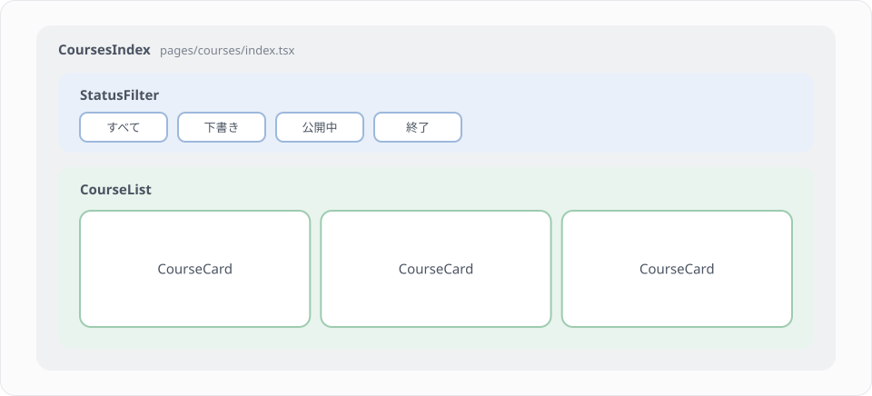
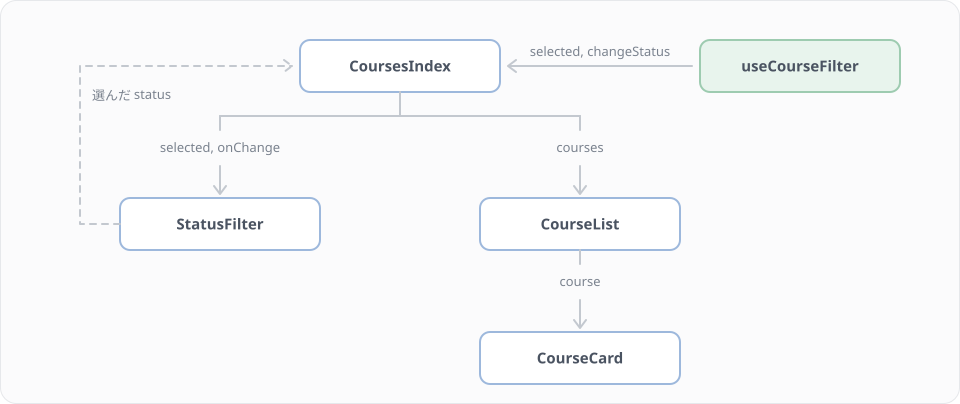

# F6 コンポーネント設計

## 学習目標

F5 までで、講座一覧のページ（resources/js/pages/courses/index.tsx）には型が付き、サーバーの絞り込みとも連動するようになりました。ただ、絞り込みのボタン、URL を書き換える処理、「気になる」の状態、一覧、講座1件の見た目が、すべて1つのファイルに入っています。このレッスンでは、このページを部品（コンポーネント）とカスタムフックに分けます。分け方だけでなく、どこまで分けるか、どこに置くか、スターターキットの既製の部品とどう使い分けるかも、このプロジェクトの規約に沿って決めていきます。

### 到達目標
- 画面を、役割に名前が付けられる単位で部品に分け、分けすぎない判断もできる
- 部品の props を型で設計し、children で中身を外から差し込める
- 状態と URL の同期のような処理を、カスタムフックに切り出せる
- components/ui の既製の部品と、自分で作る業務の部品を置き分けられる

## このレッスンで作るもの

講座一覧のページを、次の図のように3つの部品に分けます。絞り込みと URL をつなぐ処理は、画面に表示されるものではないので、部品ではなくカスタムフックにします。



| ファイル | 中身 |
|---|---|
| resources/js/components/courses/status-filter.tsx（新規） | ステータスの絞り込み `StatusFilter` |
| resources/js/components/courses/course-card.tsx（新規） | 講座カード `CourseCard` |
| resources/js/components/courses/course-list.tsx（新規） | 講座の一覧 `CourseList` |
| resources/js/hooks/use-course-filter.ts（新規） | 絞り込みと URL をつなぐカスタムフック `useCourseFilter` |
| resources/js/lib/course-filter.ts（変更） | 絞り込みをクエリに変える `statusQuery()` を足す |

Step 1・2 で分け方を決め、Step 3〜6 で部品とフックを1つずつ作り、Step 7 でページを組み立て直します。Step 8〜10 では、置き場所、既製の部品との線引き、分ける量の決め方を整理します。

## Step 1 いまのページを見直す

F5 を終えた時点の courses/index.tsx は、F4 の Step 3 で書いたページに、講師だけに出す「講座を作る」のリンク（F4 Step 4）と、`seatLabel()` による残席の表示（F5 Step 6）を足したものです。エディタで開いて、中を見てください。ファイルの中には、ページの `CoursesIndex` のほかに、同じファイルの中だけで使う `StatusFilter` と `CourseItem` が書かれています。

`CoursesIndex` という1つの関数が、次の4つの仕事を受け持っています。

1. `filters.status` から選ばれているステータスを決め、ボタンが押されたら `router.get()` で URL を書き換える
2. 「気になる」の印を付けた講座の id を state で持ち、件数の行と各講座のボタンに渡す
3. 件数と一覧を出し、1件もなければそのことを伝える
4. 見出しと、講師にだけ出すリンクを出す

今のままでも動きますが、この先の変更を考えると困ることが出てきます。F7 では講座1件ごとに受講登録のボタンを足し、統計の表示も一覧の上に足します。1つのファイルに全部が入っていると、ボタン1つを足すたびにページ全体を読み直すことになります。どこに何を書けばよいかも、ファイルが長くなるほど分かりにくくなります。

## Step 2 部品の分け方を決める

コンポーネントは、画面を構成する部品です。F3 で見たとおり、React のコンポーネントは props を受け取って JSX を返す関数なので、大きな関数を小さな関数に分けるのと同じ感覚で分けられます。PHP で、長くなったコントローラーの処理をサービスクラスに分けた（Lesson 14）のと似ています。

分けるかどうかは、次の2つで判断します。

- その部分の役割を一言で言え、名前を付けられるか
- 別の場所でも使うか、ほかの部分と変える理由が違うか

F4 では、`StatusFilter`（絞り込みのボタン）と `CourseItem`（講座1件）を、すでにページの中で関数に分けていました。このレッスンではそれぞれを自分のファイルに移し、`CourseItem` は見た目を components/ui の Card で整えて `CourseCard` という名前にします。さらに、件数・空のときの表示・「気になる」の状態をまとめて受け持つ `CourseList` を作ります。

Step 1 の1つ目の仕事（URL の処理）は、画面に何も表示しません。表示しないものを部品にすると、何も描かない部品が1つ挟まるだけなので、Step 6 でカスタムフックにします。

> 元の資料では、部品を Atoms・Molecules・Organisms のような5段階に分ける Atomic Design を紹介していました。このプロジェクトでは段階で分けず、Step 9 で説明する「既製の部品（components/ui）」と「業務の部品（components/courses など）」の2つに分けるだけにします。この規模では、段階の名前で悩むより、役割で名前を付けるほうが扱いやすいためです。

## Step 3 StatusFilter をファイルに移す

`resources/js/components/courses/` ディレクトリを作り、その中に status-filter.tsx を作ります。中身は F4 でページに書いた `StatusFilter` とほぼ同じです。

`resources/js/components/courses/status-filter.tsx`

```tsx
import { Button } from '@/components/ui/button';
import type { CourseStatus } from '@/types/course';

export type StatusOption = CourseStatus | 'all';

const statusOptions: { value: StatusOption; label: string }[] = [
    { value: 'all', label: 'すべて' },
    { value: 'draft', label: '下書き' },
    { value: 'active', label: '公開中' },
    { value: 'closed', label: '終了' },
];

type StatusFilterProps = {
    selected: StatusOption;
    onChange: (status: StatusOption) => void;
};

export function StatusFilter({ selected, onChange }: StatusFilterProps) {
    return (
        <div className="flex flex-wrap gap-2">
            {statusOptions.map((option) => (
                <Button
                    key={option.value}
                    type="button"
                    variant={option.value === selected ? 'default' : 'outline'}
                    size="sm"
                    aria-pressed={option.value === selected}
                    onClick={() => onChange(option.value)}
                >
                    {option.label}
                </Button>
            ))}
        </div>
    );
}
```

F4 から変えたのは、次の3点です。

- `export function StatusFilter` と、名前を付けて export しました。ページは Inertia がファイル名で探して default export を読み込むので default export にしますが、それ以外の部品はスターターキットの components/nav-user.tsx（`export function NavUser`）などと同じく、名前付きの export にします。import する側で名前を変えられないので、プロジェクトの中で呼び名がそろいます
- `StatusOption` 型と選択肢の `statusOptions` を、ページからこのファイルに移しました。選択肢を知っているのはこの部品なので、型も一緒に置きます。ほかのファイルから使えるよう、`StatusOption` には export を付けています
- `aria-pressed` を足しました。どのボタンが選ばれているかを、画面読み上げソフトにも伝えるための属性です

StatusFilter は、いま選ばれている値（`selected`）と、選び直されたときに呼ぶ関数（`onChange`）を受け取るだけで、自分では状態を持ちません。どのステータスを選ぶかを決めるのは親です。F3 の「状態の持ち上げ」と同じ形で、HTML の `<input value onChange>` とも同じ使い方です。この形にしておくと、StatusFilter は URL のことも Inertia のことも知らずに済み、F3 のように手元の配列を絞り込む画面でも、同じ部品を使えます。

> F4 の練習問題2で、ボタンを `<Link>` に書き換えた人もいると思います。このレッスンでは、`onChange` を受け取る本文の形にそろえてください。URL を作る処理は Step 6 でカスタムフックにまとめます。

## Step 4 CourseCard を作る

### props を設計する

講座カードに必要なのは、講座1件ぶんのデータです。props の渡し方には2通りあります。

```tsx
<CourseCard course={course} />
```

```tsx
<CourseCard
    title={course.title}
    statusLabel={course.status_label}
    instructorName={course.instructor?.name}
    seatText={seatLabel(seatAvailability(course))}
/>
```

2つ目のように値を1つずつ渡すと、CourseCard は Course 型を知らなくて済み、講座以外のデータにも使えます。そのかわり、表示する項目を1つ増やすたびに、CourseCard とそれを使うすべての場所を直すことになります。

CourseCard は「講座」を表示するための業務の部品なので、Course 型に依存してかまいません。ここでは `course` を丸ごと受け取る1つ目の形にします。逆に、Step 9 で見る components/ui の Button や Card は、どの業務でも使えるように、Course のような業務の型を受け取りません。

### children で中身を外から差し込む

F4 の `CourseItem` は、「気になる」のボタンまで自分で描いていました。そのため、`isFavorite` と `onToggleFavorite` という、講座の表示とは関係のない props も受け取っていました。

カードの下に何のボタンを置くかは、カードを使う側の事情です。講座一覧では「気になる」のボタンを置きますが、別の画面では置かないかもしれません。このように中身を使う側に決めてもらいたいときは、`children` を使います。`children` は、部品の開始タグと終了タグのあいだに書いた JSX を受け取る特別な props です。

```tsx
<CourseCard course={course}>
    <Button>☆ 気になる</Button>
</CourseCard>
```

スターターキットの AppLayout も children を受け取る部品です。ページの JSX を `<AppLayout>` と `</AppLayout>` で囲むと、レイアウトの中にページの中身が入ります。これから使う components/ui の Card も、同じく children で中身を受け取ります。

### course-card.tsx を作る

`resources/js/components/courses/course-card.tsx`

```tsx
import { Badge } from '@/components/ui/badge';
import {
    Card,
    CardContent,
    CardDescription,
    CardFooter,
    CardHeader,
    CardTitle,
} from '@/components/ui/card';
import { seatAvailability, seatLabel } from '@/lib/course-seats';
import type { Course } from '@/types/course';
import type { ReactNode } from 'react';

type CourseCardProps = {
    course: Course;
    children?: ReactNode;
};

export function CourseCard({ course, children }: CourseCardProps) {
    return (
        <Card className="h-full">
            <CardHeader>
                <div className="flex items-start justify-between gap-2">
                    <CardTitle>{course.title}</CardTitle>
                    <Badge variant="secondary">{course.status_label}</Badge>
                </div>
                <CardDescription>
                    講師 {course.instructor?.name ?? '未定'}
                </CardDescription>
            </CardHeader>
            <CardContent className="flex flex-col gap-1 text-sm">
                <p>開始 {course.starts_at}</p>
                <p>{seatLabel(seatAvailability(course))}</p>
            </CardContent>
            {children ? <CardFooter>{children}</CardFooter> : null}
        </Card>
    );
}
```

ポイント
- props の型 `CourseCardProps` を、部品のすぐ上に書きます。`children?: ReactNode` の `?` は、children を渡さなくてもよいという意味です。ReactNode は、JSX、文字列、数値、null など、画面に描けるものすべてを表す React の型です
- children が渡されなかったときは、CardFooter ごと出しません。F3 で見た「0 が表示される罠」を避けるため、`&&` ではなく三項演算子で書いています
- 見た目は components/ui の Card と Badge を組み合わせて作ります。Tailwind のクラス名は、このとおりに写してかまいません
- 残席の文は、F5 で作った `seatLabel(seatAvailability(course))` に任せます

## Step 5 CourseList を作る

### state は使う部品のいちばん近くに置く

「気になる」の印を付けた講座の id（`favoriteIds`）は、F4 ではページの state でした。この state を使うのは、件数の行（「気になる 2 件」）と、各講座のボタンの2か所です。どちらも、これから作る CourseList の中に入ります。

F3 では、2つの部品で同じ state を使うときは、いちばん近い共通の親に持ち上げると学びました。逆に言えば、state はそれを使う部品のうち、いちばん近い共通の親より上に置く必要はありません。そこで `favoriteIds` は、ページから CourseList に移します。ページは「気になる」のことを知らなくてよくなり、CourseList の中だけを読めば「気になる」の動きが分かります。

### course-list.tsx を作る

`resources/js/components/courses/course-list.tsx`

```tsx
import { CourseCard } from '@/components/courses/course-card';
import { Button } from '@/components/ui/button';
import type { Course } from '@/types/course';
import { useState } from 'react';

type CourseListProps = {
    courses: Course[];
};

export function CourseList({ courses }: CourseListProps) {
    const [favoriteIds, setFavoriteIds] = useState<number[]>([]);

    function handleToggleFavorite(id: number) {
        setFavoriteIds((ids) =>
            ids.includes(id)
                ? ids.filter((favoriteId) => favoriteId !== id)
                : [...ids, id],
        );
    }

    return (
        <div className="flex flex-col gap-2">
            <p className="text-sm text-muted-foreground">
                {courses.length} 件
                {favoriteIds.length > 0 &&
                    `（気になる ${favoriteIds.length} 件）`}
            </p>

            {courses.length === 0 ? (
                <p>条件に合う講座はありません。</p>
            ) : (
                <ul className="grid gap-4 md:grid-cols-2 xl:grid-cols-3">
                    {courses.map((course) => {
                        const isFavorite = favoriteIds.includes(course.id);

                        return (
                            <li key={course.id}>
                                <CourseCard course={course}>
                                    <Button
                                        type="button"
                                        variant={
                                            isFavorite ? 'default' : 'outline'
                                        }
                                        size="sm"
                                        onClick={() =>
                                            handleToggleFavorite(course.id)
                                        }
                                    >
                                        {isFavorite
                                            ? '★ 気になる'
                                            : '☆ 気になる'}
                                    </Button>
                                </CourseCard>
                            </li>
                        );
                    })}
                </ul>
            )}
        </div>
    );
}
```

`handleToggleFavorite` は、F4 でページに書いたものをそのまま移しています。配列を直接書き換えず、新しい配列を作って set する書き方も F3・F4 と同じです。

`key` は、map で並べた要素のいちばん外側（ここでは `<li>`）に付けます（F3）。CourseCard の中に付けても、React は並びの中のどれがどれかを見分けられません。

「気になる」のボタンは、CourseCard の children として渡しています。CourseCard は「カードの下に何かを置ける」ことしか知らず、それが「気になる」のボタンだということは知りません。

> F4 では、`preserveState` を付けたので、絞り込みを変えても「気になる」の印が残りました。state を CourseList に移しても、この動きは変わりません。`preserveState: true` のときはページの部品が作り直されず、その中にある CourseList も同じ部品のまま新しい props で描き直されるので、CourseList の state も残ります。

## Step 6 useCourseFilter を作る

### 絞り込みをクエリに変える関数を足す

残っているのは、Step 1 の1つ目の仕事（URL を読み、書き換える）です。まず、「すべて」なら `?status=` を付けず、それ以外なら `?status=active` のように付ける、という判断を純粋な関数にします。F3 で作った lib/course-filter.ts の末尾に足してください。

`resources/js/lib/course-filter.ts`（末尾に追加）

```ts
export type StatusQuery = { status?: CourseStatus };

/**
 * 選んだステータスを URL のクエリに変える（'all' ならクエリなし）
 */
export function statusQuery(status: CourseStatus | 'all'): StatusQuery {
    if (status === 'all') {
        return {};
    }

    return { status };
}
```

`if (status === 'all')` で return したあとは、tsc が `status` を CourseStatus に絞り込むので、`{ status }` は StatusQuery の形に合います（F5 Step 6 の型の絞り込み）。

この判断をフックの中に直接書いても動きます。純粋な関数に出しておくと、React も Inertia もなしに node --test で確かめられます。このファイルには、これまでどおり `import type` 以外の import を書かないでください。引数の型を `StatusOption` ではなく `CourseStatus | 'all'` と書いているのも、部品のファイル（status-filter.tsx）を読み込まずに済ませるためです。中身は同じ型です。

### カスタムフックを書く

カスタムフックは、`use` で始まる名前の関数で、中で useState や usePage のようなフックを呼びます。部品と違って JSX を返さず、値や関数を返します。

`resources/js/hooks/use-course-filter.ts`

```ts
import type { StatusOption } from '@/components/courses/status-filter';
import { statusQuery } from '@/lib/course-filter';
import { index } from '@/routes/courses';
import type { CourseStatus } from '@/types/course';
import { router, usePage } from '@inertiajs/react';

type CourseFilterProps = {
    filters: { status: CourseStatus | null };
};

type CourseFilter = {
    selected: StatusOption;
    changeStatus: (status: StatusOption) => void;
};

export function useCourseFilter(): CourseFilter {
    const { filters } = usePage<CourseFilterProps>().props;
    const selected = filters.status ?? 'all';

    function changeStatus(status: StatusOption): void {
        router.get(index.url(), statusQuery(status), {
            preserveState: true,
            preserveScroll: true,
        });
    }

    return { selected, changeStatus };
}
```

ポイント
- `usePage()` でページの props から `filters` を読みます。ページから引数で受け渡さなくても、フックの中で props を読めます
- 選ばれているステータスは、F4 と同じく useState に持たず、`filters.status` から毎回作ります。URL の `?status=` をコントローラーが読んで `filters` に入れて返すので、URL がただ1つの正しい値になります。ブラウザの「戻る」で前の URL に戻ったときも、ボタンの選択が URL とずれません
- `router.get()` に渡す中身は F4 の `handleChangeStatus` と同じで、クエリを作る部分だけを `statusQuery()` に任せています
- 戻り値の型 `CourseFilter` を書いています。書かないと、返すオブジェクトの中で `'all'` が string に広げられ、ページで StatusFilter に渡すところで `Type 'string' is not assignable to type 'StatusOption'.` というエラーになります

### フックと関数の置き分け

statusQuery は lib に、useCourseFilter は hooks に置きました。中でフックを呼ぶかどうかで分けています。フックを呼ばない関数に `use` を付けると、React はそれをフックとして扱い、if の中で呼べないなどの決まり（フックのルール）が無駄にかかります。逆に、フックを呼ぶ関数に `use` を付けないと、eslint の react-hooks のルールがフックの呼び方の間違いを見つけられません。

> 元の資料には、データを取ってくる部品（Container）と見た目だけの部品（Presentational）を分ける、Container/Presentational というパターンの資料がありました。フックが入る前の React では、状態を持つにはクラスの部品が必要だったので、この分け方がよく使われました。今は、状態や処理をカスタムフックに出せば、見た目の部品をそのまま残せます。部品の層を1つ増やさずに済むので、このコースではカスタムフックを使います。

## Step 7 ページを組み立て直す

作った部品とフックを使って、courses/index.tsx を書き直します。ページの中に書いていた `StatusFilter`・`CourseItem`・`StatusOption`・`statusOptions` と、`favoriteIds` の state は、それぞれのファイルに移したので消えます。

`resources/js/pages/courses/index.tsx`

```tsx
import { CourseList } from '@/components/courses/course-list';
import { StatusFilter } from '@/components/courses/status-filter';
import { Button } from '@/components/ui/button';
import { useCourseFilter } from '@/hooks/use-course-filter';
import AppLayout from '@/layouts/app-layout';
import { create, index } from '@/routes/courses';
import type { BreadcrumbItem, SharedData } from '@/types';
import type { Course, CourseStatus } from '@/types/course';
import { Head, Link, usePage } from '@inertiajs/react';

const breadcrumbs: BreadcrumbItem[] = [
    {
        title: '講座一覧',
        href: index().url,
    },
];

type CoursesPageProps = {
    courses: { data: Course[] };
    filters: { status: CourseStatus | null };
};

export default function CoursesIndex({ courses }: CoursesPageProps) {
    const { auth } = usePage<SharedData>().props;
    const { selected, changeStatus } = useCourseFilter();

    return (
        <AppLayout breadcrumbs={breadcrumbs}>
            <Head title="講座一覧" />
            <div className="flex flex-col gap-4 p-4">
                <div className="flex items-center justify-between">
                    <h1 className="text-xl font-semibold">講座一覧</h1>
                    {auth.user.role === 'instructor' && (
                        <Button asChild size="sm">
                            <Link href={create()}>講座を作る</Link>
                        </Button>
                    )}
                </div>

                <StatusFilter selected={selected} onChange={changeStatus} />

                <CourseList courses={courses.data} />
            </div>
        </AppLayout>
    );
}
```

ページの JSX が、「見出しとリンク、絞り込み、一覧」と画面の並びをそのまま読める形になりました。CoursesPageProps の `filters` はページの中では使っていませんが、コントローラーから届く props の形を表す型なので残しておきます。

データは、次の図のように親から子へ props で流れます。StatusFilter で選んだステータスだけが、onChange を通って親に戻ります。



書き終えたら、型と eslint を確かめます。

```bash
npm run types
npx eslint --max-warnings 0 resources/js/pages/courses/index.tsx resources/js/components/courses resources/js/hooks/use-course-filter.ts resources/js/lib/course-filter.ts
```

ブラウザで http://localhost:8000/courses を開き、F4 のときと同じように動くことを確かめてください。

- ボタンを押すと URL が `?status=active` のように変わり、一覧が絞り込まれる。「すべて」を押すと、URL から `?status=` が消える
- 「気になる」を付けてから絞り込みを変えても、件数の行の「気になる N 件」が残る
- ブラウザの「戻る」で、前の絞り込みとボタンの選択が一緒に戻る
- 講師（test2@example.com）でログインしたときだけ「講座を作る」が出る

## Step 8 置き場所を決める

### コロケーション

関連するファイルを近くに置く整理の方法を、コロケーション（colocation、「同じ場所に置く」の意味）と呼びます。元の資料では、Header.jsx の隣に Header.css や Header.test.js を置く例で説明していました。

このプロジェクトには、部品ごとの CSS ファイルもフロントエンドのテストもありません。見た目は Tailwind のクラス名で JSX の中に書き、確かめは tsc・eslint と、純粋な関数の node --test で行うからです。そのため、このプロジェクトでのコロケーションは「同じ業務の部品を同じディレクトリにまとめる」ことと、「その部品でしか使わない型や定数を、部品と同じファイルに置く」ことになります。StatusOption と statusOptions を status-filter.tsx に置いたのは、後者の例です。

このレッスンまでで、resources/js は次のようになりました。

```text
resources/js/
├── pages/                ページ（1ページ1ファイル）
│   └── courses/
│       ├── index.tsx
│       └── create.tsx
├── components/
│   ├── ui/               shadcn/ui の既製の部品（button.tsx、card.tsx など）
│   ├── courses/          講座の業務の部品
│   │   ├── course-card.tsx
│   │   ├── course-list.tsx
│   │   └── status-filter.tsx
│   └── app-header.tsx    アプリ全体の部品（スターターキット）など
├── hooks/                カスタムフック（use-course-filter.ts など）
├── lib/                  純粋な関数（course-filter.ts、course-seats.ts など）
├── types/                型（course.ts、attendance.ts など）
└── layouts/              レイアウト
```

スターターキットは、いちばん上を「ページ、部品、フック、関数、型」という種類で分けています。この規約は崩さず、components の中だけを業務ごと（courses）に分けて、講座の部品を1か所にまとめました。受講の部品を作るときは、components/attendances のように同じ形で足していきます。

ファイル名はケバブケース（course-card.tsx）、部品の名前はパスカルケース（CourseCard）にします。スターターキットの app-header.tsx と AppHeader と同じ規約です。

### 部品を pages の下に置かない

講座一覧でしか使わない部品なら、pages/courses の中に置きたくなるかもしれません。しかし、resources/js/app.tsx はページを次のように探しています。

```tsx
resolve: (name) =>
    resolvePageComponent(
        `./pages/${name}.tsx`,
        import.meta.glob<ResolvedComponent>('./pages/**/*.tsx'),
    ),
```

`./pages/**/*.tsx` に当てはまるファイルは、すべてページの候補として扱われ、ビルドでもページとして別のファイルに分けられます。pages の下には、コントローラーの `Inertia::render()` で名前を指定するページだけを置き、部品は components に置きます。

## Step 9 既製の部品と業務の部品を分ける

### components/ui は既製の部品

components/ui の中のファイルは、shadcn/ui というライブラリが作った部品です。npm のパッケージとして読み込むのではなく、ソースコードをプロジェクトに写して使う方式なので、ファイルとして手元にあります。Button、Card、Badge、Dialog など、どの業務でも使える汎用の部品で、講座や受講といった業務のことは何も知りません。

このコースでは、components/ui の部品は使うだけにします。中身を書き換えると、スターターキットのログイン画面や設定画面など、同じ部品を使うすべての画面に影響するからです。見た目を少し変えたいときは、CourseCard で `<Card className="h-full">` と書いたように、className を渡して調整します。

### 業務の部品は ui の部品を組み合わせて作る

CourseCard は、Card と Badge を組み合わせ、講座のタイトル、講師、残席を並べています。Course 型を知り、「公開中」や「満席」のような業務の言葉を表示します。

部品をどちらに置くか迷ったら、「その部品の中に、講座や受講のような業務の言葉が出てくるか」で判断してください。出てくるなら業務の部品として components/courses などに置き、出てこない汎用の部品なら ui の仲間です。ただし、このコースで汎用の部品を新しく作る場面はほとんどありません。必要な部品は components/ui にそろっています。

## Step 10 分けすぎない

部品に分けると、そのぶんファイルが増え、props を受け渡す行が増えます。分けた先が小さすぎると、読むときにファイルを行き来する手間のほうが大きくなります。

たとえば、CourseCard をさらに次のように分けたとします。

```tsx
<Card>
    <CourseCardHeader course={course} />
    <CourseCardSchedule course={course} />
    <CourseCardSeats course={course} />
</Card>
```

3つの部品はどれも course を受け取り、数行の JSX を返すだけです。ほかの場所で使う予定もなく、CourseCard と別の理由で変わることもありません。カードの見た目を変えるときには、結局4つのファイルを開くことになります。このような分割はせず、CourseCard の中に書いておきます。

分けるのは、Step 2 の2つの問いに答えられるときです。最初から細かく分けようとせず、同じ JSX を2回書いたとき、ファイルが長くなって読みにくくなったとき、ほかと違う理由で変える部分が見えたときに分けます。このレッスンで講座一覧を分けたのも、F7 で講座カードに受講登録のボタンを足し、一覧の上に統計を足すことが分かっていて、変える場所を見つけやすくしておきたいからです。

## 練習問題

### 問題1
絞り込んだ結果が0件のとき、今は「条件に合う講座はありません。」とだけ出ます。絞り込み中（「すべて」以外を選んでいるとき）だけは、「この条件の講座はありません。」という文と、「すべて表示する」ボタンを出すようにしてください。ボタンを押すと、「すべて」を選んだのと同じになります。

ただし、CourseList に絞り込みのことを教えるのではなく、空のときに出すものを、ページの側から CourseList に渡せるようにしてください。props の名前は `empty` とし、渡されなかったときは今までどおり「条件に合う講座はありません。」を出します。

> ヒント: children と同じく、props の型を `ReactNode` にすると JSX を受け取れます。CourseList の中では、`empty ?? (今までの表示)` のように書けます。

<details>
<summary>解答例</summary>

CourseList に `empty` を足します。変えるのは、import、props の型、引数、空のときの表示の4か所です。

`resources/js/components/courses/course-list.tsx`（変えるところ）

```tsx
import { useState, type ReactNode } from 'react';

type CourseListProps = {
    courses: Course[];
    empty?: ReactNode;
};

export function CourseList({ courses, empty }: CourseListProps) {
```

```tsx
{courses.length === 0 ? (
    (empty ?? <p>条件に合う講座はありません。</p>)
) : (
```

ページでは、「すべて」以外を選んでいるときだけ `empty` を渡します。courses/index.tsx の `<CourseList courses={courses.data} />` を次のように書き換えます。

```tsx
<CourseList
    courses={courses.data}
    empty={
        selected === 'all' ? undefined : (
            <div className="flex items-center gap-2">
                <p>この条件の講座はありません。</p>
                <Button
                    variant="link"
                    onClick={() => changeStatus('all')}
                >
                    すべて表示する
                </Button>
            </div>
        )
    }
/>
```

CourseList は「空のときに何を出すか」を知らず、受け取ったものを出すだけです。絞り込みの状態を知っているのはページなので、出し分けはページで決めます。CourseList に `selected` と `onReset` を渡して中で出し分ける書き方もできますが、そうすると CourseList が絞り込みのことを知る必要があり、絞り込みのない画面で使いにくくなります。
</details>

### 問題2
ある人が、部品をさらに次のように分けることを提案しました。それぞれ、分けたほうがよいか、分けないほうがよいかを考えてください。

1. CourseList の件数の行（「11 件（気になる 2 件）」）を、`CourseCount` という部品にする
2. StatusFilter の1つ1つのボタンを、`StatusFilterButton` という部品にする
3. 「気になる」のボタンを、`FavoriteButton` という部品にする

<details>
<summary>解答例</summary>

1 は分けません。数行の JSX で、ほかで使う予定もなく、変える理由も CourseList と同じです。

2 も今は分けません。ボタンの見た目は components/ui の Button が受け持っていて、StatusFilter の中で map しているので、同じ JSX を何度も書いてもいません。選択肢ごとに件数を出すなど、ボタン1つぶんの中身が大きくなってきたら分けることを考えます。

3 は、今の段階では分けなくてかまいません。使うのは CourseList の1か所で、中身も Button 1つです。ただし、ほかの画面でも「気になる」を付けたくなったり、印をサーバーに保存するようになって送信中の表示などが増えたりしたら、分ける理由ができます。F7 で受講登録のボタンを AttendButton という部品にするのは、「誰に見せるか」「送信中にどうするか」といった、ボタンだけの判断が増えるためです。「将来こうなるかもしれない」だけを理由に先に分けると、使われない部品や props が増えます。
</details>

## クリア判定

ここまでできたら、次のコマンドでクリアしたかを確かめましょう。

```bash
make quest-f6
```

メインのミッションは、部品とフックを本文の名前・場所・props で作り、ページをそれらで組み立て直すことです。部品は `export function CourseCard` のような名前付きの export にしてください。判定では、判定専用の tsconfig で次のコードが型検査を通るかを確かめます。

- `<CourseCard course={course} />` と、children を渡した `<CourseCard course={course}>...</CourseCard>`
- `<CourseList courses={courses} />`
- `<StatusFilter selected="all" onChange={...} />`。selected に `'published'` を渡すと型エラーになること
- `useCourseFilter()` の戻り値が `{ selected: CourseStatus | 'all'; changeStatus: (status: CourseStatus | 'all') => void }` の形であること

lib/course-filter.ts の `statusQuery()` は node --test で、`'all'` なら `{}`、`'active'` なら `{ status: 'active' }` を返すことを確かめます。F3 で作った `filterCourses()`・`countByStatus()` も同じファイルにあるので、`import type` 以外の import を足さないでください。

あわせて、`npx tsc --noEmit` がプロジェクト全体で通ること、このレッスンで作った・直したファイルが eslint（`--no-inline-config --max-warnings 0`。react-hooks のルールも含む）を通ること、F4 の判定（講座一覧のページが courses/index として表示され、props が変わっていないこと）が引き続き通ることを確かめます。

練習問題1の `empty` はサイドのミッションです。`<CourseList courses={[]} empty={<span />} />` が型検査を通るかを確かめます。練習問題2と、Step 7 のブラウザでの確認はセルフチェックです。

## 参考資料

- [React 公式ドキュメント - コンポーネントに props を渡す（children）](https://ja.react.dev/learn/passing-props-to-a-component#passing-jsx-as-children)
- [React 公式ドキュメント - React の流儀](https://ja.react.dev/learn/thinking-in-react)
- [React 公式ドキュメント - カスタムフックでロジックを再利用する](https://ja.react.dev/learn/reusing-logic-with-custom-hooks)
- [Inertia 公式ドキュメント - Manual visits（preserveState・preserveScroll、英語）](https://inertiajs.com/manual-visits)
- [shadcn/ui（英語）](https://ui.shadcn.com/docs)
- [Colocation - Kent C. Dodds（英語）](https://kentcdodds.com/blog/colocation)
- [Presentational and Container Components - Dan Abramov（2019年の追記つき、英語）](https://medium.com/@dan_abramov/smart-and-dumb-components-7ca2f9a7c7d0)
- [【React】「困難は分割せよ」―― 複雑な画面は小さな機能に分けて実装しよう。](https://qiita.com/honey32/items/2e6206c7dc1974b9bf9a)
- [【React】Context を使う前に #1 無駄なコンポーネントの層を削れ](https://qiita.com/honey32/items/b9f70f960e891f031b0f)
- [【React】Context を使う前に #2 コンポジション (ReactNode 型の Props) を使え](https://qiita.com/honey32/items/4d04e454550fb1ed922c)

## 次のレッスン

[F7 待ち時間を設計する](./07-async-ui.md) では、講座カードに受講登録のボタンを足し、押してから結果が返るまでのあいだ、画面をどう見せるかを設計します。
