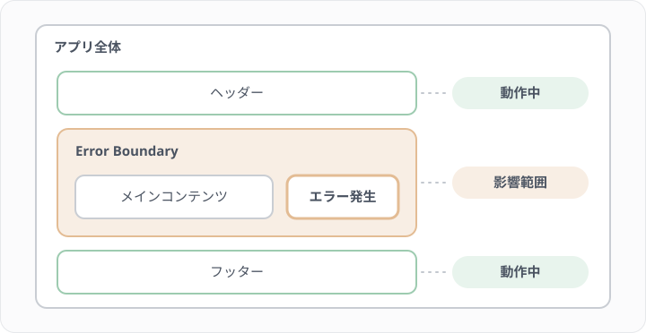
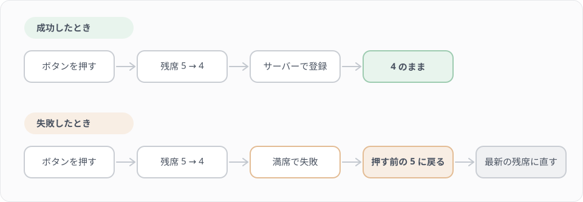
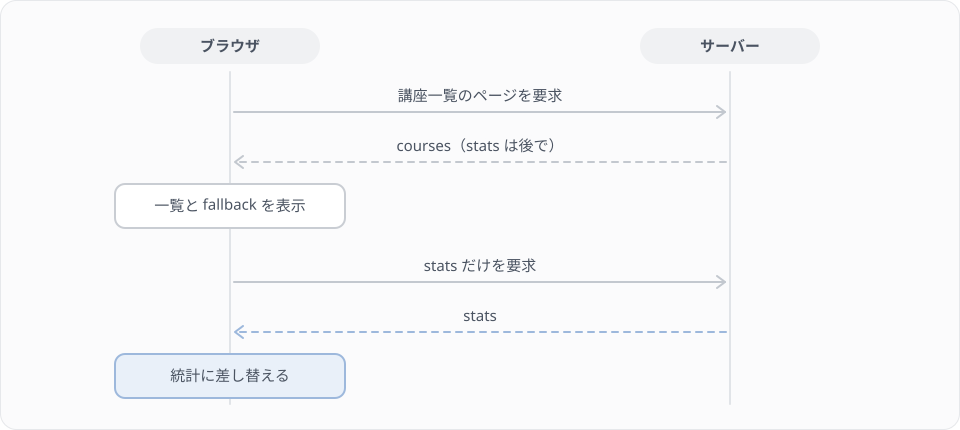
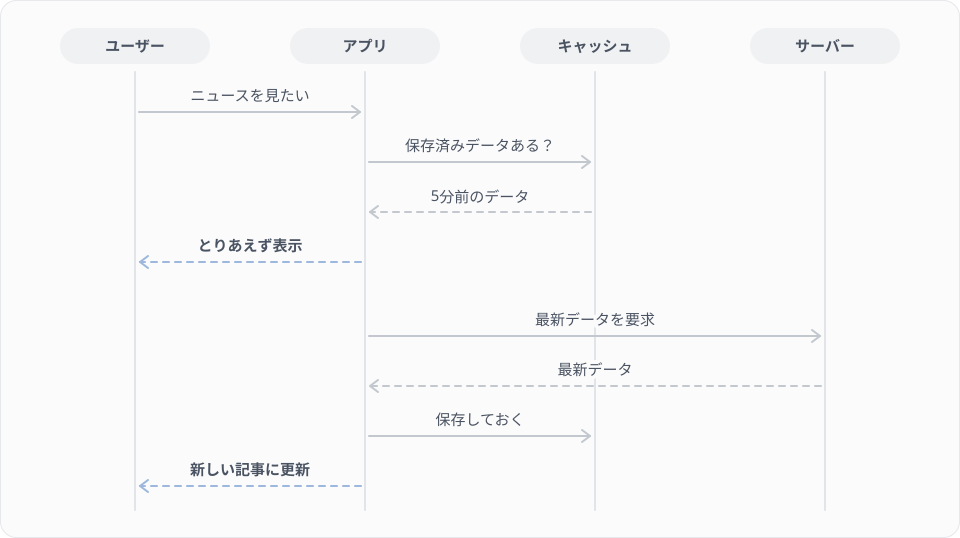

# F7 待ち時間を設計する（Async React）

## 学習目標

このレッスンでは、講座一覧に受講登録のボタンを付け、押してからサーバーの応答が返るまでの「待ち時間」を設計します。押した直後に残席を減らして見せ、失敗したら元に戻し、統計は一覧より後から読み込みます。考え方は React 一般のもの（Async React）として学び、手を動かすのはこのプロジェクトの Inertia の道具で行います。

### 到達目標
- ユーザーを待たせる4つの場面と、失敗したら元に戻すことを、例を挙げて説明できる
- web のルートから Lesson 14 の AttendCourse を呼び、業務例外をエラーメッセージ付きの応答に変えられる
- `router.optimistic()` で楽観的な更新を書き、失敗したときに最新の値へ直せる
- 送信中はボタンを無効にし、`<Deferred>` で読み込み中の表示を出せる
- 遅延と失敗をわざと起こして、画面の動きを目で確かめられる

> このレッスンは、F4 の Web\CourseController と courses/index.tsx、F5 の resources/js/types/course.ts と lib/course-seats.ts、F6 の CourseCard・CourseList・useCourseFilter を前提にしています。練習用のデータは F0 の `make seed-frontend` で入れたものを使います。

## このレッスンで作るもの

講座一覧の各カードに「受講登録」のボタンを付けます。押すとすぐに残席が1つ減り、サーバーの応答を待つあいだボタンは「送信中…」になって押せなくなります。満席や二重申し込みで失敗したときは、一覧の上にエラーメッセージが出て、残席が元に戻ります。絞り込みのボタンの上には、公開中・下書き・終了の講座の数を並べた統計を置き、一覧より少し遅れて表示します。

Step 1・2 で待ち時間の考え方と React 19 の道具を読み、Step 3〜5 で受講登録と統計を作ります。Step 6 で遅延と失敗をわざと起こし、Step 7 で先読み（prefetch）を短く見ます。

## Step 1 待ち時間を4つの場面に分ける

手元の環境では、サーバーの応答は一瞬で返ってきます。ところが本番では、回線が遅かったり、サーバーが混んでいたりして、応答に1秒以上かかることも珍しくありません。そのあいだ画面が何も変わらないと、ユーザーは「押せていないのかな」と思って、もう一度押してしまいます。

ユーザーが待たされる場面は、大きく次の4つに分けられます。

| 場面 | 例 | 画面ですること |
|---|---|---|
| 送信中 | 受講登録のボタンを押した | ボタンを「送信中…」にして、もう一度押せないようにする |
| 楽観的な更新 | 押せばほぼ成功すると分かっている | 応答を待たずに、成功したときの表示（残席が1つ減る）を先に出す |
| 読み込み中 | 統計の集計に時間がかかる | 先に出せるものだけを表示し、残りの場所には読み込み中の表示を置く |
| 画面の切り替え | 絞り込みで一覧が入れ替わる | 古い表示から新しい表示へ、つながりが分かるように切り替える |

この4つに共通して大事なのが、失敗したら元に戻すことです。楽観的に残席を減らしたのに受講登録が失敗したら、残席を押す前の値に戻し、なぜ失敗したかを伝えます。

### Async React

React チームは React Conf 2025（2025年10月）で、この考え方を「Async React」という方針として示しました。React 19 の Transition、楽観的な更新、Suspense、ViewTransition を組み合わせ、ライブラリやフレームワークの側がそれらを使うことで、アプリを書く人が待ち時間の扱いを一つずつ手で書かなくても済むようにしよう、という方針です。2026年11月の時点では、React のワーキンググループで、ルーターやデータ取得のライブラリがどう対応するかの議論が続いています。

具体的な API の名前や使い方は、これから変わる可能性があります。このレッスンでは、変わりにくい原則（4つの場面、すぐに反応を返すこと、失敗したら元に戻すこと）を中心に学び、API の名前は次の対応表にまとめておきます。

### 対応表

Inertia の道具と React 19 の道具は、同じ考え方を別の API で実現しています。両方で手を動かすと覚えることが2倍になるので、このレッスンで手を動かすのは右の列の Inertia の道具だけにします。

| 考え方 | React 19 の道具（読むだけ） | このプロジェクトの道具（手を動かす） |
|---|---|---|
| 送信中の状態 | useTransition、useActionState | router の onStart・onFinish で自分の state を切り替える（`<Form>`・useForm なら processing） |
| 楽観的な更新 | useOptimistic | `router.optimistic()`（useForm・`<Form>` の optimistic もある）。失敗したら押す前の値に戻る |
| 読み込み中の表示 | Suspense | `<Deferred>` の fallback |
| 画面の切り替え | ViewTransition | router と Link の viewTransition（練習問題1） |
| 失敗したときの表示 | Error Boundary | props の errors を表示する。遅延読み込みの失敗は、サーバーで `Inertia::defer(fn, rescue: true)` にしたときだけ `<Deferred>` の rescue で受けられる（練習問題2） |

## Step 2 React 19 の道具を読む

ここで見るコードは、Inertia を使わない React のプロジェクトでの書き方です。このプロジェクトには写さず、読むだけにしてください。`attendCourse()` と `fetchStats()` は、それぞれ受講登録の API と統計の API を呼ぶ関数があるものとします。

### useTransition と useActionState（送信中の状態）

`useTransition` は、時間のかかる処理を「Transition」として始め、終わるまでのあいだ `isPending` を true にします。

```tsx
import { useTransition } from 'react';

function AttendButton({ courseId }: { courseId: number }) {
    const [isPending, startTransition] = useTransition();

    function attend() {
        startTransition(async () => {
            await attendCourse(courseId);
        });
    }

    return (
        <button onClick={attend} disabled={isPending}>
            {isPending ? '送信中…' : '受講登録'}
        </button>
    );
}
```

フォームの送信には `useActionState` も使えます。送信の処理（アクション）を渡すと、前回の結果と送信中かどうかを返してくれます。

```tsx
import { useActionState } from 'react';

function AttendForm({ courseId }: { courseId: number }) {
    const [error, submit, isPending] = useActionState(async () => {
        const ok = await attendCourse(courseId);

        return ok ? null : '受講登録に失敗しました';
    }, null);

    return (
        <form action={submit}>
            <button disabled={isPending}>受講登録</button>
            {error && <p>{error}</p>}
        </form>
    );
}
```

どちらも「送信中かどうか」を自分で `useState` に持たなくてよいのが利点です。

### useOptimistic（楽観的な更新）

`useOptimistic` は、Transition のあいだだけ使う仮の値を作ります。

```tsx
import { useOptimistic, useTransition } from 'react';

function Seats({ courseId, remainingSeats }: { courseId: number; remainingSeats: number }) {
    const [optimisticSeats, setOptimisticSeats] = useOptimistic(remainingSeats);
    const [, startTransition] = useTransition();

    function attend() {
        startTransition(async () => {
            setOptimisticSeats(remainingSeats - 1);
            await attendCourse(courseId);
        });
    }

    return <button onClick={attend}>残席 {optimisticSeats}</button>;
}
```

押した直後は `optimisticSeats` が1つ減った値になります。Transition が終わると、仮の値は捨てられ、親から渡された `remainingSeats` の表示に戻ります。成功したときは親が新しい残席を渡し直すので減ったまま、失敗したときは押す前の値に戻ります。Step 4 で使う Inertia の `router.optimistic()` も、同じ考え方で動きます。

### Suspense（読み込み中の表示）

`Suspense` は、中の部品がデータを待っているあいだ、代わりに `fallback` を表示します。React 19 の `use` に Promise を渡すと、その Promise が解決するまで部品は「待っている」状態になります。

```tsx
import { Suspense, use } from 'react';

function StatsPanel({ statsPromise }: { statsPromise: Promise<CourseStats> }) {
    const stats = use(statsPromise);

    return <p>公開中 {stats.active} 件</p>;
}

function CoursesPage({ statsPromise }: { statsPromise: Promise<CourseStats> }) {
    return (
        <Suspense fallback={<p>統計を読み込み中…</p>}>
            <StatsPanel statsPromise={statsPromise} />
        </Suspense>
    );
}
```

`use` に渡す Promise は、描画のたびに作り直さないようにします。`use(fetchStats())` のように部品の中で毎回作ると、描画のたびに fallback に戻ってしまいます。Promise は親やデータ取得のライブラリで作って渡します。

### ViewTransition（画面の切り替え）

ブラウザの View Transitions API を使うと、表示が入れ替わるときに古い表示から新しい表示へアニメーションでつなげられます。このプロジェクトに入っている React 19.3 では、`react` から `ViewTransition` を import できます。

```tsx
import { startTransition, useState, ViewTransition } from 'react';

function FilteredCourses({ courses }: { courses: Course[] }) {
    const [status, setStatus] = useState<CourseStatus>('active');

    return (
        <>
            <button onClick={() => startTransition(() => setStatus('closed'))}>
                終了した講座
            </button>
            <ViewTransition>
                <CourseList courses={courses.filter((course) => course.status === status)} />
            </ViewTransition>
        </>
    );
}
```

`ViewTransition` の中身が Transition の中で変わったときに、アニメーションが付きます。

### Error Boundary（失敗したときの表示）

描画中に例外が起きると、React はふつう画面全体を消してしまいます。Error Boundary で囲むと、その範囲だけを代わりの表示に差し替え、ほかの部分は動かしたままにできます。



Error Boundary は、React の仕様でクラスコンポーネントでしか書けません。ただ、ライブラリを入れなくても、次の十数行で書けます。

```tsx
import { Component, type ReactNode } from 'react';

type Props = { fallback: ReactNode; children: ReactNode };
type State = { hasError: boolean };

class ErrorBoundary extends Component<Props, State> {
    state: State = { hasError: false };

    static getDerivedStateFromError(): State {
        return { hasError: true };
    }

    render() {
        return this.state.hasError ? this.props.fallback : this.props.children;
    }
}
```

`<ErrorBoundary fallback={<p>表示できませんでした</p>}>` で囲んで使います。再試行のボタンや、エラーの記録まで付けたいときは、react-error-boundary というライブラリがよく使われます。

> 補足: Error Boundary が受け止めるのは、描画中に起きた例外だけです。ボタンを押したときの処理（イベントハンドラー）や、サーバーが返したエラーは受け止めません。受講登録の失敗のように「起こりうる失敗」は、例外ではなく、エラーメッセージとして画面に出すのが基本です。

## Step 3 画面から受講登録する

ここから手を動かします。まず、画面から受講登録を受け付ける web のルートとコントローラーを作ります。

### API ではなく web のルートに送る理由

受講登録の API（`POST /api/courses/{course}/attendances`）は Lesson 10 で作りました。ただ、画面から API を呼ぶと、返ってくるのは JSON なので、講座一覧の props（残席）はそのままでは変わりません。Inertia では、web のルートに送り、処理が終わったら `back()` で元のページに戻すのが基本の形です。戻った先のページでは、コントローラーが最新の props を渡し直すので、残席も新しい値になります。

処理の中身は、Lesson 14 で作った AttendCourse をそのまま呼びます。サービスクラスに切り出しておいたので、API のコントローラーと web のコントローラーの両方から、同じ受講登録の処理を使えます。

### Web\AttendanceController を作る

`make app` でコンテナに入ってから、コントローラーを作ります。API のコントローラーと名前が重ならないよう、`Web` の下に置きます。

```bash
php artisan make:controller Web/AttendanceController
```

`app/Http/Controllers/Web/AttendanceController.php` を次の内容にします。

```php
<?php

declare(strict_types=1);

namespace App\Http\Controllers\Web;

use App\Exceptions\BusinessException;
use App\Http\Controllers\Controller;
use App\Models\Attendance;
use App\Models\Course;
use App\Services\Attendance\AttendCourse;
use Illuminate\Http\RedirectResponse;
use Illuminate\Http\Request;

class AttendanceController extends Controller
{
    public function __construct(
        private AttendCourse $attendCourse,
    ) {}

    /**
     * 画面からの受講登録
     */
    public function store(Request $request, Course $course): RedirectResponse
    {
        // 生徒以外は 403（Lesson 10 の AttendancePolicy@create）
        $this->authorize('create', Attendance::class);

        try {
            ($this->attendCourse)($request->user(), $course);
        } catch (BusinessException $e) {
            return back()->withErrors(['attendance' => $e->getMessage()]);
        }

        return back();
    }
}
```

ポイント
- 認可は API と同じく `AttendancePolicy@create` で、講師は 403 になります
- 満席（CapacityExceededException）や二重申し込み（AlreadyAttendingException）は、Lesson 14 で作った BusinessException の子クラスです。まとめて catch し、例外のメッセージを `attendance` というキーのエラーにして、元のページへ戻します
- 成功したときも `back()` で元のページへ戻します。戻った先で講座一覧の props が作り直されるので、残席は最新の値になります

### 業務例外を catch しないとどうなるか

試しに try と catch を外して、満席の講座に申し込んでみると、画面にエラーのモーダルが出て「Inertia のリクエストには Inertia の応答が必要」という内容のメッセージが表示されます。

Lesson 14 の BusinessException には、例外を JSON の応答に変える `render()` があります。API ではそれで正しいのですが、Inertia のリクエストは「ページの応答（またはリダイレクト）」を待っているので、JSON が返ってくると扱えずにモーダルを出します。web のコントローラーでは業務例外を catch し、`back()->withErrors()` で「エラーメッセージ付きのリダイレクト」に変えるのはこのためです。こうすると、Inertia は戻った先のページの props の `errors` にメッセージを入れてくれます。

### ルートを足す

`routes/web.php` の `auth`・`verified` のグループの中に足します。`use` 文はファイル先頭の既存の `use` ブロックに足してください。

```php
use App\Http\Controllers\Web\AttendanceController;

Route::middleware(['auth', 'verified'])->group(function () {
    // ...既存のルート...

    Route::post('courses/{course}/attendances', [AttendanceController::class, 'store'])
        ->name('courses.attendances.store');
});
```

ルートを足したら、Wayfinder の関数を作り直します。

```bash
php artisan wayfinder:generate --with-form
```

`resources/js/actions/App/Http/Controllers/Web/AttendanceController.ts` ができ、`AttendanceController.store(course.id)` で URL とメソッドの組を作れるようになります。

## Step 4 受講登録のボタンを作る

### AttendButton を作る

ボタンは、CourseCard とは別の部品にします。「誰に見せるか」「押したら何をするか」の判断をこの部品に閉じ込めておくと、CourseCard は表示だけに集中できます。

`resources/js/components/courses/attend-button.tsx` を新しく作ります。

```tsx
import AttendanceController from '@/actions/App/Http/Controllers/Web/AttendanceController';
import { Button } from '@/components/ui/button';
import { seatAvailability } from '@/lib/course-seats';
import type { CoursesPageProps } from '@/pages/courses/index';
import { type SharedData } from '@/types';
import type { Course } from '@/types/course';
import { router, usePage } from '@inertiajs/react';
import { useState } from 'react';

type Props = {
    course: Course;
};

/**
 * 残席を1つ減らした新しい講座を返す（元の講座は書き換えない）
 */
function takeOneSeat(course: Course): Course {
    return {
        ...course,
        remaining_seats: Math.max((course.remaining_seats ?? 0) - 1, 0),
    };
}

export function AttendButton({ course }: Props) {
    const { auth } = usePage<SharedData>().props;
    const [processing, setProcessing] = useState(false);

    if (auth.user.role !== 'student' || course.status !== 'active') {
        return null;
    }

    const isFull = seatAvailability(course).kind === 'full';

    function attend() {
        router
            .optimistic<CoursesPageProps>((props) => ({
                courses: {
                    data: props.courses.data.map((item) =>
                        item.id === course.id ? takeOneSeat(item) : item,
                    ),
                },
            }))
            .post(
                AttendanceController.store(course.id),
                {},
                {
                    preserveScroll: true,
                    only: ['courses'],
                    onStart: () => setProcessing(true),
                    onFinish: () => setProcessing(false),
                    onError: () =>
                        router.reload({
                            only: ['courses'],
                            preserveErrors: true,
                        }),
                },
            );
    }

    return (
        <Button size="sm" onClick={attend} disabled={processing || isFull}>
            {isFull ? '満席' : processing ? '送信中…' : '受講登録'}
        </Button>
    );
}
```

`CoursesPageProps` は F4・F5 で courses/index.tsx に書いた型です。ほかのファイルから使うので、courses/index.tsx の `type CoursesPageProps = {` を `export type CoursesPageProps = {` に直してください。

上から順に見ていきます。

### ボタンを出す相手を決める

ボタンを出すのは、ログインしているのが生徒で、講座が公開中（active）のときだけです。条件に合わなければ `null` を返し、何も表示しません。

- 講師には出しません。講師が押すと Policy で 403 になり、HTML のエラーページが返るので、Inertia のエラーのモーダルになります
- 下書きや募集終了の講座には出しません。Lesson 14 の AttendCourse は講座のステータスを確かめていないので、ボタンを出すとサーバーは受講登録を受け付けてしまいます

> 補足: 本来はサーバーの側でも「公開中の講座にだけ申し込める」と確かめるべきです。画面でボタンを隠すのは使いやすさのためで、守りの役目はサーバーにあります。ボス戦3までのバックエンドにはこの確認がないので、このレッスンでは画面の側だけで扱います。

`usePage<SharedData>().props.auth.user.role` は、F5 で User の型に足した `role` です。フックの呼び出し（`usePage`、`useState`）は、`return null` より前に書きます。フックは毎回同じ順番で呼ぶ決まりがあるためです。

### 楽観的に残席を減らす

`router.optimistic()` に渡した関数は、送信の直前に呼ばれます。今のページの props を受け取り、書き換えたい props だけを返すと、応答を待たずに画面がその値で描き直されます。ここでは、押した講座だけを `takeOneSeat()` で残席を1つ減らした新しいオブジェクトにし、ほかの講座はそのまま返しています。F1・F3 で学んだとおり、props のオブジェクトを直接書き換えず、新しいオブジェクトを作るのがポイントです。

`router.optimistic<CoursesPageProps>()` のように、ページの props の型を渡しておくと、`props.courses.data` に型が付きます。Inertia の楽観的な更新には `<Form>` の optimistic もありますが、props の型を渡せるのは `router.optimistic()` と useForm の `optimistic()` だけで、`<Form>` では props の中身の型が分かりません。このレッスンでは型の付く `router.optimistic()` を使います。



サーバーが成功を返すと、戻った先のページの props（最新の残席）で画面が描き直されます。失敗したとき（エラーメッセージ付きで戻ったとき、サーバーのエラーのとき）は、Inertia が楽観的に書き換えた props を押す前の値に戻します。

### 失敗したら最新の値に直す

ここで注意がいるのは、失敗したときに戻るのが「押す前の値」で、サーバーの最新の値ではないことです。たとえば残席5の講座で受講登録を押し、応答を待っているあいだにほかの生徒が1席取ったとします。自分の受講登録が失敗すると残席は押す前の5に戻りますが、本当の残席は4です。

そこで `onError` で `router.reload({ only: ['courses'] })` を呼び、講座一覧の props だけをサーバーから取り直します。`preserveErrors: true` を付けないと、取り直したときに `errors` が空になり、表示したエラーメッセージがすぐに消えてしまいます。

### 送信中はボタンを無効にする

Inertia の楽観的な更新は、送信中もほかの操作を止めません。ボタンを連打すると送信が重なり、残席が2つ3つと減って見えたり、二重申し込みのエラーが出たりします。そこで、`onStart` で `processing` を true にし、`onFinish` で false に戻して、送信中はボタンを押せないようにします。`onFinish` は成功しても失敗しても呼ばれるので、ボタンが押せないまま残ることはありません。

`only: ['courses']` は、戻った先のページで作り直す props を `courses` だけにする指定です。Step 5 で足す統計は、講座のステータスが変わらない限り同じ値なので、受講登録のたびに読み込み直す必要がありません。

> 補足: useForm を使う場合は、`const { post, processing, optimistic } = useForm({})` とし、`optimistic<CoursesPageProps>(...)` を呼んでから `post(AttendanceController.store.url(course.id), { ... })` で送ります。useForm が `processing` を持っているので、自分で `useState` を用意しなくて済みます。

### CourseCard にボタンを置く

F6 で、CourseCard は children を受け取り、カードの下の段（CardFooter）に表示するように作りました。F6 で作った `resources/js/components/courses/course-list.tsx` で CourseCard を使っているところに、AttendButton を children として渡します。

```tsx
import { AttendButton } from '@/components/courses/attend-button';
```

```tsx
<li key={course.id}>
    <CourseCard course={course}>
        <AttendButton course={course} />
    </CourseCard>
</li>
```

CourseCard の中身は変えません。カードの枠は一覧でも、ボス戦F の自分の受講一覧でも同じで、下の段に入るボタンだけが使う場所によって変わる、という F6 の分け方をそのまま使います。残席の表示は F5 の `seatLabel()` が course の値から作っているので、楽観的な更新で `remaining_seats` が変われば、表示も一緒に変わります。

### エラーメッセージを表示する

`back()->withErrors(['attendance' => ...])` で戻すと、メッセージはページの props の `errors.attendance` に入ります。`errors` は、Inertia がどのページにも渡す props です。`resources/js/pages/courses/index.tsx` では、F4 で `const { auth } = usePage<SharedData>().props;` と書いて共有 props を取り出しているので、そこに `errors` を足します。

```tsx
const { auth, errors } = usePage<SharedData>().props;
```

一覧の上に、`InputError` で表示します。`InputError` はスターターキットにある、エラーの文を赤く表示する部品です（`import InputError from '@/components/input-error';`）。

```tsx
<InputError message={errors.attendance} />
```

ページ全体の形は、Step 5 の最後に載せます。

## Step 5 統計を遅れて読み込む

一覧の上に、公開中・下書き・終了の講座の数を表示します。講座が増えると集計に時間がかかるようになりますが、統計を待つために一覧の表示まで遅れるのは困ります。そこで、一覧を先に表示し、統計はあとから読み込みます。

### サーバーで stats を deferred にする

F4 で作った `app/Http/Controllers/Web/CourseController.php` の `index` で、`Inertia::render` に渡す配列に `stats` を足します。

```php
return Inertia::render('courses/index', [
    'courses' => CourseResource::collection($courses),
    'filters' => [
        'status' => $status?->value,
    ],
    'stats' => Inertia::defer(fn () => [
        'draft' => Course::where('status', CourseStatus::Draft)->count(),
        'active' => Course::where('status', CourseStatus::Active)->count(),
        'closed' => Course::where('status', CourseStatus::Closed)->count(),
    ]),
]);
```

`courses` と `filters` は F4 で書いたままで、足すのは `stats` だけです。`CourseStatus` と `Inertia` の `use` は、F4 で書いてあります。

`Inertia::defer()` に渡したクロージャーは、最初のページの応答では呼ばれません。最初の応答には `courses` と `filters` だけが入り、ページが表示されたあとで、Inertia が `stats` だけを取りに2回目のリクエストを送ります。



### 統計の部品を作る

`resources/js/components/courses/course-stats-summary.tsx` を新しく作ります。統計の表示と、読み込み中に出すスケルトン（灰色の枠が点滅する仮の表示）の2つの部品を置きます。`CourseStats` は F5 で course.ts に書いた型（`{ draft: number; active: number; closed: number }`）です。

```tsx
import { Skeleton } from '@/components/ui/skeleton';
import type { CourseStats } from '@/types/course';

type Props = {
    stats: CourseStats;
};

export function CourseStatsSummary({ stats }: Props) {
    return (
        <dl className="grid grid-cols-3 gap-4 rounded-xl border p-4 text-center">
            <div>
                <dt className="text-sm text-muted-foreground">公開中</dt>
                <dd className="text-2xl font-semibold">{stats.active}</dd>
            </div>
            <div>
                <dt className="text-sm text-muted-foreground">下書き</dt>
                <dd className="text-2xl font-semibold">{stats.draft}</dd>
            </div>
            <div>
                <dt className="text-sm text-muted-foreground">終了</dt>
                <dd className="text-2xl font-semibold">{stats.closed}</dd>
            </div>
        </dl>
    );
}

export function CourseStatsSkeleton() {
    return (
        <div className="grid grid-cols-3 gap-4 rounded-xl border p-4">
            <Skeleton className="h-14" />
            <Skeleton className="h-14" />
            <Skeleton className="h-14" />
        </div>
    );
}
```

スケルトンを統計と同じ大きさにしておくと、読み込みが終わって差し替わったときに、下の一覧の位置がずれません。

### `<Deferred>` で囲む

`resources/js/pages/courses/index.tsx` を、次のように直します。Step 4 のエラーメッセージの表示も入れた、このレッスンの最後の形です。

```tsx
import { CourseList } from '@/components/courses/course-list';
import {
    CourseStatsSkeleton,
    CourseStatsSummary,
} from '@/components/courses/course-stats-summary';
import { StatusFilter } from '@/components/courses/status-filter';
import InputError from '@/components/input-error';
import { Button } from '@/components/ui/button';
import { useCourseFilter } from '@/hooks/use-course-filter';
import AppLayout from '@/layouts/app-layout';
import { create, index } from '@/routes/courses';
import type { BreadcrumbItem, SharedData } from '@/types';
import type { Course, CourseStats, CourseStatus } from '@/types/course';
import { Deferred, Head, Link, usePage } from '@inertiajs/react';

export type CoursesPageProps = {
    courses: { data: Course[] };
    filters: { status: CourseStatus | null };
    stats?: CourseStats;
};

const breadcrumbs: BreadcrumbItem[] = [
    { title: '講座一覧', href: index().url },
];

export default function CoursesIndex({ courses, stats }: CoursesPageProps) {
    const { auth, errors } = usePage<SharedData>().props;
    const { status, changeStatus } = useCourseFilter();

    return (
        <AppLayout breadcrumbs={breadcrumbs}>
            <Head title="講座一覧" />
            <div className="flex flex-col gap-4 p-4">
                {auth.user.role === 'instructor' && (
                    <Button asChild className="self-start">
                        <Link href={create()}>講座を作成する</Link>
                    </Button>
                )}
                <Deferred data="stats" fallback={<CourseStatsSkeleton />}>
                    {stats && <CourseStatsSummary stats={stats} />}
                </Deferred>
                <StatusFilter value={status} onChange={changeStatus} />
                <InputError message={errors.attendance} />
                <CourseList courses={courses.data} />
            </div>
        </AppLayout>
    );
}
```

F6 の形から変えたのは、次のところです。

- `CoursesPageProps` に `stats?: CourseStats` を足した（`export` は Step 4 で付けたもの）
- 引数で `stats` も受け取り、`usePage` から `errors` も取り出した
- 統計を `<Deferred>` で囲んで置き、絞り込みのボタンの下にエラーメッセージを置いた

`<Deferred>` は、`data` に書いた props が届くまで `fallback` を表示し、届いたら中身に切り替えます。Step 2 の `Suspense` と同じ役目を、Inertia の deferred props に合わせて受け持つ部品です。

`stats` は省略できる（`stats?: CourseStats`）ことにしているので、型は `CourseStats | undefined` です。`<Deferred>` の中では届いていることが分かっていますが、TypeScript にはそこまで分からないので、`stats &&` で undefined のときを除いてから渡しています。

## Step 6 遅延と失敗を起こして確かめる

手元の環境では応答が一瞬で返るので、このままでは「送信中…」の表示もスケルトンも、ほとんど目に見えません。そこで、教材に用意してある仕組みで、応答をわざと遅らせたり失敗させたりします。

### 練習用のデータを入れる

F0 で入れていなければ、練習用のデータを入れます。

```bash
make seed-frontend
```

講座一覧に、次の講座が増えます。

| 講座 | 状態 | 確かめられること |
|---|---|---|
| React 入門 | 公開中、空きあり | 受講登録が成功する |
| TypeScript 実践（満席） | 公開中、残席0 | ボタンが「満席」で押せない |
| コンポーネント設計（受講中） | 公開中、test@example.com が受講中 | 二重申し込みで失敗し、残席が元に戻る |
| 非同期処理の設計（下書き）、JavaScript 基礎（募集終了） | 下書き、終了 | ボタンが出ない |

画面は http://localhost:8000/courses で開き、生徒の test@example.com でログインします。

### 応答を遅らせる

`.env` の `LESSON_LATENCY_MS` に、遅らせるミリ秒を書きます。

```bash
LESSON_LATENCY_MS=1500
```

`.env` を保存すると、コンテナの中のサーバー（`php artisan serve`）が設定を読み込み直すために再起動します。再起動には数秒かかり、そのあいだに送ったリクエストは失敗するので、少し待ってからページを読み込み直してください。

この設定は、Inertia が送るリクエストだけを遅らせます。受講登録では、POST と、`back()` でリダイレクトした先の GET の両方が遅れるので、待ち時間は設定のおよそ2倍（1500 なら約3秒）になります。

次のことを確かめます。

- 講座一覧を開くと、統計の場所にスケルトンが出て、少し遅れて数字に変わる
- React 入門の受講登録を押すと、すぐに残席が1つ減り、ボタンが「送信中…」になって押せなくなる。応答が返ると、ボタンが元に戻り、残席は減ったまま
- コンポーネント設計（受講中）の受講登録を押すと、残席が1つ減ったあと、応答が返ったところで元の値に戻り、「すでにこの講座に登録済みです。」と表示される

### 受講登録を失敗させる

`.env` の `LESSON_FAIL` に `attend` を書くと、受講登録がすべて、満席のときと同じ形（エラーメッセージ付きのリダイレクト）で失敗します。

```bash
LESSON_LATENCY_MS=1500
LESSON_FAIL=attend
```

空きのある講座で受講登録を押し、残席が減ったあとで元に戻ること、一覧の上に「（練習用に受講登録を失敗させています…）」と表示されることを確かめます。

余裕があれば、`onError` の reload の効果も確かめてみましょう。`LESSON_LATENCY_MS` を 4000 くらいに長くして受講登録を押し、応答を待っているあいだに別のコンテナのシェルで、同じ講座にほかの生徒の受講を1件入れます。

```bash
php artisan tinker --execute '$course = App\Models\Course::where("title", "React 入門")->first(); App\Models\Attendance::factory()->for($course)->create();'
```

失敗の応答が返ると、残席はいったん押す前の値に戻り、reload が終わったところで、ほかの生徒の分だけ減った最新の値に変わります。

### サーバーのエラーを起こす

`LESSON_FAIL=500` にすると、GET 以外のリクエストがすべてサーバーのエラー（500）になります。受講登録を押すと、エラーのモーダルが出て、残席は押す前の値に戻ります。サーバーのエラーのときに呼ばれるのは `onError` ではなく `onHttpException` なので、Step 4 で書いた reload は動きません。`onFinish` は呼ばれるので、ボタンは押せる状態に戻ります。

`LESSON_FAIL=500` が効くのは、受講登録とキャンセルのルートだけです。確かめ終わったら空に戻してください。

```bash
LESSON_LATENCY_MS=0
LESSON_FAIL=
```

> 補足: この仕組みは app/Http/Middleware/SimulateLessonNetwork.php にあり、`APP_ENV=local` のときだけ効きます。テストや本番では、`.env` に何が書いてあっても動きません。

## Step 7 先読み（prefetch）と stale-while-revalidate

待ち時間を減らすもう1つの方法は、ユーザーが開きそうなページを先に読み込んでおくことです。Inertia では、Link に `prefetch` を付けると、リンクにマウスを75ミリ秒以上のせたときにそのページを取りに行き、30秒のあいだキャッシュしておきます。クリックしたときにはデータがそろっているので、すぐに表示が切り替わります。

スターターキットのサイドバー（`resources/js/components/nav-main.tsx`）の Link には、すでに `prefetch` が付いています。サイドバーから講座一覧を開くと速いのはこのためです。

`cacheFor` に2つの値を渡すと、stale-while-revalidate という考え方でキャッシュを使えます。

```tsx
<Link href={coursesIndex()} prefetch cacheFor={['30s', '1m']}>
    講座一覧
</Link>
```

`coursesIndex` は、F4 でサイドバーに講座一覧を足したときと同じく `import { index as coursesIndex } from '@/routes/courses'` で読み込んだ関数です。

30秒以内ならキャッシュをそのまま表示します。30秒から1分のあいだは、古い（stale）キャッシュを先に表示しておき、裏でサーバーに取り直して（revalidate）、届いたら新しい値に差し替えます。1分を過ぎたら、ふつうにサーバーから読み込みます。



上の図はニュースアプリの例ですが、流れは同じです。古くてもよいから先に見せて、あとで正しい値に直すという点で、楽観的な更新と同じく「すぐに反応を返す」ための工夫です。

ただし、キャッシュを使うと、表示が古くなることがあります。ボス戦F では、自分の受講をキャンセルしたあとに講座一覧を開くと、キャッシュに残っていた古い残席が表示される問題に出会います。そのときは、このステップを思い出してください。

## 練習問題

### 問題1（サイド）
講座一覧のステータスの絞り込み（F6 の useCourseFilter）で一覧が入れ替わるときに、View Transitions API のアニメーションを付けてください。

> ヒント: Inertia の router の訪問（`router.get` など）には `viewTransition` というオプションがあります。Link にも同じ名前の props があります。

<details>
<summary>解答例</summary>

F6 の useCourseFilter で `router.get` を呼んでいるところの、オプションのオブジェクトに `viewTransition: true` を足します。

`resources/js/hooks/use-course-filter.ts`

```ts
router.get(index(), statusQuery(next), {
    preserveState: true,
    preserveScroll: true,
    viewTransition: true,
});
```

足すのは `viewTransition: true` の1行だけです。

ブラウザが View Transitions API に対応していれば、古い一覧が薄くなりながら新しい一覧に切り替わります。対応していないブラウザでは、アニメーションなしでふつうに切り替わります。

すべての訪問にアニメーションを付けたいときは、`resources/js/app.tsx` の `createInertiaApp` に `defaults: { visitOptions: () => ({ viewTransition: true }) }` を足す方法もあります。

</details>

### 問題2（サイド）
統計の集計で例外が起きたとき、ページ全体をエラーにせず、統計の場所にだけ「統計を読み込めませんでした」と再読み込みのボタンを表示してください。

> ヒント: `Inertia::defer()` の `rescue` と、`<Deferred>` の `rescue` を使います。確かめるときは、クロージャーの先頭で一時的に `throw new \RuntimeException('練習用の失敗');` と書いて例外を起こします。

<details>
<summary>解答例</summary>

サーバーでは、`Inertia::defer()` の第2引数に `rescue: true` を渡します。

```php
'stats' => Inertia::defer(fn () => [
    'draft' => Course::where('status', CourseStatus::Draft)->count(),
    'active' => Course::where('status', CourseStatus::Active)->count(),
    'closed' => Course::where('status', CourseStatus::Closed)->count(),
], rescue: true),
```

`rescue: true` を付けると、クロージャーで例外が起きても応答は失敗せず、`stats` だけが props から外れて届きます。例外は Laravel のログに記録されます。`rescue` を付けないと、`stats` を取りに行く2回目のリクエストがサーバーのエラーになり、エラーのモーダルが出ます。

画面では、`<Deferred>` に `rescue` を渡します。

```tsx
<Deferred
    data="stats"
    fallback={<CourseStatsSkeleton />}
    rescue={({ reloading }) => (
        <div className="flex items-center gap-2 rounded-xl border p-4 text-sm">
            <p>統計を読み込めませんでした</p>
            <Button
                size="sm"
                variant="outline"
                disabled={reloading}
                onClick={() => router.reload({ only: ['stats'] })}
            >
                再読み込み
            </Button>
        </div>
    )}
>
    {stats && <CourseStatsSummary stats={stats} />}
</Deferred>
```

`Button` は `@/components/ui/button` から、`router` は `@inertiajs/react` から import します。Step 2 の Error Boundary が「描画中の例外」を受け止めるのに対して、こちらは「サーバーでデータを用意するときの例外」を受け止める仕組みです。確かめ終わったら、`throw` の行は消してください。

</details>

## クリア判定

ここまでできたら、次のコマンドでクリアしたかを確かめましょう。

```bash
make quest-f7
```

メインのミッションは次の3つです。

- 受講登録の web のルート（`courses.attendances.store`）。成功すると元のページへ戻って受講が1件増えること、満席や二重申し込みのときは `attendance` のエラーメッセージ付きで戻ること、講師は 403 になることを Pest で確かめます
- 講座一覧の `stats` が deferred になっていること。最初の props には `stats` がなく、あとから読み込むと公開中・下書き・終了の件数が届くことを Pest で確かめます
- 本文で作った・直したファイル（attend-button.tsx、course-list.tsx、course-stats-summary.tsx、courses/index.tsx）で、`tsc` と ESLint がエラーも警告もなく通ること

練習問題1の viewTransition と、練習問題2の rescue はサイドのミッションで、画面で確かめるセルフチェックになります。

画面の動きは自動では判定できないので、判定の最後に次の確認項目が出ます。Step 6 の手順で遅延と失敗を起こして、自分の目で確かめてください。

- [ ] 受講登録を押すと、応答を待たずに残席が1つ減る
- [ ] 送信中はボタンが「送信中…」になり、押せない
- [ ] `LESSON_FAIL=attend` で失敗させると、エラーメッセージが出て、残席が押す前の値に戻る
- [ ] 統計の場所に、読み込み中はスケルトンが出る
- [ ] 講師でログインしたときと、下書き・募集終了の講座には、ボタンが出ない

## 参考資料

- [Inertia 公式ドキュメント - Optimistic Updates](https://inertiajs.com/docs/v3/the-basics/optimistic-updates)
- [Inertia 公式ドキュメント - Deferred Props](https://inertiajs.com/docs/v3/data-props/deferred-props)
- [Inertia 公式ドキュメント - Prefetching](https://inertiajs.com/docs/v3/data-props/prefetching)
- [Inertia 公式ドキュメント - View Transitions](https://inertiajs.com/docs/v3/the-basics/view-transitions)
- [React 公式ドキュメント - useTransition](https://ja.react.dev/reference/react/useTransition)
- [React 公式ドキュメント - useActionState](https://ja.react.dev/reference/react/useActionState)
- [React 公式ドキュメント - useOptimistic](https://ja.react.dev/reference/react/useOptimistic)
- [React 公式ドキュメント - Suspense](https://ja.react.dev/reference/react/Suspense)
- [React 公式ドキュメント - Error Boundary](https://ja.react.dev/reference/react/Component#catching-rendering-errors-with-an-error-boundary)

## 次のレッスン

[ボス戦F 自分の受講一覧](./boss-f-my-attendances.md) では、このレッスンで学んだ楽観的な更新と失敗したときの戻し方を使って、自分の受講の一覧とキャンセルの画面を、仕様だけを見て作ります。
