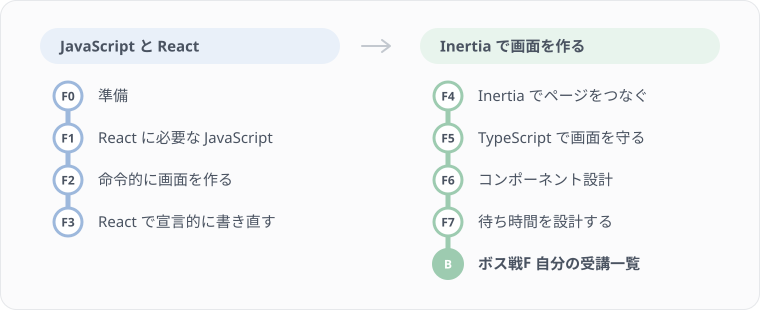

# フロントエンドのレッスン

バックエンドのレッスンで作った受講管理システムに、画面を付けていく Part です。講座一覧、受講登録、自分の受講一覧、受講のキャンセルを、ブラウザから使えるようにします。[バックエンドのレッスン](../backend/README.md) をボス戦3まで終えてから始めてください。

バックエンドと同じく、レッスンを「ステージ」として、手を動かしながらクリアしていきます。最後のボス戦F では、コードを載せず仕様だけを見て、自分の受講一覧の画面を作ります。

## このレッスンの方針

このプロジェクトの画面は、Inertia.js v3 と React 19 で作られています。Inertia では、ページに必要なデータはコントローラーから props として渡されるので、画面の側で API を呼ぶ必要がありません。受講登録のような送信や、押した直後に画面を先に変えておく楽観的な更新も、Inertia の道具が受け持ちます。

そこで、考え方は React 一般のものとして説明し、手を動かすのはこのプロジェクトの Inertia で行います。たとえば待ち時間の扱いでは、React 19 の useOptimistic などは読むだけにして、実際に書くのは Inertia の `router.optimistic()` です。どちらも同じ考え方を別の API で実現しているので、Inertia で身につけたことは、Inertia を使わない React のプロジェクトでもそのまま使えます。

画面の見た目は Tailwind CSS と、`resources/js/components/ui` にある既製の部品（shadcn/ui）で作ります。このレッスンでは見た目の作り方は扱わず、本文のクラス名は写して使って構いません。

## 進め方

### ステージのクリア判定

各ステージを終えたら、ステージの番号を付けて判定を実行します。フロントエンドのステージは番号の前に `f` を付けます。

```bash
make quest-f1
```

ボス戦F は `make quest-boss-f` です。表示の見方はバックエンドと同じで、クリアしたミッションに ✅、まだのものに ❌ とヒントが出ます。全ステージの進み具合は `make map` で見られます。

「メイン」「サイド」「前提」の意味もバックエンドと同じです。メインは本文の手順どおりに進めればクリアできるもので、メインがすべて ✅ になれば STAGE CLEAR です。サイドは練習問題に対応していて、クリアの条件には入りません。前提は、前のステージで作ったものが壊れていないかの確認です。

フロントエンドでは、これに「セルフチェック」が加わります。押した直後に表示が変わるか、失敗したら元に戻るかといった画面の動きは、自動では判定できません。そうした項目は判定の最後に ⬜ の確認項目として並ぶので、ブラウザで動かして自分の目で確かめてください。確かめ方は、各レッスンの本文に書いています。

判定のしかたはステージによって違います。F1 の練習問題は `node --test` で関数を呼んで確かめ、ページやルートは Pest で、型と React のルールは `tsc` と ESLint の結果で確かめます。F2 は画面の動きを見るステージなので、セルフチェックだけです。

> 注意: フロントエンドの判定テストは `tests/Quests/frontend` にあります。中身を読んでも構いませんが、書き換えないでください。

## レッスンの一覧

| # | タイトル | 学習目標 | 判定 |
|---|---|---|---|
| F0 | [準備](./00-setup.md) | バックエンドの準備を確かめ、練習用のデータを入れて、画面を開けるようにする | Pest |
| F1 | [React に必要な JavaScript](./01-javascript.md) | PHP と比べながら、配列の操作や値と参照の違いなど、React で使う書き方を身につける | node --test |
| F2 | [命令的に画面を作る](./02-imperative.md) | 素の JavaScript で一覧に機能を足し、DOM を手で書き換える大変さを体験する | セルフチェック |
| F3 | [React で宣言的に書き直す](./03-react.md) | F2 と同じ画面を React で書き直し、「画面は状態から作る」書き方を身につける | node --test、ESLint、tsc |
| F4 | [Inertia でページをつなぐ](./04-inertia.md) | コントローラーから props を渡してページを作り、リンクとフォームでページをつなぐ | Pest |
| F5 | [TypeScript で画面を守る](./05-typescript.md) | API の形を型にして、ありえない値を書けないようにする | tsc、ESLint |
| F6 | [コンポーネント設計](./06-component-design.md) | 画面を部品とカスタムフックに分け、分けすぎない判断もできるようにする | tsc、ESLint、node --test |
| F7 | [待ち時間を設計する](./07-async-ui.md) | 送信中・楽観的な更新・読み込み中の表示と、失敗したら元に戻す動きを作る | Pest、セルフチェック |
| ボス戦F | [自分の受講一覧](./boss-f-my-attendances.md) | 仕様だけを見て、受講の一覧とキャンセルの画面を作る | Pest、tsc、ESLint、セルフチェック |



F1〜F3 では、JavaScript と React そのものを学びます。F2 と F3 は同じ画面を2通りに作るレッスンで、F2 で感じた不便が F3 でどう解消されるかを並べて比べます。F4 からは、このプロジェクトの Inertia の画面を作っていきます。TypeScript は F1 で型注釈の読み方だけを見ておき、F3・F4 では本文の型を写して使い、F5 でまとめて学びます。

## レッスン中に参照する資料

- [API仕様一覧](../reference/api-spec.md)
- [ER図](../reference/er.md)
- [バックエンドのレッスン](../backend/README.md)

## 最初に読むもの

[F0 準備](./00-setup.md) から始めてください。
