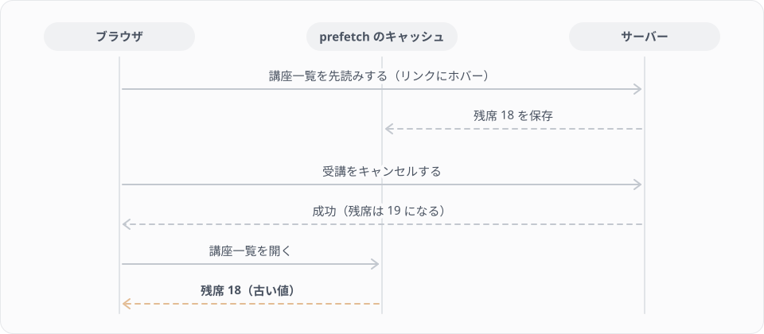

# ボス戦F 自分の受講一覧

フロントエンドのレッスンの最後のステージです。生徒が自分の受講を一覧で見て、キャンセルできる画面を、仕様だけを見て作ります。本文にコードは載せていません。行き詰まったら、段階的に開けるヒントを1つずつ開いてください。

## ボスの説明

バックエンドの Lesson 18 で作った受講キャンセルを、画面から使えるようにします。F7 の受講登録と同じく楽観的な更新で作りますが、今回は「一覧から1件を消す」更新です。さらに、締切を過ぎた受講はボタンを押せなくする、確認のダイアログを挟む、キャンセルしたあと講座一覧の残席も正しく戻る、といった仕様が加わります。どれか1つを忘れても画面はそれらしく動くので、仕様の項目ごとに確かめながら進めることが大事になります。

使う知識は次のレッスンで学んだものです。

| 使う知識 | 学んだレッスン |
|---|---|
| CancelAttendance と、開始3日前の締切 | Lesson 18 |
| Attendance の active スコープ | Lesson 11 |
| web のルートとコントローラー、`Inertia::render`、Wayfinder | F4 |
| ページの props の型、Attendance の型 | F5 |
| components/ui の部品と、業務の部品の分け方 | F6 |
| `router.optimistic()`、送信中の状態、失敗したときの戻し方、prefetch | F7 |

## 仕様

### ルートとコントローラー

routes/web.php の `auth`・`verified` のグループの中に、次の2つのルートを足します。

| メソッド | URL | 名前 | コントローラー |
|---|---|---|---|
| GET | /me/attendances | me.attendances.index | `App\Http\Controllers\Web\MyAttendanceController` の `index` |
| DELETE | /courses/{course}/attendances | courses.attendances.destroy | `App\Http\Controllers\Web\AttendanceController` の `destroy` |

`destroy` は、F7 で作った Web\AttendanceController に足します。Lesson 18 の CancelAttendance をそのまま呼び、成功したら `back()` で元のページへ戻します。締切を過ぎているなどの業務例外は catch して、`attendance` というキーのエラーメッセージ付きで元のページへ戻します（F7 の `store` と同じ形です）。

### ページと props

ページのファイルは `resources/js/pages/me/attendances.tsx` です。コントローラーからは、次の props を渡します。

| props | 中身 |
|---|---|
| `attendances` | ログインしている人の受講を、Lesson 10 の AttendanceResource のコレクションにしたもの。ページには `{ data: Attendance[] }` の形で届く |

一覧に入れるのは、受講中のものだけです。Lesson 11 の active スコープを使い、キャンセル済みの受講は含めません。ほかの人の受講も含めません。並び順は申し込んだ順（`id` の昇順）です。各要素の `course` には、講座のタイトルと開始日時（`starts_at`）が入っている必要があります。

### 一覧の表示

各行に、講座のタイトル、開始日時、受講の状態（`status_label`）、キャンセルのボタンを表示します。受講が1件もないときは、空の一覧ではなく「受講している講座はありません。」のような文を表示します。

### キャンセル

キャンセルのボタンを押すと、すぐには送信せず、確認のダイアログを出します。ダイアログには、どの講座の受講をキャンセルするのかが分かるよう、講座のタイトルを入れます。ダイアログは `resources/js/components/ui/dialog.tsx` の部品を使って作ってください。

ダイアログで確定したら、F7 と同じく楽観的な更新にします。

- 応答を待たずに、その受講を一覧から消す
- 送信中はボタンを押せないようにする
- 締切を過ぎていてエラーメッセージ付きで戻ってきたときは、ページの上にメッセージを表示し、消した受講が一覧に戻る

### 締切を過ぎた受講

開始の3日前を過ぎた受講は、キャンセルのボタンを無効にし、締切を過ぎたことが分かる表示にします。判定は、次の純粋な関数に切り出してください。

| ファイル | 関数 |
|---|---|
| `resources/js/lib/attendance.ts` | `canCancel(startsAt: string, now: Date): boolean` |

`startsAt` は講座の `starts_at`（`'2026-11-20 10:00:00'` の形）、`now` は今の時刻です。開始の3日前までなら true、それを過ぎたら false を返します。Lesson 18 の CancelAttendance と同じ締切にするので、ちょうど3日前は true です。

| startsAt | now | 返す値 |
|---|---|---|
| `'2026-11-20 10:00:00'` | 2026-11-10 00:00:00 | true |
| `'2026-11-20 10:00:00'` | 2026-11-17 10:00:00（ちょうど3日前） | true |
| `'2026-11-20 10:00:00'` | 2026-11-17 10:00:01 | false |
| `'2026-11-20 10:00:00'` | 2026-11-21 00:00:00（開始後） | false |

このファイルは判定で `node --test` から直接読み込むので、`import type` 以外の import を書かないでください（F3 の course-filter.ts と同じ決まりです）。

> 補足: ボタンを無効にするのは使いやすさのためで、最後にキャンセルできるかを決めるのはサーバーの CancelAttendance です。ブラウザの時計とサーバーの時計がずれていて、画面ではまだ押せるのにサーバーでは締切を過ぎていた、ということも起こりえます。そのときもエラーメッセージ付きで戻り、一覧が元に戻るように作ってあれば困りません。

### 講座一覧の残席

キャンセルしたあとにサイドバーから講座一覧を開くと、その講座の残席が1つ増えている必要があります。サーバーの残席はキャンセルした時点で戻っていますが、F7 の Step 7 で見た prefetch のキャッシュに注意してください。スターターキットのサイドバーのリンクには `prefetch` が付いているので、キャンセルする前にリンクにマウスをのせていると、そのときの講座一覧がキャッシュに残っています。



キャンセルが成功したら、古いキャッシュが使われないようにしてください。逆向きも同じで、講座一覧で受講登録したあとに「自分の受講」を開いたとき、登録した講座が一覧に出ている必要があります。

### サイドバー

サイドバー（`resources/js/components/app-sidebar.tsx`）に「自分の受講」のリンクを足し、/me/attendances を開けるようにします。

## 進め方

おすすめの順番は、サーバー側（ルート、MyAttendanceController、`destroy`）、ページの一覧表示、`canCancel`、キャンセルのボタンとダイアログ、楽観的な更新、キャッシュの対策、サイドバーです。サーバー側ができた時点で `make quest-boss-f` を実行すると、Pest のミッションが緑になっていくのを確かめながら進められます。

画面の動きは、F7 の Step 6 と同じく `.env` の `LESSON_LATENCY_MS` で遅らせて確かめます。練習用のデータ（`make seed-frontend`）では、test@example.com が次の2つを受講しています。

| 講座 | 確かめられること |
|---|---|
| コンポーネント設計（受講中） | 開始まで2週間あるので、キャンセルできる |
| Inertia でつくる画面（開始間近） | 開始まで2日なので、ボタンが無効になる |

締切を過ぎた受講はボタンが無効なので、画面からは失敗を起こせません。失敗して一覧が元に戻る動きは、`LESSON_FAIL=500` でサーバーのエラーを起こして確かめてください。締切のエラーメッセージ付きで戻る動きは、Pest のミッションで確かめます。

## クリア条件

次のコマンドで判定します。

```bash
make quest-boss-f
```

次のことが確かめられたらクリアです。

- [ ] /me/attendances（me.attendances.index）を開くと `me/attendances` のページになり、`attendances.data` に自分の受講中の受講だけが申し込んだ順に入る（キャンセル済みとほかの人の受講は入らない）
- [ ] 締切前の受講を DELETE /courses/{course}/attendances（courses.attendances.destroy）でキャンセルすると、元のページへ戻り、受講がキャンセル済みになる
- [ ] 締切を過ぎた受講をキャンセルしようとすると、`attendance` のエラーメッセージ付きで戻り、受講は受講中のまま
- [ ] キャンセルしたあと、講座一覧の props の残席が1つ増えている
- [ ] `canCancel()` が、仕様の表のとおりの値を返す
- [ ] 作ったファイルで、`tsc` と ESLint がエラーも警告もなく通る

画面の動きは、判定の最後に出る次の項目を、自分の目で確かめてください。

- [ ] 受講がないときに、そのことを伝える文が表示される
- [ ] キャンセルのボタンを押すと確認のダイアログが出て、講座のタイトルが表示される。やめると何も起きない
- [ ] ダイアログで確定すると、その受講の行が応答を待たずに一覧から消える
- [ ] `LESSON_FAIL=500` で失敗させると、消えた受講が一覧に戻る
- [ ] 開始間近の受講は、ボタンが無効になっている
- [ ] 講座一覧のリンクにマウスをのせてからキャンセルし、講座一覧を開いても、残席が増えた値で表示される
- [ ] 講座一覧で受講登録してから「自分の受講」を開くと、登録した講座が出ている
- [ ] サイドバーに「自分の受講」があり、/me/attendances を開ける

## ヒント

<details>
<summary>ヒント1 サーバー側の作り方</summary>

MyAttendanceController の `index` は、F4 の CourseController の `index` と同じ形で、`Inertia::render('me/attendances', [...])` を返します。受講は `$request->user()->attendances()` から取り出し、Lesson 11 の `active()` で受講中だけに絞ります。AttendanceResource は `user` と `course` を出力するので、`with()` で一緒に読み込んでおかないと、Lesson 16 の `preventLazyLoading()` で 500 になります。`course` の中の講師も出力されるので、`course.instructor` まで読み込みます。

`destroy` は、F7 の `store` の AttendCourse を CancelAttendance に替えた形です。コンストラクターで CancelAttendance も受け取ります。

ルートを足したら、`php artisan wayfinder:generate --with-form` で Wayfinder の関数を作り直します。

</details>

<details>
<summary>ヒント2 ページの props の型</summary>

F4・F5 の `CoursesPageProps` と同じように、ページのファイルに props の型を書いて export しておきます。`Attendance` の型は F5 の `resources/js/types/attendance.ts` にあります。

```tsx
export type MyAttendancesPageProps = {
    attendances: { data: Attendance[] };
};
```

この型を `router.optimistic<MyAttendancesPageProps>()` に渡すと、楽観的な更新の関数の中で `props.attendances.data` に型が付きます。

</details>

<details>
<summary>ヒント3 canCancel の日時の扱い</summary>

`starts_at` の `'2026-11-20 10:00:00'` は、空白を `T` に替えると、`new Date()` で読める形（`'2026-11-20T10:00:00'`）になります。`getTime()` でミリ秒の数にすれば、引き算や比較ができます。3日は `3 * 24 * 60 * 60 * 1000` ミリ秒です。

「開始の3日前を締切とし、今がその締切と同じか前なら true」と考えると、比較の向きを間違えにくくなります。

</details>

<details>
<summary>ヒント4 楽観的に一覧から消す</summary>

F7 では `map` で1件だけ書き換えた配列を返しました。今回は、キャンセルする受講を除いた配列を返します。配列から条件に合わないものを除くのは、F1 で学んだ `filter` です。

送信は `router.delete()` です。F7 の `router.post()` と違い、`router.delete()` は送るデータの引数がなく、第2引数がオプションです。

</details>

<details>
<summary>ヒント5 確認のダイアログ</summary>

スターターキットの `resources/js/components/delete-user.tsx` が、`Dialog`・`DialogTrigger`・`DialogContent`・`DialogClose` を使った確認のダイアログの例になっています。「やめる」のボタンも確定のボタンも `DialogClose` で囲むと、押したときにダイアログが閉じます。確定のボタンの `onClick` で送信してください。

キャンセルのボタンとダイアログは、1件分の受講を受け取る部品（たとえば `CancelAttendanceButton`）に切り出すと、送信中の state を受講ごとに持てます。

</details>

<details>
<summary>ヒント6 古いキャッシュが表示されるとき</summary>

prefetch のキャッシュは、`router.flushAll()` ですべて捨てられます。キャンセルの `onSuccess` で呼べば、そのあとに講座一覧を開いたときはサーバーから読み込み直します。F7 の AttendButton の `onSuccess` でも同じように呼ぶと、受講登録のあとの「自分の受講」も古くなりません。

Link に `cacheTags` を付けておき、送信のオプションの `invalidateCacheTags` で捨てる方法もあります。ただ、サイドバーのリンクはスターターキットの NavMain がまとめて作っているので、このステージでは `flushAll()` で十分です。

</details>

## 解答例

<details>
<summary>解答例</summary>

### サーバー側

`app/Http/Controllers/Web/MyAttendanceController.php`（`php artisan make:controller Web/MyAttendanceController` で作る）

```php
<?php

declare(strict_types=1);

namespace App\Http\Controllers\Web;

use App\Http\Controllers\Controller;
use App\Http\Resources\AttendanceResource;
use Illuminate\Http\Request;
use Inertia\Inertia;
use Inertia\Response;

class MyAttendanceController extends Controller
{
    /**
     * 自分の受講一覧（キャンセル済みは含めない）
     */
    public function index(Request $request): Response
    {
        $attendances = $request->user()
            ->attendances()
            ->active()
            ->with(['user', 'course.instructor'])
            ->orderBy('id')
            ->get();

        return Inertia::render('me/attendances', [
            'attendances' => AttendanceResource::collection($attendances),
        ]);
    }
}
```

`app/Http/Controllers/Web/AttendanceController.php`（F7 で作ったものに `destroy` を足す）

```php
<?php

declare(strict_types=1);

namespace App\Http\Controllers\Web;

use App\Exceptions\BusinessException;
use App\Http\Controllers\Controller;
use App\Models\Attendance;
use App\Models\Course;
use App\Services\Attendance\AttendCourse;
use App\Services\Attendance\CancelAttendance;
use Illuminate\Http\RedirectResponse;
use Illuminate\Http\Request;

class AttendanceController extends Controller
{
    public function __construct(
        private AttendCourse $attendCourse,
        private CancelAttendance $cancelAttendance,
    ) {}

    /**
     * 画面からの受講登録
     */
    public function store(Request $request, Course $course): RedirectResponse
    {
        $this->authorize('create', Attendance::class);

        try {
            ($this->attendCourse)($request->user(), $course);
        } catch (BusinessException $e) {
            return back()->withErrors(['attendance' => $e->getMessage()]);
        }

        return back();
    }

    /**
     * 画面からの受講キャンセル
     */
    public function destroy(Request $request, Course $course): RedirectResponse
    {
        try {
            ($this->cancelAttendance)($request->user(), $course);
        } catch (BusinessException $e) {
            return back()->withErrors(['attendance' => $e->getMessage()]);
        }

        return back();
    }
}
```

ルート（`routes/web.php` の `auth`・`verified` のグループの中。`use` はファイル先頭に足す）

```php
use App\Http\Controllers\Web\MyAttendanceController;

Route::delete('courses/{course}/attendances', [AttendanceController::class, 'destroy'])
    ->name('courses.attendances.destroy');
Route::get('me/attendances', [MyAttendanceController::class, 'index'])
    ->name('me.attendances.index');
```

ルートを足したら `php artisan wayfinder:generate --with-form` を実行します。

### 締切の判定

`resources/js/lib/attendance.ts`

```ts
const CANCELLABLE_DAYS_BEFORE_START = 3;
const DAY_IN_MS = 24 * 60 * 60 * 1000;

/**
 * 受講をキャンセルできるか（開始の3日前までなら true。Lesson 18 の CancelAttendance と同じ締切）
 *
 * startsAt は CourseResource の starts_at（'2026-11-20 10:00:00' の形）
 */
export function canCancel(startsAt: string, now: Date): boolean {
    const startsAtTime = new Date(startsAt.replace(' ', 'T')).getTime();
    const deadline = startsAtTime - CANCELLABLE_DAYS_BEFORE_START * DAY_IN_MS;

    return now.getTime() <= deadline;
}
```

> 補足: このプロジェクトの `app.timezone` は UTC なので、`starts_at` の `'2026-11-20 10:00:00'` は UTC の時刻です。ところが、タイムゾーンを書かない `'2026-11-20T10:00:00'` を `new Date()` で読むと、ブラウザは自分の地域の時刻として扱います。日本の時刻のブラウザでは日本時間の10時（UTC の1時）と読むので、画面の締切はサーバーより9時間早くなります。ボタンが早めに無効になる向きのずれなので、締切を過ぎた受講を画面から送ってしまうことはありません。仕様の補足にあるとおり、最後にキャンセルできるかを決めるのはサーバーの CancelAttendance です。

### キャンセルのボタン

`resources/js/components/attendances/cancel-attendance-button.tsx`

```tsx
import AttendanceController from '@/actions/App/Http/Controllers/Web/AttendanceController';
import { Button } from '@/components/ui/button';
import {
    Dialog,
    DialogClose,
    DialogContent,
    DialogDescription,
    DialogFooter,
    DialogTitle,
    DialogTrigger,
} from '@/components/ui/dialog';
import { canCancel } from '@/lib/attendance';
import type { MyAttendancesPageProps } from '@/pages/me/attendances';
import type { Attendance } from '@/types/attendance';
import { router } from '@inertiajs/react';
import { useState } from 'react';

type Props = {
    attendance: Attendance;
};

export function CancelAttendanceButton({ attendance }: Props) {
    const [processing, setProcessing] = useState(false);
    const isCancellable = canCancel(attendance.course.starts_at, new Date());

    function cancel() {
        router
            .optimistic<MyAttendancesPageProps>((props) => ({
                attendances: {
                    data: props.attendances.data.filter(
                        (item) => item.id !== attendance.id,
                    ),
                },
            }))
            .delete(AttendanceController.destroy(attendance.course.id), {
                preserveScroll: true,
                onStart: () => setProcessing(true),
                onFinish: () => setProcessing(false),
                onSuccess: () => router.flushAll(),
                onError: () =>
                    router.reload({
                        only: ['attendances'],
                        preserveErrors: true,
                    }),
            });
    }

    return (
        <Dialog>
            <DialogTrigger asChild>
                <Button
                    variant="outline"
                    size="sm"
                    disabled={!isCancellable || processing}
                >
                    {isCancellable ? 'キャンセル' : '締切を過ぎました'}
                </Button>
            </DialogTrigger>
            <DialogContent>
                <DialogTitle>受講をキャンセルしますか？</DialogTitle>
                <DialogDescription>
                    「{attendance.course.title}」の受講をキャンセルします。
                </DialogDescription>
                <DialogFooter className="gap-2">
                    <DialogClose asChild>
                        <Button variant="secondary">やめる</Button>
                    </DialogClose>
                    <DialogClose asChild>
                        <Button variant="destructive" onClick={cancel}>
                            キャンセルする
                        </Button>
                    </DialogClose>
                </DialogFooter>
            </DialogContent>
        </Dialog>
    );
}
```

### ページ

`resources/js/pages/me/attendances.tsx`

```tsx
import { CancelAttendanceButton } from '@/components/attendances/cancel-attendance-button';
import InputError from '@/components/input-error';
import AppLayout from '@/layouts/app-layout';
import { index } from '@/routes/me/attendances';
import { type BreadcrumbItem } from '@/types';
import type { Attendance } from '@/types/attendance';
import { Head, usePage } from '@inertiajs/react';

export type MyAttendancesPageProps = {
    attendances: { data: Attendance[] };
};

const breadcrumbs: BreadcrumbItem[] = [
    {
        title: '自分の受講',
        href: index().url,
    },
];

export default function MyAttendances({ attendances }: MyAttendancesPageProps) {
    const { errors } = usePage().props;

    return (
        <AppLayout breadcrumbs={breadcrumbs}>
            <Head title="自分の受講" />
            <div className="flex flex-col gap-4 p-4">
                <InputError message={errors.attendance} />
                {attendances.data.length === 0 ? (
                    <p className="text-sm text-muted-foreground">
                        受講している講座はありません。
                    </p>
                ) : (
                    <ul className="flex flex-col gap-3">
                        {attendances.data.map((attendance) => (
                            <li
                                key={attendance.id}
                                className="flex items-center justify-between gap-4 rounded-xl border p-4"
                            >
                                <div>
                                    <p className="font-semibold">
                                        {attendance.course.title}
                                    </p>
                                    <p className="text-sm text-muted-foreground">
                                        開始: {attendance.course.starts_at} /{' '}
                                        {attendance.status_label}
                                    </p>
                                </div>
                                <CancelAttendanceButton
                                    attendance={attendance}
                                />
                            </li>
                        ))}
                    </ul>
                )}
            </div>
        </AppLayout>
    );
}
```

### 受講登録のあとのキャッシュ

F7 の `resources/js/components/courses/attend-button.tsx` の `router.post()` のオプションに、1行足します。

```tsx
onSuccess: () => router.flushAll(),
```

### サイドバー

`resources/js/components/app-sidebar.tsx` の `mainNavItems` に、F4 で足した講座一覧と同じ形で足します。lucide-react の import には `ClipboardList` を足します。

```tsx
import { index as myAttendancesIndex } from '@/routes/me/attendances';
```

```tsx
{
    title: '自分の受講',
    href: myAttendancesIndex(),
    icon: ClipboardList,
},
```

試しに `onSuccess` の `router.flushAll()` を消し、講座一覧のリンクにマウスをのせてからキャンセルして講座一覧を開くと、キャンセルする前の残席が表示されます。`canCancel` の `<=` を `<` に変えると、ちょうど3日前の判定が false になり、node の判定が赤になります。仕様の項目ごとに、どのコードがそれを守っているかを確かめてみてください。

</details>

## クリアしたら次へ

フロントエンドのレッスンはこれで終わりです。バックエンドで作ったサービスクラスを、画面と API の両方から使えることを確かめられました。F7 で読んだ React 19 の道具（useOptimistic や Suspense など）は、Inertia を使わない React のプロジェクトで同じ考え方を書くときに役に立ちます。発展の [A1 データベース設計の原則](../backend/A1-database-design.md) と [A2 サービスコンテナとDI](../backend/A2-di-container.md) をまだ読んでいなければ、ここで読んでおくと、これまでのコードの背景が分かります。
